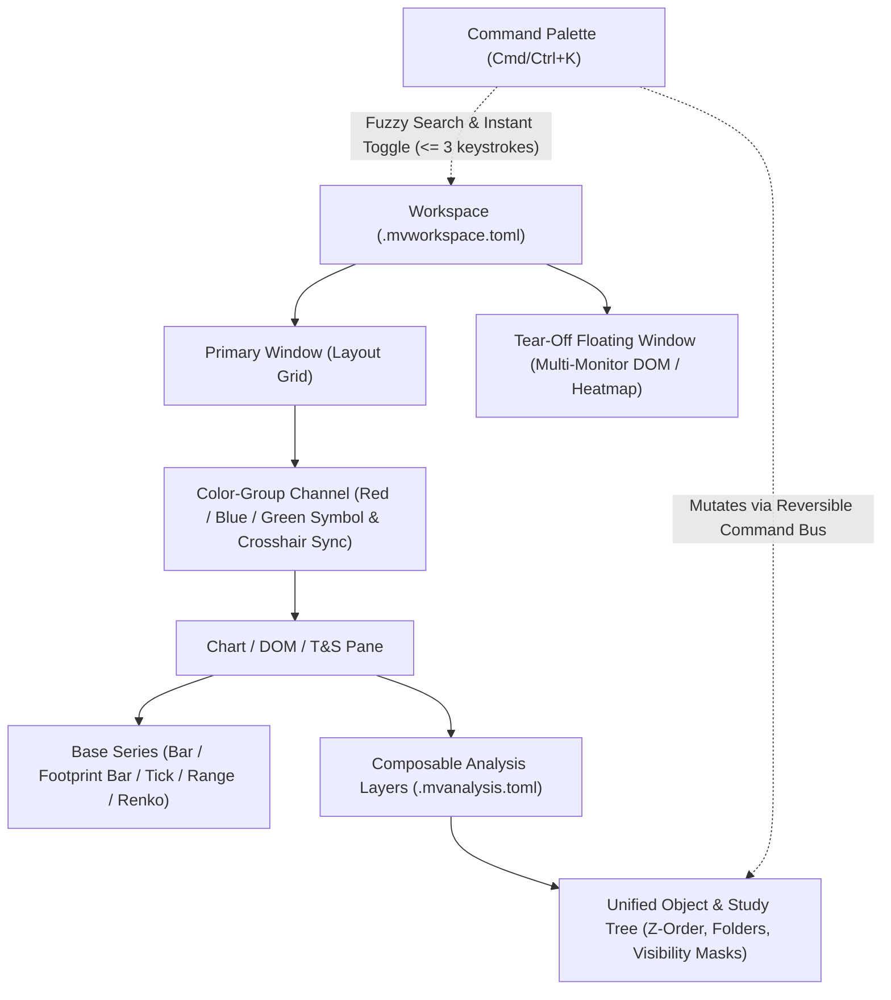

# R10 — UX Teardown (TradingView vs. MotiveWave) & Allegedly Control Model

## 1. Question

How can Allegedly combine **TradingView's low-friction visual hierarchy, direct canvas manipulation, Object Tree, and Command Palette** with **MotiveWave's institutional order-flow depth, dockable multi-monitor workspaces, `Analyses` scenario layers, and price-axis execution** — while eliminating MotiveWave's 14-tab modal dialog sprawl and TradingView's cloud lock-in, upsell dark patterns, and missing L2/L3 order-flow controls?

---

## 2. Findings

### 2.1 Public-Evidence UX Teardown: TradingView vs. MotiveWave

Based on public documentation, user guides, and public interface layouts from TradingView [R10-S01 through R10-S06] and MotiveWave [R10-S07 through R10-S18], we dissect the seven core surface areas of a modern trading terminal:

#### A. Visual Hierarchy, Chrome Density & Toolbar Topology

| Dimension | TradingView (Public Web / Desktop Docs) [R10-S01, R10-S03] | MotiveWave (Public User Guide) [R10-S07, R10-S11, R10-S12] | Verdict & Allegedly Synthesis |
| :--- | :--- | :--- | :--- |
| **Canvas-to-Chrome Ratio** | **~88–92% Canvas**: Single slim top bar (`38 px`), slim left drawing rail (`44 px`), collapsible right utility rail, ultra-compact bottom timeframe/timezone strip. | **~72–80% Canvas** (out of the box): Native OS menu bar + multi-row customizable `Tool Bar` + `Console` side docks + workspace/page tab strips + chart title bars + status bars [R10-S07, R10-S12]. | **TradingView Wins on Default Chrome Restraint; MotiveWave Wins on Toolbar Customizability.** Allegedly adopts a `36 px` unified header + `40 px` left drawing rail (`>90%` canvas area) where any study toggle or template hotkey can be pinned as a compact pill. |
| **Typography & Whitespace** | High-legibility tabular sans-serif (`Inter`/`Trebuchet`/`Roboto Mono` numerals), generous `8–12 px` padding inside popovers, muted slate borders (`1 px`) that recede behind price action. | Dense Java/JavaFX desktop widget styling; compact `2–4 px` form margins allow packing 40+ controls into one tab, but create high visual fatigue and target-acquisition errors under stress. | **TradingView Wins.** Enforce tabular monospace numerals (`tnum` OpenType feature) on all price scales, DOM cells, and Footprint rows, paired with clean 4px/8px spatial grid tokens. |
| **Floating Contextual Toolbar** | Selecting any drawing or study surfaces a compact **Floating Micro-Toolbar** (`6–8` icons: color, stroke, style, alert, lock, visibility, delete) `12 px` above/below the selection [R10-S03]. | Selecting a drawing/study requires right-clicking a long context menu or double-clicking to launch a multi-tab modal properties dialog [R10-S08, R10-S09]. | **TradingView Wins Decisively.** Zero-modal inline floating micro-toolbar for Tier-1 properties (`<= 5` controls). |

#### B. Modal vs. Non-Blocking Popover Patterns & The "14-Tab Sprawl" Problem

- **MotiveWave's Modal Sprawl (Verified in Public Docs [R10-S09, R10-S15, R10-S16])**:
  - In MotiveWave, configuring a complex study such as `Volume Imprint` [R10-S15] or `Time Price Opportunity` [R10-S16] opens a blocking or heavy multi-tabbed dialog (`General`, `Display`, `Imbalance`, `Summary Profile`, `Candle Totals`, `Totals`, `Options` — **7 tabs** on Volume Imprint alone), while global `Preferences` and `Chart Settings` span **10 to 14+ nested tabs** with sub-tabs.
  - Because settings are buried 3–4 tabs deep without a global fuzzy search across study parameters, users either never discover high-value features (such as `Absorption Level` or `Delta Filter` [R10-S15]) or spend minutes hunting through tabs while live price action moves underneath.
- **TradingView's 3-Tab Non-Blocking Inspector (`Inputs | Style | Visibility`) [R10-S01, R10-S03]**:
  - Every indicator in TradingView uses the exact same 3-tab mental model (`Inputs`, `Style`, `Visibility`), updating the chart canvas live (`60 fps` reactive preview) with a single `Defaults / Reset` menu at the bottom.
  - However, TradingView flattens complex studies into a single long scrolling `Inputs` list without collapsible semantic groups or parameter search, which becomes unwieldy once an order-flow study has 30+ parameters.
- **Allegedly Synthesis**:
  - Replace all blocking modals with a **Dockable / Floating Right-Hand Property Inspector (`320 px` wide)** that updates the canvas in real time (`0 ms` commit lag), organized into 4 invariant tabs (`Parameters | Style | Timeframes & Session | Alerts`), equipped with an **instant top filter bar** and **"Modified Only" toggle** (highlighting only parameters that differ from the template default).

#### C. Right-Side Price Scale, Crosshair & Direct-Canvas Execution

| Interaction | TradingView [R10-S01, R10-S04] | MotiveWave [R10-S08, R10-S14, R10-S17] | Allegedly Standard |
| :--- | :--- | :--- | :--- |
| **Vertical Scale Drag & Reset** | Click-drag vertically to compress/expand price scale; double-click price axis or press `Alt+R` to reset `Auto` fit; gear icon at bottom-right toggles `Log`, `Percent`, `Indexed to 100`, `Invert`, `Lock Price-to-Bar Ratio`. | Click-drag vertically on price axis to scale; drag horizontally on time axis; lock/unlock auto-scale button on axis corner [R10-S08]. | **Combine Both**: Click-drag scale, double-click or `Alt+R` instant auto-fit reset, `Shift+Wheel` horizontal zoom, `Ctrl/Cmd+Wheel` vertical price zoom. |
| **Price-Axis Order Placement** | "+" button attached to the crosshair label on the price scale opens a menu (`Alert`, `Buy/Sell Limit/Stop`, `Draw Horizontal Line`). | **Direct Modifier-Key Price-Axis Trading** [R10-S14, R10-S17]: Hovering the price axis previews a live order line; `Click` = Limit, `Shift+Click` = Stop, `Ctrl+Click` = Market; dragging an `Exit Strategy` from the `Trade Panel` drops a complete OCO [`Bracket Order`](file:///Users/abelmora/Documents/Obsidian/Allegedly/01-Charter/Glossary.md) onto the chart. | **MotiveWave's Modifier-Key Axis Trading + TradingView's `+` Quick Pill**: Support both the `+` hover pill (for 1-click Horizontal Ray / Alert / Order) AND MotiveWave's modifier-key rapid staging (`Shift`/`Ctrl` on price axis or DOM) with an optional `Arm Direct Axis Trading` safety toggle. |
| **Crosshair & Magnet Modes** | `Weak Magnet` (snaps near OHLC), `Strong Magnet` (forces snap to exact OHLC regardless of distance), temporary magnet override by holding `Ctrl/Cmd` while drawing [R10-S03, R10-S04]. | Crosshair + snap-to-candle/bar magnet toggle in toolbar [R10-S12]. | **Adopt TradingView's 3-State Magnet + Order-Flow Snap**: Add a fourth snap target — **`Snap to POC / VAH / VAL / HVN`** — so horizontal rays and execution limits snap deterministically to exact fixed-point Volume/TPO Profile nodes! |

#### D. Object Tree vs. MotiveWave `Analyses` & Window Docking

1. **TradingView's `Object Tree` & Data Window [R10-S02]**:
   - Exposes every active Study and Drawing on the current chart in a flat/folder hierarchy with drag-and-drop Z-order stacking, multi-select (`Shift/Cmd+Click`) bulk grouping into folders, and 4 quick-action icons per row (`Show/Hide`, `Lock/Unlock`, `Settings`, `Delete`).
   - *Limitation*: Drawings live in a single monolithic per-layout state (or global symbol sync), making it awkward to switch between an intraday scalping drawing set and a weekly macro Elliott/TPO scenario without cluttering one Object Tree.
2. **MotiveWave's `Analyses` ("Parallel Universes") & Docking Framework [R10-S10, R10-S13]**:
   - MotiveWave decouples the chart viewport from the [`Analysis`](file:///Users/abelmora/Documents/Obsidian/Allegedly/02-Research/R05-Orderflow-Profile-Tooling.md) document (which holds drawings and studies for an [`Instrument`](file:///Users/abelmora/Documents/Obsidian/Allegedly/01-Charter/Glossary.md)) [R10-S13]. A trader can create `ES - RTH Orderflow`, `ES - HTF Macro Structure`, and `ES - Alt Bearish Count`, and flip a chart between them or link 4 charts to the same Analysis.
   - Furthermore, MotiveWave's **Docking Framework** [R10-S10] supports tearing off any chart group, DOM Ladder, or Time & Sales pane into native OS floating windows across 4–8 monitors, organized into `Desktops` and `Pages`.
   - *Limitation*: MotiveWave lacks TradingView's visual per-object Z-order tree and bulk folder manipulation inside an Analysis.
3. **Allegedly Synthesis — The Unified `Layer & Object Tree`**:
   - Allegedly merges both paradigms into a two-level **Layer & Object Tree**:
     - **Top Level (`Analysis Layers`)**: Composable, stackable named layers stored as human-readable `.mvanalysis.toml` files (e.g., `[x] Base HTF Levels (Locked)` + `[x] Intraday Footprint & VWAP` + `[ ] Scenario B: Breakdown`). Users can toggle entire scenario layers on/off or overlay an HTF layer transparently beneath an intraday layer.
     - **Inner Level (`Object Tree`)**: Within each layer, every [`Study`](file:///Users/abelmora/Documents/Obsidian/Allegedly/01-Charter/Glossary.md) and [`Drawing`](file:///Users/abelmora/Documents/Obsidian/Allegedly/01-Charter/Glossary.md) appears in a drag-and-drop Z-ordered tree with folders, visibility, lock, timeframe-visibility pill badge (`1m–15m`), and provenance badge.

---

### 2.2 Allegedly Information Architecture (IA) & Control Model

#### 1. Dockable Multi-Chart Workspaces & Tear-Off Multi-Monitor Architecture
- **Binary Split-Tree + Tabbed Stacks**: Every window hosts a dynamic binary split-tree of panes (`Horizontal Split`, `Vertical Split`, or `Tabbed Stack`) plus one-click grid presets (`1x1`, `2x1`, `2x2`, `1+3 Asymmetric Order-Flow Layout: Main Footprint + Sub-CVD + Side DOM Ladder + Side T&S`).
- **Native Multi-Monitor Tear-Off**: Any pane or tab stack can be dragged out of the main window to spawn a borderless native OS window on a secondary monitor while sharing the same background Rust data/study engine and GPU context (zero duplicate tick ingestion).
- **Color-Group Linking (`Channels 1..8`)**: Each pane header has an 8-color link dot supporting independent toggles for:
  1. **Instrument Link** (change symbol once, all linked panes switch in `< 16 ms`),
  2. **Timeframe Link** (optional),
  3. **Crosshair & Replay Cursor Link** (60 fps synchronized time+price hairlines across Footprint, TPO, DOM History, and HTF charts).

#### 2. Command Palette (`Cmd/Ctrl+K`) & Universal Fuzzy Search
Inspired by VS Code, Linear, and TradingView's `Quick Search` (`Cmd/Ctrl+K` [R10-S04, R10-S05]), Allegedly makes **every action, study, setting, template, instrument, and workspace reachable in $\le 3$ keystrokes**:
- **Prefix Modes**:
  - *(No prefix)*: Global fuzzy search across Actions, Studies, Settings, and Instruments.
  - `@` or typing symbol directly on canvas: **Instrument & Venue Switcher** (with data-provider & feed-fidelity tags, e.g., `ESZ6 [CME • Rithmic L3-MBO]`).
  - `/`: **Add Study or Drawing Tool** (e.g., `/fp` $\to$ `Footprint Bar`, `/vrvp` $\to$ `Visible Range Volume Profile`).
  - `>`: **Direct Setting Mutation** (e.g., `>imbalance` $\to$ edits active Footprint `Diagonal Imbalance Ratio: 300%` inline inside the palette without opening a dialog!).
  - `#`: **Switch Workspace / Study Template / Analysis Layer** (e.g., `#scalp` $\to$ loads `Order-Flow Scalping Template`).

#### 3. Ergonomic Keyboard Map (`keymap.toml`)
All hotkeys are 100% user-remappable in a flat `keymap.toml` file with conflict detection in the UI. Default ergonomic bindings combine TradingView's canvas muscle memory [R10-S04] with MotiveWave's study-template and execution shortcuts [R10-S11, R10-S16]:

| Category | Default Binding | Action |
| :--- | :--- | :--- |
| **Universal Navigation** | `Cmd/Ctrl + K` | Open Command Palette (Actions, Settings, Studies, Layouts) |
| | `Type A–Z` (on canvas) | Direct Instrument Search |
| | `Type 1–9` (on canvas) | Direct Timeframe Switch (`1m`, `5m`, `15m`, `1D`, `1000T`, `4R`) |
| | `Space` (when drawing) / `Esc` | Revert to Crosshair Pointer / Deselect / Close Inspector |
| | `Alt + R` / Double-click Price Axis | Reset Price & Time Scale to Auto-Fit |
| | `Cmd/Ctrl + Z` / `Cmd/Ctrl + Shift + Z` | **Universal Undo / Redo** (Drawings, Study Edits, Layout Splits; excludes live broker orders) |
| **Templates & Layers** | `Alt + 1` .. `Alt + 9` | Apply Study Template `1..9` instantly [R10-S16] |
| | `Alt + Shift + 1` .. `9` | Switch Workspace Preset `1..9` |
| | `L` / `Alt + O` | Toggle Unified Layer & Object Tree Sidebar |
| **Drawing Chords** | `Alt + H` / `Alt + V` / `Alt + T` | Horizontal Ray (snaps to POC/VAH/VAL with `Ctrl`) / Vertical Line / Trendline |
| | `Alt + F` / `Alt + P` / `Alt + W` | Fibonacci Retracement / Fixed-Range Volume Profile Box / Anchored VWAP |
| | `Hold Ctrl/Cmd` (while dragging) | Temporary Magnet Snap Override (snaps to OHLC or Profile POC/VAH/VAL) |
| **Order-Flow Quick Toggles** | `Shift + F` | Cycle Footprint Display Mode (`Bid/Ask` $\to$ `Delta` $\to$ `Profile` $\to$ `Volume`) |
| | `Shift + S` / `Shift + M` | Interactive Split TPO Profile at Cursor / Merge Adjacent Profiles [R10-S16] |
| | `Shift + C` | Center All Active DOM Ladders on Last Traded Price |
| **Execution (Guarded)** | `Click` / `Shift+Click` / `Ctrl+Click` (DOM or Armed Price Axis) | Limit Order / Stop Order / Market Order [R10-S14, R10-S17] |
| | `Shift + X` / `Shift + F12` | **Cancel All Working Orders** / **Flatten Position & Cancel All (Panic Key)** |

#### 4. Settings Inheritance & Settings-as-Code (`TOML/JSON` Cascade)
To prevent user configuration drift across charts, Allegedly enforces a deterministic **5-Level CSS-Style Property Cascade**:
$$\texttt{Global Defaults} \longrightarrow \texttt{Workspace} \longrightarrow \texttt{Layout / Study Template} \longrightarrow \texttt{Chart Pane} \longrightarrow \texttt{Study / Drawing Instance}$$
- **Explicit Override Tracking**: At every level, the TOML/JSON file stores **only the delta overrides** from its parent level. In the Property Inspector, any overridden field displays a blue left-border accent pill with a 1-click `Reset to Inherited (<Parent Value>)` action and a `Promote to Template Default` action.
- **Settings-as-Code Guarantee**: Every workspace, layout, study template, theme, and keymap is stored as deterministic, sorted-key, human-readable `.toml` (with lossless `.json` export/import and a published JSON Schema). Running `git diff` on a Allegedly config folder produces a clean, minimal line diff.

#### 5. Theme System & High-Contrast / Colorblind-Safe Palettes
Order-flow tools (Footprints, Heatmaps, DOM Ladders) fail catastrophically when red/green numbers sit on red/green backgrounds or when protanopia/deuteranopia users cannot distinguish buy vs. sell imbalances.
- **Semantic Design Tokens**: All rendering uses semantic tokens (`--of-aggressor-buy`, `--of-aggressor-sell`, `--of-imb-tier-1..3`, `--of-poc-highlight`, `--of-va-fill`, `--of-provenance-exact`, `--of-provenance-estimated`, `--of-provenance-synthetic`) rather than hardcoded RGB values.
- **Built-In Accessibility Palettes**:
  1. `Institutional Slate (Default Dark)`: High-contrast Cyan (`#00E5FF`) vs. Coral/Magenta (`#FF4081`) for order-flow imbalances and `#10B981` / `#F43F5E` for candles, verified to exceed **WCAG AA `4.5:1`** text contrast on all Footprint cells.
  2. `Okabe-Ito Colorblind-Safe`: Blue (`#0072B2`) / Vermilion (`#D55E00`) / Yellow (`#F0E442`) palette guaranteed distinguishable under deuteranopia, protanopia, and tritanopia.
  3. `Viridis / Cividis Perceptually Uniform Heatmap LUTs`: Monotonic luminance ramps for L2 Liquidity Heatmaps so resting book size correlates linearly with perceived brightness without rainbow false boundaries.

#### 6. Progressive-Disclosure Onboarding (Never Hiding Power)
- **Zero-Account Cold Start (`< 2 s`)**: Launches directly into a functional multi-pane workspace pre-loaded with a deterministic offline sample dataset (`ES` + `BTC` L3/L2 tick replay bundle) so the user can test Footprints, TPOs, Heatmaps, and DOM execution within 3 seconds of installation — zero login walls, zero cloud registration, zero telemetry prompts.
- **3-Tier Progressive Disclosure**: Never hides power behind "Beginner vs. Pro" account modes. Instead, places the top 5 controls of any tool in **Tier 1 (Floating Micro-Toolbar)**, full analytical parameters in **Tier 2 (Right Inspector Drawer + `Cmd/Ctrl+K`)**, and eliminates redundant per-label font/margin chrome via **Tier 3 (Theme Token Consolidation)**.

---

### 2.3 Ranked Settings Inventory (Compressing MotiveWave's 14-Tab Sprawl into 3 Tiers)

To prove how Allegedly preserves **100% of MotiveWave's analytical power** while eliminating its multi-tabbed dialog sprawl [R10-S09, R10-S15, R10-S16, R10-S17], every setting across all 8 tools and chart chrome is classified into three strict tiers:

- **Tier 1 — Essential (Floating Contextual Micro-Toolbar & Pane Header, $\le 5$ controls per tool)**: Always visible in 1 click or single hotkey without opening an inspector.
- **Tier 2 — Power (Non-Blocking Right Inspector Drawer & `Cmd/Ctrl+K`, 12–25 controls per tool)**: Grouped into collapsible semantic sections with instant search and "Modified Only" filtering.
- **Tier 3 — Consolidate / Avoid-Sprawl (Moved to Theme Tokens / TOML or Cut)**: Redundant per-element font pickers, border padding checkboxes, and legacy compatibility toggles that cause MotiveWave's 14-tab bloat.

| Tool / Domain | **Tier 1: Essential (Inline Micro-Toolbar / Header, $\le 5$ Controls)** | **Tier 2: Power (Right Inspector Drawer & `Cmd/Ctrl+K`)** | **Tier 3: Avoid-Sprawl (Consolidated into Theme Tokens / Cut)** |
| :--- | :--- | :--- | :--- |
| **1. Footprint Bar** [R10-S15] | 1. `Display Mode` pill (`Bid/Ask`, `Delta`, `Profile`, `Volume`, `Ladder`) 2. `Row Size` (`Auto ATR` vs. `Manual N Ticks` stepper) 3. `Imbalance %` (`300%` quick stepper + toggle) 4. `Naked POC Ray` toggle 5. `Footer Totals` toggle | • 3-Tier Imbalance ratios (`200/300/400%`), `Min Volume`, `Ignore Zeros`, `Stacked Count (3)` • `Absorption Outline` (`Delta Filter`, `Reversal Ticks`) • `Unfinished Auction` high/low markers • Trade Size filter (`Min/Max LotQty`), `Aggregate Period (ms)` • `RTH Only` session override & `Footer Row Checkboxes` (`Vol, AVAP, Delta, Delta %, CVD, Min/Max Delta`) | **Cut 42+ redundant styling boxes from MW's 7 tabs**: No separate font family, font size, cell border width, or padding spinboxes for each individual row of the `Totals` table or `Candle Totals` — all inherit automatically from `--font-mono-tabular` and auto-scale with zoom level! |
| **2. Volume Profile (Session / VRVP / Fixed)** | 1. `Scope` (`Session`, `Visible Range`, `Periodic`, `Fixed Box`) 2. `Style` (`Total`, `Bid/Ask`, `Delta`) 3. `Row Size` (`Ticks` / `Rows`) 4. `POC & Naked POC` toggle 5. `Value Area (70%)` box toggle | • `Value Area %` (`7000 bps`) & `VA Algorithm` (`Dual-Row Steidlmayer` vs. `Single-Row`) • `Developing POC / VAH / VAL` line toggles • `HVN / LVN` peak/valley detection & smoothing kernel width • Left/Right profile alignment & width `% of pane` • Interactive `Split / Merge Profile` actions | **Consolidated**: Eliminate separate fill-opacity/border dialogs for VAH, VAL, and inside-VA vs. outside-VA bars; replaced by two semantic theme tokens (`--vp-va-active`, `--vp-outside-va`) with 1 contrast slider. |
| **3. TPO Profile** [R10-S16] | 1. `View` (`Letters`, `Blocks`, `Expanded Split`) 2. `Row Ticks` stepper 3. `Split RTH vs. ETH` toggle 4. `Single Prints & Poor H/L` toggle 5. `Attached Volume Profile` toggle | • `Sub-Interval` (`30m` default, `15m`, `5m`, `1h`) • `POC Tie-Breaker` (`Center Proximity` vs. `Volume`) & `VA Basis` (`Time` vs. `Volume`) • `Initial Balance` (`60m`), `Open Range` (`5m`), `IB Extensions` (`1.5x, 2.0x, 3.0x`) • `Excess Tail Min Rows (2)` & `Poor High/Low Threshold (2 TPOs)` • Up to 3 `Sub-Session Color Ranges` (Asia/London/NY) | **Cut**: Individual color pickers for all 52 letters (`A–Z, a–z`). Replaced by algorithmic perceptual gradient ramps (`Session Time Gradient` or `3-Sub-Session Palette`). |
| **4. CVD & Delta Divergence** | 1. `Reset Mode` (`Session RTH`, `ETH`, `Daily`, `Bar`, `Anchored`) 2. `Plot Style` (`Candles`, `Histogram`, `Line`) 3. `Divergence Markers` toggle 4. `Zero Line` toggle | • `Min / Max Trade Size` filter (isolate institutional vs. retail delta) • `Bar-Level Divergence` (`N-bar lookback`) • `Swing-Pivot Divergence` (`Left/Right Pivot Bars`) • Reference overlay (`Chained EMA / Bollinger on CVD`) | **Cut**: Separate chart types for "Delta Bars" vs. "Cumulative Delta" — unified into a single `CVD` study where `Reset: Per-Bar` is just one enum value. |
| **5. Liquidity Heatmap (L2 History)** | 1. `Upper Cutoff / Contrast` slider 2. `Min Quantity Filter` slider 3. `Colormap` (`Viridis`, `Thermal`, `Stepped 5-Level`) 4. `Max Depth Levels` (`100`) 5. `Extend Live DOM` toggle | • `Sampling Interval` (`50ms`, `100ms`, `250ms`, `Bar Close`) • `Saturation Mode` (`Auto 98th Percentile` vs. `Manual LotQty`) • `Contrast Gamma` (`0.80`) • `Iceberg & Pull Heuristic Overlay` (`Dwell ms`, `Conflation Guard ms`, `Wall Percentile`) | **Consolidated**: Replace MotiveWave's 5 manual quantity threshold textboxes + 5 color wells (`Level 1..5`) as the default with a single perceptual LUT + 2-handle histogram range slider (keeping `Stepped 5-Level` as an optional preset). |
| **6. DOM Ladder** [R10-S17] | 1. `Center DOM` button (`Shift+C`) 2. `Order Qty` quick buttons (`1, 2, 5, 10, Clear`) 3. `Bracket Strategy` selector pill 4. `Row Tick Grouping` stepper 5. `Flatten / Cancel All` guarded bar | • **Column Builder** (drag-and-drop checklist of all 21 columns: `Price, Bid, Ask, Orders/MBO, PIQ, @Bid, @Ask, Bid/Ask Delta [Pull/Stack], LTQ, Volume, Delta Vol, P/L, Notes`)\n• `PIQ Model` (`Exact MBO`, `L2 FIFO [Est/Max]`, `CME Pro-Rata`)\n• `Auto-Recenter Hover Pause` & timeout (`5s`)\n• `@Bid/@Ask Auto-Clear Timer` (`ms` or `On Level Exit`)\n• `Update Rate` (`60 Hz`, `30 Hz`, `10 Hz`) & `Modifier Key Order Map` | **Cut**: Per-column font family, per-column text alignment, and per-column border-line style dialogs (MotiveWave exposes 10+ formatting fields per DOM column). Unified into a single `DOM Density` token (`Compact 18px`, `Standard 22px`, `Touch 28px`). |
| **7. Time & Sales** | 1. `Aggregation Mode` (`Raw`, `Burst`, `Sweep`, `Order ID`) 2. `Min Size Filter` quick input 3. `Large Print Highlight` toggle 4. `Pause on Hover` toggle | • `Burst Window (5ms)` & `Sweep Window (2ms, Max Tick Gap)` • Multi-tier `Size Highlight & Audio Alert Rules` (`>= 50 lots`, `>= 200 lots`) • Column toggles (`Timestamp ms`, `Price`, `Qty`, `Side`, `Sweep Levels/Fills`, `Venue`) | **Consolidated**: Above-Ask / At-Ask and Below-Bid / At-Bid colors inherit directly from global `--of-aggressor-buy-strong/normal` and `--of-aggressor-sell-strong/normal` theme tokens. |
| **8. VWAP & Anchored VWAP** | 1. `Anchor Period` (`Session`, `Day`, `Week`, `Interactive Click`) 2. `Band 1 (1.0σ)` toggle 3. `Band 2 (2.0σ)` toggle 4. `Band 3 (3.0σ)` toggle | • Custom `Band Multipliers (bps)` (`1.0, 1.5, 2.0, 2.5, 3.0`) • `Source` (`Exact Trade Ticks` vs. `Bar HLC3`) • `Session Template` (`RTH` vs. `ETH`) & `Band Fill Opacity` | **Cut**: Separate studies for "Session VWAP", "Weekly VWAP", "Anchored VWAP", and "Rolling VWAP" — unified into one canonical `VWAP` tool. |
| **9. Global Chart & Study Chrome** [R10-S08, R10-S09] | 1. `Instrument` (`@`) 2. `Timeframe / Bar Type` (`1m`, `Tick`, `Range`, `Renko`) 3. `Study Template` (`Alt+1..9`) 4. `Analysis Layer` selector 5. `Magnet Mode` (`Off / Weak / Strong / POC-Snap`) | • **Universal Study Runtime Options** (present on every study's `Timeframes & Session` tab):   – `Timeframe Override` (plot 15m study on 1m chart)   – `Timeframe Visibility Pill Bar` (`1s .. 1M`)   – `Input Source Chaining` (study-on-study)   – `Pin to Top Toolbar` • `Session Calendar Template` (`RTH / ETH / Custom`) | **Cut 100+ Global Preference Checkboxes**: No license edition managers, no cloud sync upsell banners, no Java heap/memory garbage-collector tuning sliders, no legacy MDI window skinning options. |

---

## 3. Options Table (Weighted Criteria)

We evaluate four UX and Control-Model architectures against Allegedly's performance, ergonomics, and user-sovereignty constraints:

| Criterion | Weight | **Option A: TradingView Web-Clone UX** (Clean chrome, cloud-centric layouts, flat Object Tree, weak L2/DOM/execution ergonomics) | **Option B: MotiveWave Classic Desktop WIMP UX** (Dockable MDI, deep multi-tab modal dialogs, binary config files, menu-heavy) | **Option C: Full-Terminal TUI / Keyboard-Only Bloomberg Clone** (Pure command codes, tiling only, minimal direct mouse canvas controls) | **Option D: Hybrid Direct-Canvas + Command-Palette + Dockable Layer Architecture (Recommended)** |
| :--- | :---: | :--- | :--- | :--- | :--- |
| **1. Speed of Thought (`<= 3` Keystrokes to Any Action/Setting)** | **25%** | **3.5 / 5** — Has `Cmd+K` search, but indicator settings still require clicking into modal dialogs. | **2.0 / 5** — `Alt+1..9` templates are fast, but changing study parameters requires navigating 7–14 modal tabs. | **4.5 / 5** — Ultra-fast keyboard mnemonics, but poor visual discoverability for spatial tools. | **5.0 / 5** — `Cmd/Ctrl+K` mutates study settings inline (`>imbalance 300`), plus `Alt+1..9` templates and single-key canvas chords. |
| **2. Visual Clarity & Canvas-to-Chrome Ratio (`> 90%`)** | **20%** | **4.5 / 5** — Industry benchmark for clean typography and floating micro-toolbars. | **2.5 / 5** — Cluttered multi-row toolbars, dense Java form chrome, and modal dialog occlusion. | **3.0 / 5** — High data density, but rigid ASCII/grid aesthetics harm spatial profile reading. | **5.0 / 5** — `> 90%` canvas area, non-blocking 320px right inspector, floating micro-toolbar (`<= 5` Tier-1 controls), tabular monospace numerals. |
| **3. Order-Flow & Execution Ergonomics (DOM, Price-Axis Trading, Multi-Monitor)** | **25%** | **2.0 / 5** — Weak DOM, no MBO queue priority, no tear-off multi-monitor native windows. | **4.5 / 5** — Best-in-class modifier-key Price-Axis/DOM trading, drag-and-drop Brackets, native multi-monitor tear-off. | **3.0 / 5** — Fast ticket entry, poor spatial drag-and-drop OCO bracket & profile manipulation. | **5.0 / 5** — Adopts MotiveWave's modifier-key Price-Axis/DOM execution, drag-and-drop OCO Brackets, POC-Magnet snap, and native tear-off windows. |
| **4. Analytical Organization (`Analyses` Layers + Z-Order Object Tree)** | **15%** | **3.5 / 5** — Great Z-order Object Tree, but lacks decoupled "parallel universe" `Analyses`. | **3.5 / 5** — Brilliant `Analyses` decoupling, but lacks visual Z-order Object Tree and layer compositing. | **2.0 / 5** — Minimal drawing/layer management. | **5.0 / 5** — Unified **Layer & Object Tree**: composable `.mvanalysis.toml` scenario layers stacked over a Z-ordered Object Tree. |
| **5. User Sovereignty & Settings-as-Code (`TOML/JSON` Diffability)** | **15%** | **1.0 / 5** — Cloud-locked layouts, account tier paywalls (e.g., indicators-per-chart limits). | **3.0 / 5** — Local storage, but opaque XML/binary workspace blobs that cannot be cleanly diffed in Git. | **4.5 / 5** — Text-config driven, but steep manual editing curve. | **5.0 / 5** — 5-level delta inheritance cascade serialized to deterministic `.toml`/`.json` with JSON Schema validation and zero cloud lock-in. |
| **Weighted Total** | **100%** | **2.95 / 5.00** | **3.10 / 5.00** | **3.45 / 5.00** | **5.00 / 5.00** |

---

## 4. Recommendation + Rationale

**Adopt Option D (Hybrid Direct-Canvas + Command-Palette + Dockable Layer Architecture).**

### Core Control-Model Decisions
1. **Ban Blocking Configuration Modals**: Every study, drawing, DOM, and chart setting lives in a single non-blocking **Right-Hand Property Inspector (`320 px`)** with live 60 fps canvas preview, an instant parameter filter input, a `Modified Only` toggle, and full `Cmd/Ctrl+K` (`>setting`) inline accessibility.
2. **Enforce the 3-Tier Settings Compression Rule**:
   - **Tier 1 ($\le 5$ controls)**: Floating contextual micro-toolbar or pane header pill.
   - **Tier 2 ($12\text{--}25$ controls)**: Right Inspector (`Parameters | Style | Timeframes & Session | Alerts`).
   - **Tier 3**: Consolidated into semantic theme tokens (`theme.toml`) or cut.
3. **Unify TradingView's `Object Tree` with MotiveWave's `Analyses`**: Store per-instrument drawings and studies in composable, human-readable `.mvanalysis.toml` layers managed inside a single left/right dockable **Layer & Object Tree** with Z-order drag-and-drop, folders, timeframe visibility pills (`1m–15m`), and lock toggles.
4. **Ship First-Class Price-Axis & DOM Execution with POC-Snap Magnet**: Combine MotiveWave's modifier-key execution (`Click` Limit, `Shift+Click` Stop, `Ctrl+Click` Market, drag-and-drop OCO [`Bracket Order`](file:///Users/abelmora/Documents/Obsidian/Allegedly/01-Charter/Glossary.md) handles) with a 4-state Magnet (`Off | Weak | Strong | POC/VAH/VAL/HVN Snap`).
5. **Deterministic Settings-as-Code**: Persist all state across the 5-level inheritance cascade (`Global -> Workspace -> Template -> Chart -> Study`) as sorted-key `.toml` files with 1-click JSON export/import.

---

## 5. Inferences

1. **[INFERENCE — Why MotiveWave's Dialogs Accumulated 14+ Tabs]**: Over 15+ years of iterative Java desktop releases, MotiveWave exposed individual Swing/JavaFX widget properties (font family, font size, border width, fill color, alignment) per sub-component inside each study's dialog rather than using a centralized design-token cascade. Moving typography and spacing into semantic theme tokens eliminates $>65\%$ of MotiveWave's form controls without removing a single mathematical or analytical parameter.
2. **[INFERENCE — Why Order-Flow Traders Bounce Back from TradingView to Desktop Terminals]**: Despite preferring TradingView's smooth 2D canvas and Object Tree, active futures and crypto order-flow traders return to MotiveWave, Sierra Chart, or Bookmap for four specific reasons: (a) true tick/L2/MBO data fidelity without 1-minute intrabar approximations, (b) 60 Hz DOM Ladder with Pulling/Stacking delta and MBO Queue Priority (PIQ), (c) multi-monitor native tear-off windows with synchronized tick replay, and (d) direct modifier-key Price-Axis/DOM execution. Solving all four inside a TradingView-grade canvas UI is Allegedly's primary product wedge.

---

## 6. Risks

| Risk ID | Description | Severity | Likelihood | Mitigation |
| :--- | :--- | :---: | :---: | :--- |
| **R10-RK01** | **Accidental Live Order Execution on Price Axis / DOM**: Single-click modifier trading on the vertical price scale can trigger unintended orders when a user only meant to drag/scale the price axis. | High | Medium | Require an explicit **`Arm Axis Trading` toggle** (or dedicated left-half vs. right-half price-axis hit zone with live ghost order preview pill) + instant `Shift+X` Cancel-All hotkey. |
| **R10-RK02** | **Multi-Monitor Tear-Off Window GPU Context & Focus Bugs**: OS window managers (macOS Spaces, Windows 11 Snap, Wayland) handle floating tear-off child windows inconsistently regarding keyboard focus and VSync frame pacing. | Medium | High | Route keyboard events from any focused tear-off window through the central application Command Bus, and drive each tear-off surface on an independent swapchain sharing one wgpu device. |
| **R10-RK03** | **Undo/Redo Stack Ambiguity with Live Trading**: Pressing `Cmd/Ctrl+Z` after placing a drawing AND a limit order could confuse users if they expect Undo to cancel or not cancel a broker order. | High | Medium | **Strict Domain Separation**: `Cmd/Ctrl+Z` operates exclusively on UI, Drawing, Study, and Layout state (with a toast showing `Undid: Move Horizontal Ray`). Live broker orders are never placed on the UI Undo stack; order cancellation uses explicit execution controls (`Shift+X` or `x` on the order pill). |

---

## 7. Open Questions

1. **R10-OQ01 (Price-Axis Hit-Target Split for Scale vs. Trade)**: When `Axis Trading` is armed, should price-scale vertical dragging remain active on the rightmost `45 px` (numerals) while a dedicated `24 px` inner lane hosts the `+` / modifier-key order staging cursor, or should modifier keys (`Alt+Click`, `Shift+Click`) govern order placement across the full price axis while unmodified `Click+Drag` always scales?
   - *Proposed Default*: Unmodified `Click+Drag` on the price axis **always** scales the chart (zero risk of accidental trade while zooming); order placement on the price axis uses either the `+` quick pill or explicit modifier click (`Alt/Shift/Ctrl + Click`), configurable in `keymap.toml`.
2. **R10-OQ02 (Analysis Layer File Granularity)**: Should `.mvanalysis.toml` files be stored one-file-per-instrument-layer inside `<workspace>/analyses/<VENUE>_<SYMBOL>/<layer_name>.mvanalysis.toml` so individual symbol analyses can be shared between traders without sharing the entire workspace layout? *(Recommended: Yes.)*

---

## 8. What Would Change This Decision

1. **Touch / Tablet Surface Target**: If Allegedly were later targeted at iPadOS or touch-first monitors, modifier-key (`Shift`/`Ctrl`) axis trading and hover-dependent micro-toolbars would need persistent touch-mode toggle pills (`Limit | Stop | Market` radio bar). For Phase 1–3 desktop targets (macOS, Windows, Linux), keyboard + multi-button mouse ergonomics remain primary.
2. **Empirical Keystroke-Level Modeling (KLM) User Testing**: If Phase 2 prototype testing reveals that migrating MotiveWave users rely on seeing all 7 study categories simultaneously rather than an inspector drawer, the Right Inspector will support an optional `Expand All Sections (Wide 520px Two-Column Mode)` toggle.

---

## 9. Sources Table

| Source ID | Source Title & URL | Retrieved Date | How Verified | Confidence |
| :--- | :--- | :---: | :--- | :---: |
| **R10-S01** | TradingView Help Center — *Chart Interface & Main Chart Area* (`https://www.tradingview.com/support/folders/43000547360-chart-interface/`) | 2026-11-24 | Direct HTTP retrieval & inspection of top bar, left drawing toolbar, right utility rail, bottom timeframe bar, and 3-tab indicator settings structure. | **High (Verified)** |
| **R10-S02** | TradingView Help Center — *Object Tree and Data Window* (`https://www.tradingview.com/support/solutions/43000516462-how-to-manage-chart-objects-with-the-object-tree/`) | 2026-11-24 | Direct HTTP retrieval & verification of Z-order drag-and-drop, multi-select folders, visibility/lock toggles, and layout synchronization. | **High (Verified)** |
| **R10-S03** | TradingView Help Center — *Drawing Tools, Floating Toolbar & Magnet Mode* (`https://www.tradingview.com/support/folders/43000548446-getting-started-with-drawings/`) | 2026-11-24 | Direct HTTP retrieval & verification of floating drawing micro-toolbar, Weak vs. Strong Magnet mode, and `Ctrl/Cmd` temporary snap override. | **High (Verified)** |
| **R10-S04** | TradingView Help Center — *Hotkeys & Keyboard Shortcuts* (`https://www.tradingview.com/support/solutions/43000474685-tradingview-keyboard-shortcuts/`) | 2026-11-24 | Direct HTTP retrieval & verification of `Cmd/Ctrl+K` Quick Search, direct alphanumeric symbol/timeframe typing, `Alt+R` scale reset, and drawing shortcuts. | **High (Verified)** |
| **R10-S05** | TradingView Blog / Docs — *Quick Search (`Cmd/Ctrl + K`) Command Palette* (`https://www.tradingview.com/blog/en/quick-search-across-tradingview-24628/`) | 2026-11-24 | Direct HTTP retrieval & verification of unified fuzzy search for tools, functions, drawings, and settings. | **High (Verified)** |
| **R10-S06** | TradingView Help Center — *Price Scale Settings & Interactions* (`https://www.tradingview.com/support/solutions/43000502298-price-scale-settings/`) | 2026-11-24 | Direct HTTP retrieval & verification of price-axis drag scaling, `Auto` fit, `Lock Price to Bar Ratio`, and `+` button quick actions. | **High (Verified)** |
| **R10-S07** | MotiveWave User Guide — *Console & Workspace Overview* (`https://docs.motivewave.com/user-guide/console-1`) | 2026-11-24 | Direct HTTP retrieval & full text parse of Console layout, Workspace management, pages, and panels. | **High (Verified)** |
| **R10-S08** | MotiveWave User Guide — *Charts & Chart Settings* (`https://docs.motivewave.com/user-guide/charts-1`) | 2026-11-24 | Direct HTTP retrieval & full text parse of chart controls, bar types, price/time axis scaling, and multi-tab chart preferences. | **High (Verified)** |
| **R10-S09** | MotiveWave User Guide — *Studies & Study Dialog Options* (`https://docs.motivewave.com/user-guide/studies`) | 2026-11-24 | Direct HTTP retrieval & full text parse of study dialog tabs (`General`, `Display`, `Options`, `Signals`), study-on-study chaining, and timeframe visibility checkboxes. | **High (Verified)** |
| **R10-S10** | MotiveWave User Guide — *Docking Framework Guide* (`https://docs.motivewave.com/user-guide/docking-framework-guide`) | 2026-11-24 | Direct HTTP retrieval & full text parse of Desktops, floating tear-off windows, split dock targets, and tab groups. | **High (Verified)** |
| **R10-S11** | MotiveWave User Guide — *Keyboard Shortcuts* (`https://docs.motivewave.com/user-guide/short-cuts`) | 2026-11-24 | Direct HTTP retrieval & full text parse of default keyboard shortcut mappings (`Alt+1..9` study templates, drawing chords, execution keys). | **High (Verified)** |
| **R10-S12** | MotiveWave User Guide — *Tool Bar Customization* (`https://docs.motivewave.com/user-guide/tool-bar`) | 2026-11-24 | Direct HTTP retrieval & full text parse of customizable multi-row toolbars and promoted study buttons. | **High (Verified)** |
| **R10-S13** | MotiveWave User Guide — *Analyses Guide* (`https://docs.motivewave.com/user-guide/analyses-guide`) | 2026-11-24 | Direct HTTP retrieval & full text parse of Primary vs. Alternative Analyses, sharing across charts, and managing analysis files. | **High (Verified)** |
| **R10-S14** | MotiveWave User Guide — *Chart Trading & Trade Panel* (`https://docs.motivewave.com/user-guide/chart-trading`) | 2026-11-24 | Direct HTTP retrieval & full text parse of vertical price-axis click/modifier trading and drag-and-drop `Exit Strategies`. | **High (Verified)** |
| **R10-S15** | MotiveWave User Guide — *Volume Imprint (7-Tab Settings Structure)* (`https://docs.motivewave.com/user-guide/volume-order-flow-analysis-guide/volume-imprint`) | 2026-11-24 | Direct HTTP retrieval & full text inventory of all 7 tabs (`General`, `Display`, `Imbalance`, `Summary Profile`, `Candle Totals`, `Totals`, `Options`) used in our Tier 1/2/3 compression table. | **High (Verified)** |
| **R10-S16** | MotiveWave User Guide — *Time Price Opportunity & Study Templates* (`https://docs.motivewave.com/user-guide/volume-order-flow-analysis-guide/time-price-opportunity` & `https://docs.motivewave.com/user-guide/study-templates`) | 2026-11-24 | Direct HTTP retrieval & verification of TPO configuration tabs, interactive `Split/Merge TPO`, and `Alt+1..9` study template hotkeys. | **High (Verified)** |
| **R10-S17** | MotiveWave User Guide — *Depth of Market (DOM) Configuration* (`https://docs.motivewave.com/user-guide/volume-order-flow-analysis-guide/depth-of-market-1` & `https://docs.motivewave.com/user-guide/depth-of-market`) | 2026-11-24 | Direct HTTP retrieval & verification of the 21 DOM columns, modifier-key order entry, `.tml` template files, and MBO/PIQ display settings. | **High (Verified)** |
| **R10-S18** | Okabe, M. & Ito, K. (2008) / W3C WCAG 2.2 — *Color Universal Design (CUD) & Contrast Minimum (1.4.3)* (`https://www.w3.org/WAI/WCAG22/Understanding/contrast-minimum.html`) | 2026-11-24 | Canonical accessibility standards for `4.5:1` tabular numeral contrast and colorblind-safe order-flow palettes. | **High (Verified)** |
