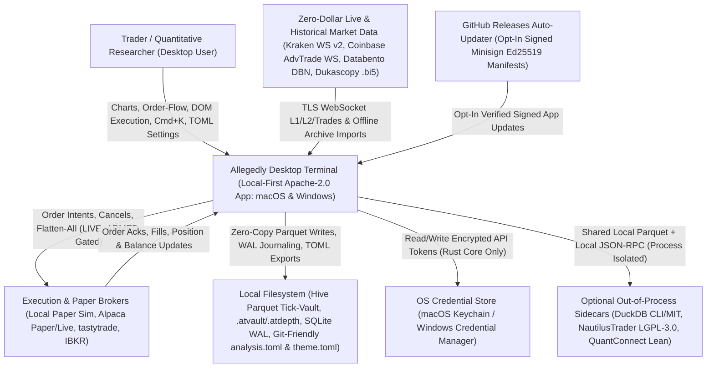
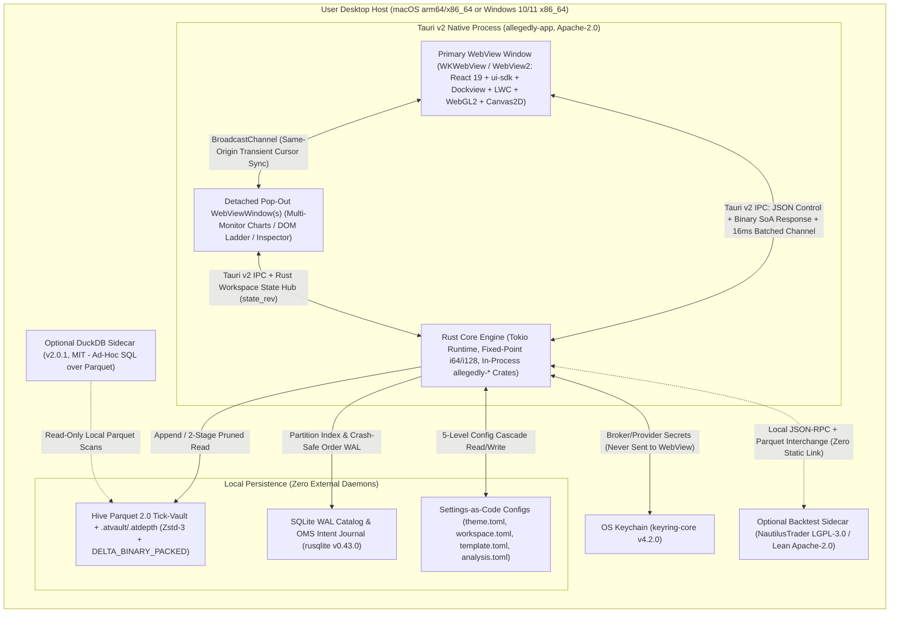

# Allegedly — C4 System Architecture & Process Topology

> **Summary:** **Allegedly** (*"Allegedly a trading terminal."*) is a local-first, `$0`-core, `Apache-2.0` desktop trading and order-flow terminal built on a single native **Tauri v2** Rust core process paired with OS-native WebViews (**macOS `WKWebView`** and **Windows `WebView2`** for `v0.1`–`v1.0`; Linux `WebKitGTK` explicitly deferred post-v1.0). All financial math, order-flow aggregation, storage, and execution run in zero-float fixed-point `i64`/`i128` Rust crates (`allegedly-*`), while rendering combines **TradingView Lightweight Charts `v5.3.0`** (with Rust-backed `<= 5,000`-bar active viewport windowing), a synchronized raw **WebGL2** instanced order-flow layer, dedicated **Canvas2D** hot-path DOM/tape panels, and **`ui-sdk` + Dockview `8.9.1` (MIT)** for non-hot-path UI chrome.

---

## 1. Architectural Invariants & Platform Scope

Every boundary in this document enforces the charter guardrails from [[Constraints]] and [[Principles]]:

1. **Platform Launch Scope (Locked):** **macOS (Apple Silicon `arm64` + Intel `x86_64`) and Windows 10/11 (`x86_64`)** are the primary v0.1–v1.0 targets. **Linux (X11/Wayland `WebKitGTK`) is explicitly deferred to post-v1.0** (moving risk `RK-01` to Deferred Post-v1.0), while preserving portable Rust crates, WebGL2 baseline shaders, and the UI `TransportAdapter` abstraction so Linux can be enabled post-v1.0 without rewriting core subsystems.
2. **Permissive FOSS Core (`Apache-2.0`):** Zero copyleft (`GPL`/`AGPL`/`LGPL`) or proprietary packages in the statically linked core or JS bundle. `dockview-enterprise` is hard-banned in CI; `NautilusTrader` (`LGPL-3.0-only`) is strictly an optional out-of-process sidecar communicating over local Parquet files and JSON-RPC.
3. **Zero-Float Financial Core (`Constraints` #7, `P6`, `SV-08`):** All prices (`PriceE9(i64)` at `1e-9` scale or integer `PriceTicks(i64)`), quantities (`QtyE9(i64)` / `LotQty(i64)`), basis points (`i32`), and VWAP accumulators (`i128`) are strictly integer fixed-point across `allegedly-core`, `allegedly-ingest`, `allegedly-storage`, `allegedly-orderflow`, `allegedly-oms`, and binary IPC wire frames. Conversion to IEEE-754 `f64`/`f32` occurs solely at the chart/GPU viewport projection boundary.
4. **Honest Provenance (`Constraints` #8, `P5`, `SV-10`):** Every Bar, Tick, Footprint Bar, Volume Profile, TPO Profile, and Book Level carries a canonical 5-tier `ProvenanceTier` (`ExactL3Mbo`, `ExactTickAggr`, `EstimatedL1Quote`, `EstimatedTickRule`, `SyntheticIntrabar`, plus modifier flags `PartialVenue`, `OtcIndicative`, `Delayed`) and canonical `BookState` (`Live`, `Stale`, `Rebuilding`, `Disconnected`, `Halted`).
5. **UI Hot-Path Isolation (`S01`, `S04`, `AGENTS.md`):** React 19 + `ui-sdk` (`@ui-sdk/react`, `@ui-sdk/core`) + Tailwind CSS `4.3.5` own non-hot-path chrome (Workspace tabs, Property Inspector, Command Palette, Layer Tree, non-blocking settings surfaces). Zero React state updates or reconciliations are permitted in `60 fps` chart ticks or `30+ Hz` DOM Ladder / Time & Sales updates.
6. **Execution Safety (`Constraints` #3, `S06`):** `live_armed` defaults to `false`; Local Paper Simulator is the default Venue in dev/tests; OS Keychain secrets never cross the IPC boundary into the WebView. Risk-increasing entries are blocked when `BookState != Live` or OMS is `RECONCILING`, while risk-reducing exits (`reduce_only: true`), cancels, and Panic Kill-Switch flatten remain unconditionally permitted.

---

## 2. C4 Level 1 — System Context



---

## 3. C4 Level 2 — Container Architecture

Allegedly runs as a **single native Tauri v2 desktop application process** (`allegedly-app`) that embeds the Rust Core Engine directly in-process and hosts one primary plus zero-or-more detached OS WebView windows (`WKWebView` on macOS, `WebView2` on Windows). No external database daemon, cloud relay, or background web server is required for core operation.



### Container Responsibilities & Verified Baselines

| Container | Technology & License | Role | Verified Phase 2 Baseline |
|---|---|---|---|
| **Rust Core Engine (`allegedly-*`)** | Rust `1.99.1`, `tokio 1.54.1`, `tauri 2.12.7` (`Apache-2.0 OR MIT`) | Ingest, normalization, order-flow math, storage, sandboxed studies, replay, OMS, IPC framing, multi-window state hub | `10 MB` raw / `2.68 MB` gzip (`S02` arm64 release); `17.73M events/s` ingest (`S05`); `102.55M ticks/s` replay at `34.44 MiB` RSS (`S08`) |
| **Primary & Pop-Out WebViews** | macOS `WKWebView`, Windows `WebView2`; React `19.3.1`, `ui-sdk` (`Apache-2.0`), Dockview `8.9.1` (`MIT`), LWC `5.3.0` (`Apache-2.0`), raw WebGL2, Canvas2D | Docking shell, non-hot-path UI chrome, windowed chart canvas, GPU order-flow overlay, Canvas2D DOM Ladder & Time & Sales | `60.0 fps` @ `60 Hz` live ticks (`5k` bar window, `0.000 px` drift, `S01`); `0.00 ms` Layout/RecalcStyle on Canvas2D DOM (`S04`); `+0.109 MB` / `0` DOM leak across 20 panel cycles (`S03`) |
| **Hive Parquet Tick-Vault** | `arrow 60.2.0` + `parquet 60.2.0` + `zstd 0.14.5` (`Apache-2.0`/`MIT`/`BSD-3`) | Cold/warm columnar tick & L2 archive partitioned by `venue/symbol/date`, plus `.atvault` / `.atdepth` Zstd chunks | `4.26 B/tick` (`406.24 MiB` for `100M` ticks), `5.22 ms` cold 1-hour seek (`S08`) |
| **SQLite WAL Store** | `rusqlite 0.43.0` (`MIT`, bundled SQLite) | Partition min/max index, OMS write-ahead order intent log, alert & trade journal | `20.00 KiB` catalog for `100M` ticks (`S08`); crash-safe WAL zero-duplicate recovery across `54` faults (`S06`) |
| **Settings-as-Code Store** | Sorted-key TOML / JSON (`theme.toml`, `workspace.toml`, `template.toml`, `analysis.toml`, Dockview JSON) | Git-diffable Layouts, Themes, Study templates, Drawing object trees | `2,376 B` 9-panel Dockview JSON, `0.10 ms` p50 save / `2.40 ms` p50 restore (`S03`) |
| **Optional Sidecars** | `DuckDB v2.0.1` (`MIT`), `NautilusTrader v1.231.0` (`LGPL-3.0-only`), `Lean` (`Apache-2.0`) | Ad-hoc SQL research over Parquet; institutional multi-venue Python/C# backtesting | Out-of-process only; zero binary bloat or copyleft contamination in core |

---

## 4. C4 Level 3 — Component Architecture

### 4A. Rust Core Workspace Components & Strict SPSC Concurrency Topology

```mermaid
flowchart TD
    subgraph RustCore["Rust Core Engine (Canonical allegedly-* Cargo Workspace)"]
        Core["allegedly-core (Fixed-Point i64/i128 Types, ProvenanceTier, BookState, InstrumentMeta, Config Cascade)"]
        IngestA["allegedly-ingest: Provider Task A (e.g., Kraken WS v2 + CRC32)"]
        IngestB["allegedly-ingest: Provider Task B (e.g., Coinbase WS / DBN / .bi5)"]
        RingA["Per-Provider SPSC Ring A (rtrb v0.4.1, cap=16384)"]
        RingB["Per-Provider SPSC Ring B (rtrb v0.4.1, cap=16384)"]
        Dispatcher["Single-Threaded Core Event Dispatcher (Order-Flow & Routing Owner)"]
        StorageRing["Dedicated Storage SPSC Ring (rtrb v0.4.1, Batched Flush)"]
        Storage["allegedly-storage (Hive Parquet 2.0 Vault, .atvault/.atdepth, SQLite WAL Catalog, 2-Stage Pruning)"]
        Orderflow["allegedly-orderflow (Flat 32B FootprintCell Slab, 16-ary Dyadic VRVP, u128 TPO Bitmasks, Heatmap Ring)"]
        Studies["allegedly-studies (Native O(1) Rust Studies, Wasmtime v51.0.0 Tier-2 Sandbox, Luau mlua Tier-3 Sandbox)"]
        Replay["allegedly-replay (Deterministic L1/L2/L3 Event-Driven Replay Simulator)"]
        Oms["allegedly-oms (Fixed-Point OMS, SQLite WAL Intent Log, Risk Kill-Switch, Local Paper Sim, BrokerAdapter, keyring-core)"]
        Ipc["allegedly-ipc (Tauri v2 Command/Channel Adapter, Binary SoA Codec, 16ms Batcher, 5k Viewport Controller, Workspace Hub)"]
        App["allegedly-app (Tauri v2 Binary Entry, Native WebviewWindow Manager, Opt-In Minisign Updater)"]
    end

    IngestA -->|"SPSC Push (i64 Ticks / L2 Deltas)"| RingA
    IngestB -->|"SPSC Push (i64 Ticks / L2 Deltas)"| RingB
    RingA -->|"Single-Consumer Drain"| Dispatcher
    RingB -->|"Single-Consumer Drain"| Dispatcher
    Replay -->|"Deterministic Replayed Events"| Dispatcher

    Dispatcher -->|"Inline Zero-Alloc Update"| Orderflow
    Dispatcher -->|"SPSC Batched Push"| StorageRing
    StorageRing -->|"Single-Consumer Async Flush"| Storage

    Storage -->|"Pruned Row Groups (5.22ms Cold Seek)"| Replay
    Storage -->|"Historical Bar/Footprint Windows"| Ipc
    Orderflow -->|"Full-History Study Inputs"| Studies
    Orderflow -->|"16ms Coalesced Binary Batches"| Ipc
    Studies -->|"Windowed Study Plots & Alert Signals"| Ipc
    Ipc <-->|"Guarded Order Commands & Fills"| Oms
    App -->|"Hosts Runtime & Capabilities"| Ipc

    Core -.->|"Shared Zero-Float Domain Types"| IngestA
    Core -.->|"Shared Zero-Float Domain Types"| Orderflow
    Core -.->|"Shared Zero-Float Domain Types"| Oms
    Core -.->|"Shared Zero-Float Domain Types"| Ipc
```

`rtrb` (`v0.4.1`) is strictly Single-Producer, Single-Consumer (`Producer<T>` and `Consumer<T>` are `!Clone`). To preserve zero-lock deterministic ingest across multiple concurrent exchange WebSockets without violating SPSC ownership, each active Provider task in `allegedly-ingest` owns its **own dedicated `rtrb` SPSC ring** drained by a **single-threaded Core Event Dispatcher**. The Dispatcher invokes `allegedly-orderflow` inline (updating bars, slabs, and VRVP with zero cross-thread locks) and pushes batched records into a **second dedicated `rtrb` SPSC ring** drained asynchronously by `allegedly-storage`.



**Canonical Crate Inventory (`RT3-04` / `RT3-18`):**
- **Production Workspace Crates (9):** `allegedly-core`, `allegedly-ingest`, `allegedly-storage`, `allegedly-orderflow`, `allegedly-studies` *(incorporates Tier-2 `Wasmtime` WASM execution directly — no separate `allegedly-runtime-wasm` crate)*, `allegedly-replay`, `allegedly-oms`, `allegedly-ipc`, and `allegedly-app`.
- **Dev-Only Tooling Crate (1, excluded from release installers):** `allegedly-docgen` (generates JSON Schema & API reference docs from Rust types during CI).

**Key Rust Component Boundaries & Spike-Driven Refinements:**
- **`allegedly-ingest` (`S05`):** Enforces Kraken direct taker `side`, Coinbase mandatory maker-to-taker `side` inversion (`85.84%` vs `13.99%` empirical proof in `S05`), Kraken CRC32 L2 verification, Coinbase monotonic `sequence_num` gap detection, and immediate `BookState::Stale` signaling on per-provider SPSC ring saturation (`cap = 16,384` production; stress-tested at `cap = 1,024` in `S05`) or reconnect backoff.
- **`allegedly-orderflow` (`S08`):** Implements fixed-point `i64` Footprint Bars backed by a **flat contiguous `32 B` `FootprintCell` slab arena** (cutting `100k`-bar RAM by `~4–6×` vs per-bar `Vec` allocations), a 16-ary Dyadic Segment Tree VRVP (`9.04 µs` p50 / `27.08 µs` p99 across `100k` bars), and `u128` TPO bitmasks (plus variable-word bitsets for multi-day composites, extending `S08`'s `2.10 ns/tick` `u64` prototype).
- **`allegedly-studies` (`S07`):** Three-tier execution model locked by `S07`: Tier 1 native `O(1)` Rust Studies (`v0.1`), Tier 2 **`Wasmtime v51.0.0`** (`cranelift`, `runtime`, `std`, fuel + `StoreLimits`, `+1.74 MiB` gzip-9, `1.679 ms` on `100k` bars, `v0.2`), and Tier 3 **`Luau`** (`mlua v0.12.3` + `luau0-src`, `+0.47 MiB` gzip-9, `10.05×` faster than Rhai, `v0.3`), with a staged clean-room Pine-inspired front-end gated to `v0.4+`. Always evaluates Studies over full session/lookback history before slicing `<= 5,000`-bar windowed outputs for IPC.
- **`allegedly-oms` (`S06`):** Zero-float `i64` execution state machine with SQLite WAL write-ahead intent journaling, `client_order_id` idempotency, 4-step Panic Kill-Switch / Flatten-All, Risk-Reduction Bypass Rule (`reduce_only: true`, cancels, and Kill-Switch unconditionally allowed when `BookState != Live` or `RECONCILING`), Local Paper Simulator (`v0.1`/`v0.2`), and in-process `BrokerAdapter` implementations (`AlpacaPaperAdapter` allowlisting `paper-api.alpaca.markets`, `barter-rs` crypto traits, `rust-ibapi` clean-room IBKR).

### 4B. WebView UI & Rendering Components

```mermaid
flowchart TD
    subgraph WebView["WebView Process (WKWebView on macOS / WebView2 on Windows)"]
        Transport["TransportAdapter (TauriTransportAdapter Primary / LoopbackWsAdapter Fallback)"]
        ViewportCtrl["ChartViewportController (Rust-Backed 5,000-Bar Sliding Window, 6,000-Bar Hysteresis & Prefetch)"]

        subgraph HotPath["60 FPS Rendering Hot Path (Zero React Reconciliation)"]
            LWC["Lightweight Charts v5.3.0 (Bars, Axes, Crosshair, Panes)"]
            SyncHook["ISeriesPrimitive Hook (useBitmapCoordinateSpace: 0.000 CSS px Drift)"]
            WebGL2["Raw WebGL2 Instanced Renderer (Footprint, Heatmap, TPO, VRVP + DPR Bitmap Glyph Atlas)"]
            CanvasDOM["Dedicated Canvas2D Panel Renderer (DOM Ladder & Time-and-Sales: 0.00ms Layout/Style)"]
        end

        subgraph ChromeUI["Non-Hot-Path UI Chrome (React 19 + ui-sdk + Tailwind 4.3.5 + Zustand 5.1)"]
            WorkspaceHost["WorkspaceHost Adapter (Dockview 8.9.1 MIT + Native Tauri Pop-Out Bridge)"]
            Inspector["3-Tier Settings & Right Property Inspector (320px, 4 Invariant Tabs, Modified-Only)"]
            CmdPalette["Cmd/Ctrl+K Command Palette & Unified Layer/Object Tree (analysis.toml)"]
            SettingsCascade["5-Level TOML/JSON Cascade & Strict Split Undo Stacks (SV-16)"]
        end
    end

    Transport -->|"Binary SoA Frames (Zero-Copy BigInt64Array)"| ViewportCtrl
    Transport -->|"16ms Batched L2 / Tape Binary Frames"| CanvasDOM
    Transport <-->|"Control JSON RPC & Revisioned State Snapshots"| ChromeUI

    ViewportCtrl -->|"<= 5,000 Active Bars setData / update"| LWC
    ViewportCtrl -->|"Visible Footprint / Heatmap / Profile Buffers"| WebGL2
    LWC -->|"Same-Frame Paint Callback"| SyncHook
    SyncHook -->|"Exact Pixel Viewport Transform"| WebGL2

    ChromeUI -->|"Imperative Commands (Theme, Tool, Study Params)"| ViewportCtrl
    ChromeUI -->|"DOM Ladder Layout Bounds & Click-to-Trade Arming"| CanvasDOM
```



---

## 5. Process Topology, Multi-Window Sync & Failure Isolation

1. **Single Core Process, Multi-Window WebViews:**
   - The Rust Core runs as one native OS process (`allegedly-app`). Closing or reloading a detached chart or DOM window never drops live exchange WebSocket sessions, L2 order books, tick-vault writes, or OMS risk checks.
   - **Multi-Monitor Pop-Outs (`S03`):** Rather than relying on browser `window.open()` (whose Tauri v2 IPC capability inheritance across `WKWebView` and `WebView2` is `UNVERIFIED`), detached panels are spawned as native Tauri `WebviewWindow` instances managed by `WorkspaceHost` and coordinated through the Rust Workspace State Hub in `allegedly-ipc` (`0.20 ms` p50 / `0.60 ms` p95 RTT measured on loopback in `S03`, protected by a monotonic `state_rev: u64`). Same-origin `BroadcastChannel` (`0.30 ms` p50 / `0.60 ms` p95 RTT in `S03`) accelerates transient crosshair/cursor sync where supported, with Rust Hub as the authoritative state plane.
2. **GPU Context Loss & Software-GL Watchdog:**
   - Each chart pane creates at most one WebGL2 context (`MAX_CONTEXTS` guarded via shared offscreen or pane-pooled context budget). On `webglcontextlost`, `WebGL2` pauses draw calls, notifies the pane status badge, and falls back to a decimated Canvas2D Footprint/Profile overlay until `webglcontextrestored`.
3. **Sidecar Process Isolation:**
   - Optional `DuckDB` (`MIT`) runs as a user-invoked read-only CLI/sidecar over the local Hive Parquet vault (WAL-safe, read-only).
   - Optional `NautilusTrader` (`LGPL-3.0-only`) runs strictly out-of-process over Parquet files and local JSON-RPC. No symbols from `NautilusTrader` are linked into any `allegedly-*` crate or installer.

---

## 6. Charter Resource Budgets vs. Phase 2 Measured Reality

| Budget (`01-Charter/Constraints.md`) | Target | Phase 2 Measured Evidence (Apple M2 macOS `26.6.2`) | Verification Status |
|---|---|---|---|
| **Compressed Installer Size** | `<= 40 MB` (`SV-20`) | Core Tauri binary `2.68 MB` gzip (`S02`) + Parquet/SQLite `+2.91 MiB` gzip (`S08`) + Wasmtime & Luau `+2.20 MiB` exact combined gzip (`S07`) = **`~7.8 MB` combined Rust gzip delta** (excluding JS assets/DMG/MSI overhead) | **PARTIALLY VERIFIED** — Combined packaged `.dmg`/`.msi` size on macOS & Windows is `UNVERIFIED` until `v0.1` Implementation CI (post-Phase-5) |
| **Cold Start to Interactive Chart** | `< 2.0 s` (`SV-01`, `SV-20`) | `S02` unsigned dev binary measured `2,330.99 ms` including synchronous `200k`-bar fixture generation in `main()` and first-run macOS AMFI check | **`UNVERIFIED`** — Must measure signed packaged `.app` (macOS) and `.msi` (Windows) with async lazy vault load in `v0.1` Implementation CI (post-Phase-5) |
| **Idle RAM (1 Chart + 1 DOM)** | **`< 300 MB`** (`Constraints` #5, `SV-13`) | Rust ingest soak `15.33 MB` RSS (`S05`); 100M replay `34.44 MiB` RSS (`S08`); `S02` Rust PID `110.19 MB` (excludes macOS `launchd`-parented WebKit XPC helpers); Brave 6-process S04 DOM `263.13 MB` | **`UNVERIFIED` full OS tree** — Must measure full `allegedly-app` + WebKit XPC tree on macOS and `WebView2` tree on Windows in `v0.1` Implementation CI (post-Phase-5) |
| **Chart & Order-Flow Frame Rate** | `60 fps` (`<= 16.67 ms`, `SV-12`) | `60.0 fps` @ `60 Hz` live ticks (`5,000`-bar LWC window + `500` Footprint Bars WebGL2: `p50 16.60 ms`, `p95 18.70 ms`, `0` stalls `> 33 ms`, `0.000 px` drift, `S01`) | **VERIFIED** on macOS Brave ANGLE Metal; **`UNVERIFIED`** on `WKWebView` & Windows `WebView2` |
| **Bulk `100k`-Bar Load Latency** | `< 50 ms` IPC | Native Tauri binary SoA `3.0 ms` median / `5.0 ms` p95 / `0.00 ms` JS decode (`S02`) | **VERIFIED** on macOS `WKWebView`; **`UNVERIFIED`** on Windows `WebView2` |
| **Live Streaming IPC Throughput** | `>= 50,000 msgs/s` | Native Tauri `16 ms`-batched Channel `100,450 msgs/s` (`1/2/3 ms` p50/p95/p99 RTT, `100%` delivery, `S02`) | **VERIFIED** on macOS `WKWebView`; **`UNVERIFIED`** on Windows `WebView2` |
| **Hot-Path DOM Ladder CPU** | Zero layout thrash @ `60 Hz` (`SV-14`) | Canvas2D `0.00 ms` Layout, `0.00 ms` RecalcStyle, `86.38 ms` script over `5 s` (`1.7%` frame budget, `60.2 fps`, `S04`) | **VERIFIED** on macOS Brave; **`UNVERIFIED`** on `WKWebView` & Windows `WebView2` |
| **Cold 1-Hour Seek (100M Ticks)** | `<= 100 ms` | `5.22 ms` cold (`F_NOCACHE`) / `8.79 ms` cold p99 (`S08`) | **VERIFIED** on Apple M2 NVMe; **`UNVERIFIED`** on Windows NTFS/SSD |

---

## 7. Proposed Repository & Workspace Folder Layout

To enforce clean ownership, fast incremental builds, strict license hygiene (`cargo-deny` + JS SPDX checks), and `CARGO_TARGET_DIR` isolation, `v0.1` implementation kickoff (post-Phase-5) initializes the following monorepo layout:

```text
allegedly/
├── Cargo.toml                           # Rust workspace root (Apache-2.0)
├── deny.toml                            # cargo-deny license & advisory allowlist (zero GPL/AGPL/LGPL)
├── package.json                         # pnpm workspace root + CI dockview-enterprise & retired legacy-prefix ban scripts (ADR-0001 §3.2)
├── pnpm-workspace.yaml
├── apps/
│   └── desktop/
│       ├── src-tauri/                   # allegedly-app: Tauri v2 entry, capabilities/, tauri.conf.json, updater
│       └── src/                         # Vite + React 19 + ui-sdk + Dockview app shell
├── crates/
│   ├── allegedly-core/                  # Fixed-point i64/i128 types, ProvenanceTier, BookState, InstrumentMeta, TOML cascade
│   ├── allegedly-ingest/                # Kraken WS v2, Coinbase WS, Databento DBN, .bi5, L2 Book + Stale FSM
│   ├── allegedly-storage/               # Hive Parquet 2.0 Tick-Vault, .atvault/.atdepth, SQLite WAL catalog
│   ├── allegedly-orderflow/             # Flat 32B FootprintCell slab, 16-ary Dyadic VRVP, u128 TPO, Heatmap ring
│   ├── allegedly-studies/               # Native O(1) Studies, Wasmtime v51 Tier-2 sandbox, Luau (mlua) Tier-3 sandbox
│   ├── allegedly-replay/                # Deterministic L1/L2/L3 replay simulator
│   ├── allegedly-oms/                   # Fixed-point OMS, SQLite WAL journal, Kill-Switch, Paper Sim, BrokerAdapter
│   ├── allegedly-ipc/                   # Tauri v2 command/channel bindings, binary SoA codec, 5k window controller, hub
│   └── tools/
│       └── allegedly-docgen/            # Dev-only workspace tool (JSON Schema & API doc generator; excluded from releases)
├── packages/
│   ├── ipc-client/                      # TypeScript TransportAdapter + zero-copy DataView/BigInt64Array decoder
│   ├── chart-engine/                    # LWC v5.3.0 wrapper, 5k ViewportController, ISeriesPrimitive drawings
│   ├── orderflow-gl/                    # Raw WebGL2 instanced Footprint/Heatmap/TPO renderer + DPR glyph atlas
│   ├── dom-canvas/                      # Dedicated Canvas2D DOM Ladder & Time-and-Sales renderer
│   └── ui-chrome/                       # ui-sdk components, WorkspaceHost (Dockview MIT), 3-Tier Inspector, Cmd+K
├── plugins/
│   ├── wit/                             # Study plugin ABI contracts for Tier-2 WASM Studies
│   └── examples/                        # Reference Rust->WASM and Luau Studies
├── schemas/
│   ├── ipc-v1/                          # Binary frame specs & JSON-RPC schemas
│   └── config/                          # theme.toml, workspace.toml, template.toml, analysis.toml JSON Schemas
└── THIRD_PARTY_NOTICES.md               # Automated attribution (LWC NOTICE, OFL-1.1 fonts, ISC/MIT/Apache)
```

---

## 8. Cross-References

- [[IPC-Contract]] — Versioned `v1` binary wire layouts, `TransportAdapter`, `5,000`-bar windowing protocol, backpressure, `BookState` FSM, and Risk-Reduction Bypass Rule.
- [[Adopt-Build-Fork]] — Master 18-subsystem Adopt/Build/Fork ledger and justifications `B1`–`B6`.
- [[0001-license-brand-and-platform-scope]] — `Apache-2.0` licensing, zero retired legacy-prefix residue, and macOS/Windows v1.0 scope.
- [[0002-desktop-shell-and-binary-ipc]] — Tauri v2 desktop shell, macOS/Windows v1.0 scope, and binary IPC decision.
- [[0003-chart-base-and-viewport-windowing]] — `Lightweight Charts v5.3.0` + mandatory `5,000`-bar Rust viewport windowing.
- [[0004-orderflow-gpu-and-hotpath-renderer]] — Synchronized raw WebGL2 order-flow layer + Canvas2D hot-path DOM/tape rendering.
- [[0010-ui-kit-docking-and-settings-as-code]] — `ui-sdk` + Dockview `8.9.1` (MIT) + 3-Tier Settings-as-Code + Sovereignty Checklist (`SV-01`–`SV-20`).
