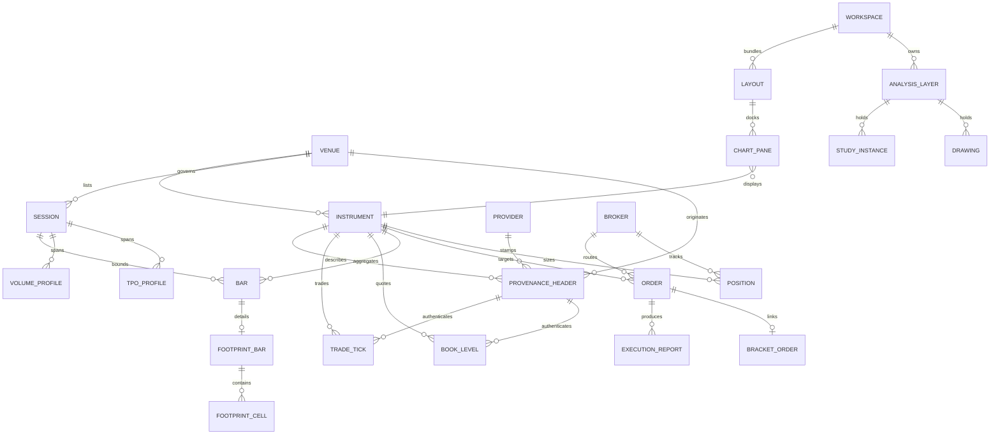

# Canonical Data Model & Local-First Persistence Specification

> **Scope:** Defines every canonical domain entity, fixed-point numeric invariant, entity-relationship schema, physical on-disk storage format, and local-first directory/settings hierarchy for **Allegedly** (`Apache-2.0`, macOS & Windows first; Linux deferred post-v1.0).
> **Terminology Governance:** Strictly obeys [`01-Charter/Glossary.md`](file:///Users/abelmora/Documents/Obsidian/Allegedly/01-Charter/Glossary.md), [`01-Charter/Constraints.md`](file:///Users/abelmora/Documents/Obsidian/Allegedly/01-Charter/Constraints.md), and [`01-Charter/Principles.md`](file:///Users/abelmora/Documents/Obsidian/Allegedly/01-Charter/Principles.md) (`P1`–`P8`, `SV-01`–`SV-20`).
> **Canonical Workspace Crates:** `allegedly-core`, `allegedly-ingest`, `allegedly-storage`, `allegedly-orderflow`, `allegedly-studies`, `allegedly-replay`, `allegedly-oms`, `allegedly-ipc`, `allegedly-app`.

---

## 1. Fixed-Point Numeric & Time Invariants (`Constraints` #7, `P6`, `SV-08`)

IEEE-754 binary floating-point types (`f32`, `f64`) are **strictly forbidden** across all domain structs, order-flow accumulators, replay state, OMS calculations, and on-disk financial schemas. Enforcement is automated via a `v0.1` Implementation CI (post-Phase-5) static AST/Clippy gate (`SV-08`) across `allegedly-core`, `allegedly-ingest`, `allegedly-orderflow`, `allegedly-storage`, `allegedly-replay`, and `allegedly-oms`.

| Domain Quantity | Canonical Type | Scale / Unit | Range & Overflow Proof | Primary Crates |
|---|---|---|---|---|
| **Ingest / Cold-Vault Price** | `PriceE9(i64)` | `10⁻⁹` (`FIXED_PRICE_SCALE = 1_000_000_000`) | `±9.22 × 10⁹` units (`±$9.22B`/unit); 1:1 with Databento DBN `v0.75.0` (zero rescaling on CME `.dbn` ingest, exact 8-decimal crypto satoshis + 1 guard digit, exact CME `0.25` ticks & 5-decimal FX pips) | `allegedly-ingest`, `allegedly-storage` (`S05`, `S08`) |
| **Ingest / Cold-Vault Qty** | `QtyE9(i64)` | `10⁻⁹` (fractional crypto/equities) or exact integer lots when `qty_scale == 1` | `±9.22 × 10⁹` units; zero silent truncation (`PrecisionLoss` / `Overflow` rejected at ingress) | `allegedly-ingest`, `allegedly-storage` (`S05`, `S08`) |
| **Order-Flow / OMS Tick Coordinate** | `PriceTicks(i64)` | Integer multiples of `Instrument.tick_size` (`tick_size_num / tick_size_den`) | Exact integer map/array index for `Footprint Bar`, `Volume Profile`, `TPO Profile`, `DOM Ladder`, and OMS limit/stop ticks; non-tick-aligned inputs (e.g., `"5942.10"` on `ES` `0.25`) rejected | `allegedly-orderflow`, `allegedly-oms` (`S06`, `S08`) |
| **Order-Flow / OMS Lot Qty** | `LotQty(i64)` | Integer multiples of `Instrument.lot_size` (`qty_scale`) | Exact `cum_filled_qty + leaves_qty == order_qty` invariant (`S06-T3`) | `allegedly-orderflow`, `allegedly-oms` |
| **Monetary / P&L Value** | `MoneyMicros(i128)` | `10⁻⁶` quote-currency units (`$0.000001`) | Exact scale-in, partial-close, and reversal-through-zero P&L without rounding drift (`S06-T1`) | `allegedly-oms`, `allegedly-replay` |
| **Accumulators (VWAP, Variance, Cumulative Delta, Imbalance Ratio)** | `i128` | Centered `i128` sums (`Σ (tick - anchor) * qty`), integer basis points `Bps(i32)` / `Bps64(i64)` (`300% = 30000 bps`) | Verified `0` drift across `100,000,000` ticks (`total_vol = 756,383,777`, `total_delta = 40,557` in `S08`) | `allegedly-orderflow`, `allegedly-studies` |
| **Timestamps** | `TimestampNs(i64)` | Nanoseconds since Unix epoch (`UTC`) | Exact `1970..2262` UTC range; both `ts_exchange_ns` (exchange matching-engine clock) and `ts_recv_ns` (local monotonic/wall receipt) preserved | All crates |
| **TPO Bracket Membership** | `TpoMask(u128)` (+ variable-word `Vec<u64>` bitset for multi-day composites) | Bitmask (`bit i = 1` iff price tick visited during bracket `i`; `u128` covers up to `128` brackets = 15m 24h sessions natively in 2 registers without overflow) | `popcnt` = `O(1)` (`S08` 64-bit prototype measured `2.10 ns/tick`); bitwise split/merge `left | (right << k) == orig` exact | `allegedly-orderflow` (`S08`) |

**Only Permitted `f32`/`f64` Boundaries:**
1. **GPU / Canvas Viewport Projection:** Converting integer `PriceTicks(i64)` / `TimestampNs(i64)` into relative screen-space `f32` pixel coordinates inside the WebGL2 / Lightweight Charts render layer (`SV-08`).
2. **Legacy Wire Ingress & Sandboxed Study Math Boundaries:** Converting third-party wire formats that transmit IEEE floats (e.g., Dukascopy `.bi5` big-endian `f32` indicative volume in `S05`) immediately at the adapter boundary into `PriceE9`/`QtyE9`, or running intermediate DSP `Study` calculations (e.g., Wilder RSI/EMA, Luau scripts whose numeric type is `f64`) strictly inside `allegedly-studies` under the deterministic float boundary rules locked in [`04-Architecture/Plugin-ABI.md`](file:///Users/abelmora/Documents/Obsidian/Allegedly/04-Architecture/Plugin-ABI.md) §5 (`cranelift_nan_canonicalization(true)`, FMA contraction disabled, IEEE-754 round-ties-to-even `f64 -> s64` with explicit `NaN -> None` / `±Inf` clamping, and deterministic `libm`)—never stored in core price, quantity, or OMS domain types.
3. **Deterministic Container Ban:** `std::collections::HashMap` is banned in replay, order-book, and profile serialization paths; use `BTreeMap`, sorted contiguous slices, or fixed-stride tick arrays to guarantee cross-OS bit-identical SHA-256 outputs (`R07`, `SV-09`).

---

## 2. Canonical Domain Entity-Relationship Diagram



---

## 3. Canonical Domain Entities (Glossary-Aligned)

### 3.1 Market & Data Entities

1. **`Venue`** (`venue_id: u16`, `mic: String`, `code: String`, `timezone: String`, `asset_class: AssetClass`)
   - The exchange, matching engine, or liquidity pool where orders match and market data originates (e.g., `CME_GLOBEX`, `KRAKEN_SPOT`, `COINBASE_ADV_TRADE`, `NASDAQ_IEX`, `DUKASCOPY_OTC`). Never conflated with `Provider` or `Broker`.
2. **`Provider`** (`provider_id: String`, `kind: ProviderKind`, `auth_mode: AuthMode`, `capabilities: ProviderCapabilities`)
   - Market-data source or aggregator delivering historical or live quotes, trade ticks, or order-book updates (e.g., `kraken_ws_v2`, `coinbase_adv_trade_ws`, `databento_dbn`, `alpaca_iex`, `dukascopy_bi5`, `synthetic_sim`).
3. **`Instrument`** (`instrument_id: u32`, `venue_id: u16`, `symbol: String`, `product_group: String`, `asset_class: AssetClass`, `tick_size_num: i64`, `tick_size_den: i64`, `tick_size_e9: i64`, `lot_size_e9: i64`, `qty_scale: i64`, `point_value_micros: i128`, `quote_currency: String`, `session_calendar_id: String`, `expiration_ts_ns: Option<i64>`)
   - Uniquely identifies a tradable contract or asset across futures, equities, FX, and crypto. `product_group` (e.g., `"ES"` shared by `ESM26` and `MESM26`) drives CME Rule 534 correlated anti-hedging checks in `allegedly-oms` (`S06`).
4. **`Session`** (`session_id: String`, `venue_id: u16`, `name: String`, `kind: SessionKind { Rth, Eth, Continuous24x7 }`, `timezone: String`, `open_local_sec: u32`, `close_local_sec: u32`, `holidays_iso: Vec<String>`, `tpo_bracket_secs: u32`)
   - Governs session VWAP resets, daily Volume Profile / TPO Profile boundaries, Initial Balance windows, and RTH/ETH filtering.
5. **`Provenance`** (`ProvenanceHeader` — mandatory on every live stream, `.atvault` segment, Parquet partition metadata, and chart legend; `Constraints` #8, `P5`, `SV-10`, `SV-11`):
   - `provider_id: String`, `venue: Venue`, `symbol: String`, `symbol_id: u16`
   - `coverage: VenueCoverage { FullVenue = 1, ConsolidatedSip = 2, SingleVenuePartial = 3, OtcIndicative = 4 }`
   - `timeliness: Timeliness { RealTime = 1, Delayed = 2, Historical = 3, Synthetic = 4 }`, `delay_seconds: u32`
   - `aggressor_source: AggressorSource { None = 0, ExchangeReported = 1, ExchangeReportedInverted = 2, InferredLeeReady = 3, InferredTickRule = 4 }`
   - `timestamp_resolution_ns: u64` (e.g., `1` for CME MDP 3.0 / Kraken / Coinbase; `1_000_000_000` for IBKR 1s quantized ticks)
   - **Canonical 5-Tier `ProvenanceTier` & Wire Bit Layout** *(unified verbatim across `Data-Model.md`, `IPC-Contract.md`, and `Plugin-ABI.md`)*:
     - Bits `2..4` encode the 5 mandatory non-dismissible UI tiers from `P5`:
       - `0 = ExactL3Mbo` (`EXACT: L3-MBO`)
       - `1 = ExactTickAggr` (`EXACT: TICK-AGGR` — `ExchangeReported` or `ExchangeReportedInverted`)
       - `2 = EstimatedL1Quote` (`ESTIMATED: L1-QUOTE` — `InferredLeeReady`)
       - `3 = EstimatedTickRule` (`ESTIMATED: TICK-RULE` — `InferredTickRule`)
       - `4 = SyntheticIntrabar` (`SYNTHETIC: 1m-INTRABAR` — OHLCV intrabar approximation; auto-disables Absorption & Unfinished Auction triggers per `SV-10`)
     - Separate orthogonal flag bits carry `PartialVenue`, `OtcIndicative`, and `Delayed` so coverage/timeliness qualifiers never collide with aggressor fidelity tier.
6. **`Trade Tick`** (`NormalizedTick` in live ingest `S05`; compact `TickEvent` in cold Parquet `S08`):
   - Live/`.atvault` `NormalizedTick` (`72 B` packed LE, matching `spikes/S05-live-ingest-tickvault/src/vault.rs` `RECORD_SIZE_BYTES = 72`): `ts_exchange_ns: i64` (`8 B`), `ts_recv_ns: i64` (`8 B`), `price_e9: i64` (`8 B`), `qty_e9: i64` (`8 B`), `trade_id: u64` (`8 B`), `seq: u64` (`8 B`), `best_bid_e9: i64` (`8 B`), `best_ask_e9: i64` (`8 B`), `symbol_id: u16` (`2 B`), `venue: u8` (`1 B`), `aggressor_side: u8` (`1 B`, `Unknown=0, Buy=1, Sell=2`), `aggressor_source: u8` (`1 B`), `_pad: [u8; 3]` (`3 B`, reserved zero padding; total = `72 B`).
   - Cold Parquet `TickEvent` (`26 B` packed / `32 B` C-aligned, verified in `S08`): `ts_event: i64`, `price_fp: i64`, `qty_fp: i64`, `aggressor_side: u8`, `flags: u8` (with `ProvenanceHeader` normalized at partition level in Parquet file metadata & SQLite catalog).
7. **`Book Level`** (L2 MBP & L3 MBO, plus `QuoteTick` for L1 NBBO/OTC):
   - L2 Market-By-Price (`BookLevel`): `price_e9: i64`, `qty_e9: i64`, `order_count: u32` (when venue provides it), `side: BookSide { Bid, Ask }`.
   - L3 Market-By-Order (`MboOrderEvent`, schema-ready v0.1, activated v0.3+): `ts_event_ns: i64`, `order_id: u64`, `price_e9: i64`, `qty_e9: i64`, `side: BookSide`, `action: MboAction { Add, Modify, Cancel, Clear, Trade, Fill }`, `flags: u8`.
   - **Canonical `BookState` Enum** *(unified verbatim across `Data-Model.md`, `IPC-Contract.md`, and `Plugin-ABI.md`)*:
     - `0 = Live` (order book synchronized, checksum/sequence verified)
     - `1 = Stale` (sequence gap, checksum mismatch, or backpressure drop; accompanied by diagnostic `reason_code` / `StaleReason`)
     - `2 = Rebuilding` (initial snapshot or post-gap snapshot resync in progress)
     - `3 = Disconnected` (transport socket closed or reconnecting with jittered backoff)
     - `4 = Halted` (venue trading halt or local administrative feed halt)

### 3.2 Charting & Order-Flow Entities

1. **`Bar`** (`ts_open_ns: i64`, `ts_close_ns: i64`, `bar_rule: BarRule { TimeSecs(u32), TickCount(u32), Volume(i64), RangeTicks(i64) }`, `open_tick: i64`, `high_tick: i64`, `low_tick: i64`, `close_tick: i64`, `volume: i64`, `buy_volume: i64`, `sell_volume: i64`, `delta: i64`, `trade_count: u32`, `provenance_tier: ProvenanceTier`, `provenance_flags: u8`, `is_closed: bool`)
2. **`Footprint Bar` & `FootprintCell`** (Memory-Optimized Slab Layout — Phase 3 Fix from `S08`):
   - **S08 Finding:** Materializing `100,000` `FootprintBar` structs each owning a heap `Vec<FootprintCell>` pushed process RSS to `260.77 MiB` (vs. `34.44 MiB` for 100M streaming).
   - **Phase 3 Production Layout:** Replace per-bar `Vec<FootprintCell>` with a **contiguous flat `FootprintSlabArena`** (`Vec<FootprintCell>` where `size_of::<FootprintCell>() == 32 B` verified in `S08`):
     - `FootprintCell` (`#[repr(C)]`, `32 B`): `price_tick: i64`, `bid_vol: i64`, `ask_vol: i64`, `trade_count: u32`, `imbalance_flags: u8` (`BIT_BUY_IMBAL`, `BIT_SELL_IMBAL`, `BIT_POC`, `BIT_UNFINISHED`), `_pad: [u8; 3]`.
     - `FootprintBarHeader` (`64 B`): `bar_index: u32`, `cell_offset: u32`, `cell_len: u16`, `poc_rel_idx: u16`, `vah_tick: i64`, `val_tick: i64`, `max_delta: i64`, `min_delta: i64`, `bar_delta: i64`, `bar_volume: i64`, `flags: u32`, `_pad: u32`.
   - Eliminates `100,000` independent heap allocations and allocator fragmentation, cutting 100k-bar order-flow RAM by an estimated `4–6×` while keeping cache-linear sequential scans.
3. **`Volume Profile` & 16-ary Dyadic VRVP Segment Tree** (`S08`):
   - `ProfileBucket`: `price_tick: i64`, `buy_vol: i64`, `sell_vol: i64`, `total_vol: i64`.
   - `VolumeProfile`: `anchor_mode: { Session, VisibleRange, AnchoredRange(ts_start, ts_end) }`, `poc_tick: i64`, `vah_tick: i64`, `val_tick: i64`, `value_area_bps: i32` (default `7000` = `70%` Steidlmayer algorithm), `total_vol: i128`, `naked_poc: bool`.
   - **Dyadic VRVP Index:** 4-level base-16 dyadic tree (`16^0=1`, `16^1=16`, `16^2=256`, `16^3=4,096` bars/node) over `FootprintSlabArena` yielding verified **`9.041 µs` p50 / `27.084 µs` p99 / `139.500 µs` max** across `10,000` random viewports on `100,000` bars (`S08`).
4. **`TPO Profile`** (`S08`, widened for 15m 24h & multi-day composites):
   - `TpoRow`: `price_tick: i64`, `bracket_mask: u128` (`count_ones()` = TPO count; natively holds up to `128` brackets — covering 30m 24h = 48 periods, CME Globex = 46 periods, and 15m 24h = 96 periods without truncation), `total_vol: i64`.
   - `CompositeTpoRow` (for multi-day / weekly composite TPO profiles exceeding `128` periods): `price_tick: i64`, `bracket_words: Vec<u64>` (variable-word bitset), `total_vol: i64`.
   - `TpoProfile`: `session_id: String`, `bracket_secs: u32` (default `1800` = 30m), `ib_brackets: u8` (default `2` = 60m), `ib_high_tick: i64`, `ib_low_tick: i64`, `poc_tick: i64`, `vah_tick: i64`, `val_tick: i64`, `single_print_ranges: Vec<(i64, i64)>`, `poor_high: bool`, `poor_low: bool`, `split_indices: Vec<u16>`.
5. **Liquidity Heatmap Ring (`R05`, `SV-13`):**
   - Fixed-resolution delta-compressed time slices (`10 Hz` default, `200` levels around mid) stored in a bounded RAM ring (`< 64 MB` hard cap for 24h = `864,000` slices) with Zstd-compressed `.atdepth` disk chunks (`< 30 MB`/24h).

### 3.3 Studies, Workspace & Execution Entities

1. **`Study`** (`StudyInstance`):
   - `instance_id: Uuid`, `plugin_id: String`, `plugin_version: String`, `runtime_tier: { Native, Wasm, Luau }`, `artifact_sha256: String`, `source_series_ref: SeriesRef` (supports study-on-study chaining), `timeframe_override: Option<BarRule>`, `params_delta: BTreeMap<String, ParamValue>`, `outputs: Vec<PlotSeries | Zone | TableValue | AlertSignal>`.
   - **Hard Invariant (`Glossary`):** A `Study` is strictly deterministic and read-only with respect to brokerage execution—it **never** submits orders directly.
2. **`Drawing`** (`drawing_id: Uuid`, `layer_id: Uuid`, `instrument_key: String`, `tool_id: String`, `anchors: Vec<TimePriceAnchor { ts_ns: i64, price_tick: i64 }>`, `z_order: i32`, `visible_timeframes: TimeframeMask`, `locked: bool`, `style_delta: BTreeMap<String, ParamValue>`).
3. **`AnalysisLayer`** (`analysis.toml`, `P7`): Named, stackable, toggleable container grouping `Drawing`s and `StudyInstance`s on an `Instrument` with explicit folder tree and Z-order.
4. **`Layout` & `Workspace`**:
   - `Layout`: Docked panel tree (serialized via thin `WorkspaceHost` adapter over MIT `dockview-core`), linked chart color-groups, instrument bindings, active layers, theme token ID.
   - `Workspace` (`workspace.toml`): Portable self-contained bundle combining one or more `Layout`s, `keymap.toml`, `Session` templates, and `Study` presets.
5. **`Broker`, `Order`, `ExecutionReport`, `Position`, & `Bracket Order`** (`S06` verified structs):
   - `Broker`: `broker_id: String`, `adapter_kind: String` (checked against `FORBIDDEN_DO_NOT_BUILD_ADAPTERS`), `env: ExecutionEnv { LocalPaper, BrokerPaper, BrokerLive }`, `allowed_hosts: Vec<String>`, `protective_leg_mode: ProtectiveLegMode { BrokerNative, ClientManagedWarning }`.
   - `Order`: `client_order_id: UuidV7` (idempotency key), `broker_order_id: Option<String>`, `instrument_id: u32`, `side: OrderSide`, `order_type: OrderType { Market, Limit(PriceTicks), Stop(PriceTicks), StopLimit(PriceTicks, PriceTicks), TrailingStop { trail_ticks } }`, `tif: TimeInForce`, `reduce_only: bool`, `order_qty: LotQty`, `cum_filled_qty: LotQty`, `leaves_qty: LotQty`, `state: OrderState` (canonical 12-state machine from `S06`: `IntentLogged`, `PendingNew`, `Accepted`, `PartiallyFilled`, `Filled`, `PendingCancel`, `Canceled`, `PendingReplace`, `Replaced`, `Rejected`, `Expired`, `UnknownPendingReconcile`).
   - `ExecutionReport` (`FillEvent`): `exec_id: String` (deduplication key), `client_order_id: UuidV7`, `fill_price: PriceTicks`, `fill_qty: LotQty`, `fee_micros: MoneyMicros`, `ts_exchange_ns: i64`, `ts_recv_ns: i64`.
   - `Bracket Order`: `entry_client_id: UuidV7`, `take_profit_client_id: Option<UuidV7>`, `stop_loss_client_id: Option<UuidV7>`, `take_profit_price: PriceTicks`, `stop_loss_price: PriceTicks`, `protected_qty: LotQty` (invariant: `protected_qty == entry.cum_filled_qty`), `oco_closed_by: Option<UuidV7>`, `mode: ProtectiveLegMode`.
   - `Position`: `account_id: String`, `instrument_id: u32`, `net_qty: LotQty`, `avg_entry_price_ticks_x1e6: i128`, `realized_pnl_micros: MoneyMicros`, `unrealized_pnl_micros: MoneyMicros`.
   - **Mandatory Risk-Reduction Bypass Rule (`allegedly-oms` Safety Invariant):**
     - Whenever market data is degraded (`BookState != Live`, i.e., `Stale | Rebuilding | Disconnected | Halted`) OR the OMS is in `RECONCILING` mode, `allegedly-oms` **MUST block** all risk-increasing entries (opening a new position or increasing an existing net position), while **ALWAYS permitting**:
       1. `cancel_order` and `cancel_all`
       2. `trigger_kill_switch` (`flatten_all`)
       3. Explicit `reduce_only: true` closing orders whose `order_qty <= abs(position.net_qty)` on the opposing side (surfaced in the UI with a loud non-dismissible red banner: *"FEED STALE / RECONCILING — RISK-REDUCING EXITS ONLY"*).

---

## 4. Physical Persistence Schemas

### 4.1 Cold Columnar Vault — Hive-Partitioned Apache Parquet 2.0 (`S08` Verified)

**Directory Layout:**
```text
vault/
  ticks/venue=<VENUE>/symbol=<SYMBOL>/date=<YYYY-MM-DD>/part-0000.parquet
  l2_mbp/venue=<VENUE>/symbol=<SYMBOL>/date=<YYYY-MM-DD>/part-0000.parquet
  l3_mbo/venue=<VENUE>/symbol=<SYMBOL>/date=<YYYY-MM-DD>/part-0000.parquet
  footprints_1m/venue=<VENUE>/symbol=<SYMBOL>/date=<YYYY-MM-DD>/part-0000.parquet
```

**Trade Ticks Parquet Schema (`S08` Measured: `4.26 B/tick`, `406.24 MiB` for `100,000,000` ticks, `6.10×` vs 26 B packed):**

| Column | Arrow / Parquet Type | Nullable | Encoding | Compression | Row-Group Stats |
|---|---|---|---|---|---|
| `ts_event` | `Int64` (UTC ns) | `false` | `DELTA_BINARY_PACKED` (dict off) | `ZSTD(level = 3)` | Chunk `min`/`max` (enables `99.58%` RG pruning) |
| `price_fp` | `Int64` (`1e-9` scale) | `false` | `DELTA_BINARY_PACKED` (dict off) | `ZSTD(level = 3)` | Chunk `min`/`max` |
| `qty_fp` | `Int64` (`1e-9` scale) | `false` | `RLE_DICTIONARY` | `ZSTD(level = 3)` | Chunk `min`/`max` |
| `aggressor_side` | `UInt8` (`0=Unk,1=Buy,2=Sell`) | `false` | `RLE_DICTIONARY` | `ZSTD(level = 3)` | Chunk `min`/`max` |
| `flags` | `UInt8` (session/auction/synthetic bits) | `false` | `RLE_DICTIONARY` | `ZSTD(level = 3)` | Chunk `min`/`max` |

- **Parquet Writer Profile:** `WriterVersion::PARQUET_2_0`, `max_row_group_row_count = 200_000`, `EnabledStatistics::Chunk`.
- **Embedded File-Level Key-Value Metadata:** `allegedly.schema_version = "1.0"`, `allegedly.provenance_json` (serialized `ProvenanceHeader`), `allegedly.tick_size_e9`, `allegedly.content_sha256`.
- **Optional L2 MBP & L3 MBO Schemas** *(opt-in per instrument with configurable retention quota to prevent SSD exhaustion, `R07`)*:
  - `l2_mbp`: `ts_event: Int64`, `seq: UInt64`, `side: UInt8`, `action: UInt8`, `price_fp: Int64`, `qty_fp: Int64`, `order_count: UInt32`, `flags: UInt8` (`DELTA_BINARY_PACKED` on `ts_event`/`seq`/`price_fp`, Zstd-3). *(Actual compression ratio on 10M real L2 rows: `UNVERIFIED` — see §7.)*
  - `l3_mbo`: `ts_event: Int64`, `order_id: UInt64`, `side: UInt8`, `action: UInt8`, `price_fp: Int64`, `qty_fp: Int64`, `flags: UInt8`.
  - `footprints_1m`: `ts_open: Int64`, `price_tick: Int64`, `bid_vol: Int64`, `ask_vol: Int64`, `trade_count: UInt32`, `imbalance_flags: UInt8` (pre-computed rollup for instant multi-month chart boot without re-scanning raw ticks).

### 4.2 Hot/Warm Live Capture Segment — `.atvault` (`S05` Verified)

Used as the crash-safe sequential recorder during live WebSocket ingest before asynchronous compaction to Cold Parquet (`S05`: `12.37–18.32 B/tick`, `2.48M ticks/s` write, `10.46M ticks/s` replay):

```text
[8 B Start Magic: "ALGDTV01"]
[4 B Format Version: u32 LE = 1]
[4 B Header JSON Len: u32 LE]
[N B UTF-8 JSON VaultHeader { provenance_headers: Vec<ProvenanceHeader>, created_ns: i64 }]
[M B Zstd(level=3) Compressed Stream of 72-byte Packed LE NormalizedTick Records (incl. _pad: [u8; 3])]
[8 B Record Count: u64 LE]
[4 B Raw Payload CRC32: u32 LE]
[8 B End Magic: "TVEND001"]
```

- **Rotation & Compaction Rule:** Rotate `.atvault` segment on either `1,000,000` ticks, `15 MiB` compressed, or `1 hour` UTC boundary (whichever comes first). Background compactor converts sealed segments into Hive Parquet 2.0, verifies `SHA-256` row count + volume/delta parity, updates SQLite `catalog.sqlite` atomically, and archives/prunes sealed `.atvault` files per user retention policy.

### 4.3 Warm SQLite WAL Metadata Catalog (`catalog.sqlite`, `S08` Verified)

Verified in `S08` at **`20.00 KiB`** (`20,480 B`) indexing `100,000,000` ticks across 20 daily partitions (`PRAGMA journal_mode = WAL; PRAGMA synchronous = NORMAL; PRAGMA foreign_keys = ON;`):

```sql
CREATE TABLE IF NOT EXISTS instruments (
    instrument_id      INTEGER PRIMARY KEY,
    venue              TEXT NOT NULL,
    symbol             TEXT NOT NULL,
    product_group      TEXT NOT NULL,
    asset_class        TEXT NOT NULL,
    tick_size_num      INTEGER NOT NULL,
    tick_size_den      INTEGER NOT NULL,
    tick_size_e9       INTEGER NOT NULL,
    lot_size_e9        INTEGER NOT NULL,
    point_value_micros TEXT NOT NULL, -- decimal i128 string (exact)
    quote_currency     TEXT NOT NULL,
    calendar_id        TEXT NOT NULL,
    UNIQUE(venue, symbol)
);

CREATE TABLE IF NOT EXISTS partitions (
    partition_id      INTEGER PRIMARY KEY AUTOINCREMENT,
    instrument_id     INTEGER NOT NULL REFERENCES instruments(instrument_id),
    dataset_kind      TEXT NOT NULL, -- 'ticks' | 'l2_mbp' | 'l3_mbo' | 'footprints_1m'
    venue             TEXT NOT NULL,
    symbol            TEXT NOT NULL,
    trading_date      TEXT NOT NULL, -- YYYY-MM-DD
    rel_path          TEXT NOT NULL UNIQUE,
    ts_min_ns         INTEGER NOT NULL,
    ts_max_ns         INTEGER NOT NULL,
    row_count         INTEGER NOT NULL,
    byte_size         INTEGER NOT NULL,
    provenance_json   TEXT NOT NULL,
    sha256_hex        TEXT NOT NULL,
    created_ns        INTEGER NOT NULL
);
CREATE INDEX IF NOT EXISTS idx_partitions_lookup
    ON partitions(venue, symbol, dataset_kind, ts_min_ns, ts_max_ns);
```

### 4.4 Durable OMS Write-Ahead Journal (`oms_journal.sqlite`, `S06` Verified)

Strict isolation from `catalog.sqlite` so market-data catalog queries never contend with execution durability (`PRAGMA journal_mode = WAL; PRAGMA synchronous = FULL; PRAGMA busy_timeout = 5000; PRAGMA foreign_keys = ON;`):

```sql
CREATE TABLE IF NOT EXISTS oms_events (
    seq             INTEGER PRIMARY KEY AUTOINCREMENT,
    ts_ns           INTEGER NOT NULL,
    account_id      TEXT NOT NULL,
    env             TEXT NOT NULL, -- 'local_paper' | 'broker_paper' | 'broker_live'
    client_order_id TEXT,          -- UUIDv7 idempotency key
    event_type      TEXT NOT NULL, -- 'intent_logged' | 'state_transition' | 'fill_applied' | ...
    payload_json    TEXT NOT NULL  -- Zero-float integer JSON; NEVER contains API secrets
);
CREATE INDEX IF NOT EXISTS idx_oms_events_cid ON oms_events(client_order_id);
CREATE INDEX IF NOT EXISTS idx_oms_events_acct_seq ON oms_events(account_id, seq);
```

- **Unified macOS `PRAGMA fullfsync = ON` & Batched WAL Policy:**
  - `PRAGMA fullfsync = ON` is **mandatory** on macOS for `ExecutionEnv::BrokerLive` (`live_journal.sqlite`) **paired with single-transaction batched Kill-Switch WAL commits** (grouping multi-event submits `(IntentLogged, BracketRegistered, PendingNew)` into 1 commit and grouping a 50-order Kill-Switch cancel wave into **1 `F_FULLFSYNC` commit** instead of 50 separate fsyncs). Paper accounts (`paper_journal.sqlite`) default to `synchronous = FULL`.
  - Gated by an explicit `v0.1` Implementation CI (post-Phase-5) macOS APFS `F_FULLFSYNC` benchmark (`UNVERIFIED`, §7).
- **Zero-Secret Invariant (`S06-T6`):** API credentials are non-`Serialize`, redacted on `Debug`/`Display`, and stored exclusively in OS Keychain (`keyring-core`: macOS Keychain / Windows Credential Manager). CI asserts zero secret bytes exist in `oms_journal.sqlite*`.

---

## 5. Local-First Directory Layout & 5-Level Settings-as-Code (`P1`, `P4`, `SV-06`, `SV-07`)

### 5.1 Canonical On-Disk Directory Layout

Default root (overridable via `ALLEGEDLY_HOME` env var or portable `--data-dir` CLI flag):
- **macOS:** `~/Library/Application Support/Allegedly/` (configs also symlinkable/exportable to `~/.allegedly/`)
- **Windows:** `%LOCALAPPDATA%\Allegedly\`
- *(Linux post-v1.0: `$XDG_DATA_HOME/allegedly/` + `$XDG_CONFIG_HOME/allegedly/`)*

```text
<ALLEGEDLY_HOME>/
├── config/                         # 100% Git-diffable, sorted-key TOML/JSON + schemas
│   ├── defaults.toml               # Level 1: Global user overrides over shipped defaults
│   ├── keymap.toml                 # 100% remappable bindings (SV-18)
│   ├── themes/
│   │   └── okabe-ito-dark.toml     # Semantic design tokens (Tier-3, SV-19)
│   ├── sessions/
│   │   ├── cme-globex-rth.toml
│   │   └── us-equities-rth.toml
│   ├── templates/
│   │   └── studies/<name>.template.toml
│   ├── workspaces/
│   │   └── default.workspace.toml
│   └── analyses/
│       └── <VENUE>_<SYMBOL>/<layer>.analysis.toml
├── vault/                          # Open user-owned market data (Parquet + .atvault + SQLite)
│   ├── catalog.sqlite              # Warm partition & instrument catalog (WAL)
│   ├── hot_segments/*.atvault      # Uncompacted live Zstd-3 + CRC32 captures
│   ├── ticks/                      # Hive-partitioned Parquet 2.0 (DuckDB-queryable!)
│   ├── l2_mbp/                     # Opt-in L2 MBP Parquet
│   ├── l3_mbo/                     # Opt-in L3 MBO Parquet (v0.3+)
│   ├── footprints_1m/              # Pre-computed 1m Footprint rollups
│   └── heatmap/*.atdepth           # Bounded 24h Zstd liquidity heatmap chunks
├── oms/
│   ├── paper_journal.sqlite        # Paper / local-sim WAL journal
│   └── live_journal.sqlite         # Physically separate Live WAL journal (never mixed!)
├── plugins/
│   ├── installed/<plugin-id>/      # plugin.toml + .wasm / .luau + verified SHA-256
│   └── cache/cwasm/                # Pre-compiled Wasmtime .cwasm cache (version-keyed)
└── logs/                           # Local rotating diagnostics (zero secrets, zero telemetry)
```

### 5.2 Deterministic 5-Level Settings Cascade (`P4`, `SV-06`, `SV-07`)

Every configurable setting resolves deterministically at read time via the cascade:

```text
Level 1: Global Defaults (shipped schema defaults + config/defaults.toml)
   └── Level 2: Workspace (workspace.toml)
          └── Level 3: Study / Layout Template (template.toml)
                 └── Level 4: Chart Pane (pane_overrides inside Layout)
                        └── Level 5: Study / Drawing Instance (instance delta inside analysis.toml)
```

- **Delta-Only Serialization:** Levels 2–5 persist **only keys whose value differs from their resolved parent**. Resetting an override (`Reset to Inherited`, `SV-07`) deletes the key from the child delta table.
- **Canonical Serialization Contract (`SV-06`):** All TOML/JSON serializers use `BTreeMap` sorted keys, explicit `schema_version`, and integer fixed-point values (`imbalance_ratio_bps = 30000`, never `3.0`), guaranteeing `SHA-256(export_1) == SHA-256(export_2)` and `<= 3` diff lines per 1-parameter edit.
- **Schema-Driven Inspector:** Every entity/study exports a JSON Schema (`2020-12`) declaring `tier: 1 | 2 | 3`, inspector tab (`Parameters | Style | Timeframes & Session | Alerts`), integer bounds, and unit (`ticks`, `bps`, `ms`, `lots`) so Tier-1 floating micro-toolbars (`<= 5` controls, `SV-04`) and the Tier-2 non-blocking right inspector drawer (`SV-03`) are generated directly from schema metadata.

---

## 6. Evidence & Verified Numbers Summary

| Metric / Claim | Verified Value | Source Artifact |
|---|---|---|
| Zero `f32`/`f64` in ingest, order-flow, storage & OMS structs | `0` float fields (static grep + release tests) | `S05`, `S06`, `S08` |
| Cold Parquet 2.0 compression (`100M` ES ticks) | **`4.26 B/tick`** (`406.24 MiB` total, `6.10×` vs 26 B / `7.51×` vs 32 B) | `S08` |
| SQLite WAL catalog size (`100M` ticks / 20 partitions) | **`20.00 KiB`** (`20,480 B`) | `S08` |
| `.atvault` live Zstd-3 + CRC32 segment efficiency | **`12.37–18.32 B/tick`**, `2.48M ticks/s` write / `10.46M ticks/s` read | `S05` |
| `FootprintCell` & `TickEvent` struct layout | Exact **`32 B`** C-aligned (`size_of` unit test) | `S08` |
| 100k-bar Dyadic VRVP Segment Tree query latency | **`9.041 µs` p50 / `27.084 µs` p99 / `139.500 µs` max** (`100%` exact parity) | `S08` |
| 64-bit TPO bitmask prototype update latency | **`2.10 ns/tick`**; bitwise split exact (widened to `u128` in production) | `S08` |
| SQLite WAL OMS journal append latency (`synchronous=FULL`) | **`119.75 µs` p50 / `348.95 µs` p99**; 500-order cold replay **`1.803 ms`** | `S06` |

---

## 7. Open Items & `UNVERIFIED` Gaps

1. **`UNVERIFIED` — `FootprintSlabArena` RAM Reduction Benchmark:** S08 proved that 100k per-bar `Vec<FootprintCell>` allocations consumed `260.77 MiB` RSS; the flat contiguous `FootprintSlabArena` design in §3.2 must be benchmarked in `v0.1` Implementation CI (post-Phase-5) against `SV-13` (`< 300 MB` total app RAM).
2. **`UNVERIFIED` — Real-World L2 MBP / L3 MBO Parquet Compression Ratio:** S08 verified `4.26 B/tick` on `100,000,000` trade ticks; compressing a `10M`-row live CME `Mbp10` / Kraken L2 Parquet archive remains to be measured in `v0.1` Implementation CI (post-Phase-5) (`S08` caveat #1).
3. **`UNVERIFIED` — Live macOS `PRAGMA fullfsync = ON` Batched WAL Latency:** `S06` measured `synchronous = FULL` (`119.75 µs` p50); `v0.1` Implementation CI (post-Phase-5) must benchmark single-transaction batched Kill-Switch commits under `PRAGMA fullfsync = ON` on macOS APFS and `FlushFileBuffers` on Windows NTFS for live accounts.
4. **`UNVERIFIED` — Real Databento Portal `.dbn.zst` CME `GLBX.MDP3` Fixture:** `S05` validated `dbn v0.75.0` on self-encoded synthetic `GLBX.MDP3` archives (`18.43M rec/s`); validating a user-downloaded real CME `.dbn.zst` file (including `InstrumentDefMsg` calendar/tick metadata) remains a human verification step.
