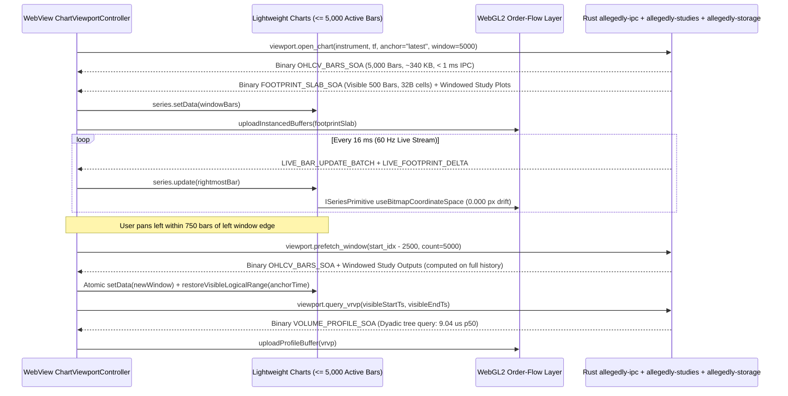
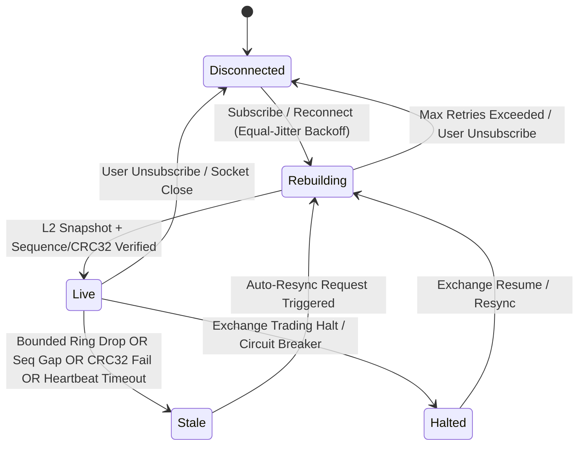

# Allegedly — IPC Contract `v1`

> **Purpose:** Define the versioned, shell-agnostic communication contract between Allegedly's Rust Core (`allegedly-ipc`) and WebView UI (`@allegedly/ipc-client`). This contract locks in zero-float fixed-point `i64` binary framing (`S02`), `16 ms` (`60 Hz`) frame-aligned batching (`S02`), Rust-backed `<= 5,000`-bar chart viewport windowing with `6,000`-bar idle-trim hysteresis (`S01`), bounded backpressure with immediate `BookState::Stale` signaling and a mandatory Risk-Reduction Bypass Rule (`S05`, `S06`), and revisioned multi-window pop-out state synchronization (`S03`).

---

## 1. Design Rules & Transport Independence

1. **Zero IEEE-754 Money Fields on the Wire (`Constraints` #7, `SV-08`):** Every price (`price_e9: i64` at `1e-9` scale or integer `price_tick: i64`), quantity (`qty_e9: i64` at `1e-9` fixed-point scale — NEVER `i32`), timestamp (`ts_ns: i64` UTC epoch nanoseconds), and cumulative delta (`i64`) crosses IPC as fixed-point little-endian integers. `InstrumentMeta` provides exact `tick_size_e9: i64`, `lot_size_e9: i64`, `tick_size_num: i64`, `tick_size_den: i64`, and `qty_scale: i64`. Only the chart/WebGL2 view boundary converts to `number` for pixel projection.
2. **8-Byte Alignment for Zero-Copy TypedArray Views (`S02`):** All binary headers (`24 B`) and every record stride (`16 B`, `24 B`, `32 B`, `40 B`, `72 B`) are strict multiples of `8` bytes with every multi-byte field naturally aligned, so bulk Structure-of-Arrays (SoA) and flat-slab payloads map directly onto `BigInt64Array`, `Int32Array`, `Uint32Array`, and `DataView` with `0.00 ms` JS parse overhead (`S02`).
3. **Mandatory `16 ms` (`60 Hz`) Frame Batching for Live Streams (`S02`):** Unbatched IPC triggers `6.3×–9.2×` tail latency spikes (`13 ms` p99 on Tauri `WKWebView` at `50k msgs/s`; `8.3 ms` p99 and `+49%` wire overhead on WS at `100k msgs/s`). Live channels MUST coalesce/batch on a `16 ms` (`60 Hz`) cadence (configurable down to `8 ms` on `120 Hz` displays, never `0 ms` unbatched in production).
4. **Zero Secrets Across IPC:** Broker/Provider API keys, OAuth tokens, and passwords are read from OS Keychain (`keyring-core`) exclusively inside Rust (`allegedly-ingest`, `allegedly-oms`) and NEVER serialized across IPC.
5. **Shell Portability (`TransportAdapter`):** UI code imports only `@allegedly/ipc-client`'s `TransportAdapter` interface, never raw `@tauri-apps/api/core`. Switching to a headless loopback WebSocket test harness or an emergency Electron fallback requires swapping one adapter implementation.

---

## 2. TypeScript `TransportAdapter` Abstraction & Canonical Enums

```typescript
export type SubscriptionId = number; // u32 allocated by Rust allegedly-ipc

/** Canonical 5-tier ProvenanceTier (bits 2..4 in wire flags; maps 1:1 to P5 / SV-10 badges). */
export const enum ProvenanceTier {
  ExactL3Mbo = 0,        // Badge: "EXACT: L3-MBO"
  ExactTickAggr = 1,     // Badge: "EXACT: TICK-AGGR"
  EstimatedL1Quote = 2,  // Badge: "ESTIMATED: L1-QUOTE"
  EstimatedTickRule = 3, // Badge: "ESTIMATED: TICK-RULE"
  SyntheticIntrabar = 4, // Badge: "SYNTHETIC: 1m-INTRABAR" (disables Absorption/Unfinished triggers)
}

/** Orthogonal provenance modifier bitmask (bits 5..7 in wire flags). */
export const enum ProvenanceModifiers {
  None = 0,
  PartialVenue = 1 << 0,   // e.g., IEX single-venue equities (~2.5% tape)
  OtcIndicative = 1 << 1,  // e.g., Dukascopy FX indicative quotes
  Delayed = 1 << 2,        // Delayed feed (non-realtime)
}

/** Canonical BookState across Data-Model.md, IPC-Contract.md, and Plugin-ABI.md. */
export const enum BookState {
  Live = 0,
  Stale = 1,
  Rebuilding = 2,
  Disconnected = 3,
  Halted = 4,
}

export interface StreamStatusEvent {
  readonly subscriptionId: SubscriptionId;
  readonly instrumentId: number;
  readonly bookState: BookState;
  readonly provenanceTier: ProvenanceTier;
  readonly provenanceModifiers: number;
  readonly lastSeq: bigint;
  readonly droppedCount: number;
  readonly reasonCode: number;
  readonly reason?: string;
}

export interface WorkspaceSyncEvent {
  /** Monotonic workspace revision owned by Rust allegedly-ipc (stale client patches rejected). */
  readonly stateRev: bigint;
  readonly sourceWindowId: string;
  readonly kind: "instrument_link" | "layout_patch" | "selection" | "theme" | "live_armed";
  readonly payload: unknown;
}

export interface TransportAdapter {
  readonly kind: "tauri-v2" | "loopback-ws";

  /** Low-frequency JSON control plane (workspace, settings, orders, windowing). */
  invokeControl<TReq, TRes>(command: string, payload: TReq): Promise<TRes>;

  /** Bulk binary read (e.g., 5k Bar SoA window, 32B Footprint slab, VRVP/TPO profile). */
  invokeBinary<TReq>(command: string, payload: TReq): Promise<ArrayBuffer>;

  /** Subscribe to a 16 ms frame-batched binary stream (trades, L2, bars, footprint). */
  subscribeStream(
    request: StreamSubscribeRequest,
    onFrame: (frame: ArrayBuffer) => void,
    onStatus: (status: StreamStatusEvent) => void,
  ): Promise<SubscriptionId>;

  /** Unsubscribe and release Rust ring/channel resources. */
  unsubscribeStream(subscriptionId: SubscriptionId): Promise<void>;

  /** Cross-window workspace state hub (authoritative multi-monitor sync with state_rev). */
  publishWorkspaceEvent(event: WorkspaceSyncEvent): Promise<{ accepted: boolean; currentRev: bigint }>;
  onWorkspaceEvent(handler: (event: WorkspaceSyncEvent) => void): () => void;
}
```

### Primary vs. Fallback Implementations

| Adapter | Control Plane | Bulk Binary Read | Live Streaming (`16 ms` Batched) | Verified `S02` Performance (Apple M2 macOS) |
|---|---|---|---|---|
| **`TauriTransportAdapter`** *(Primary — macOS `WKWebView`, Windows `WebView2`)* | `tauri::command` JSON `invoke` | `tauri::ipc::Response` raw `Vec<u8>` → `ArrayBuffer` | `tauri::ipc::Channel<InvokeResponseBody>` (`InvokeResponseBody::Raw(Vec<u8>)`) | Bulk `100k` Bars (`4.80 MB`): **`3.0 ms` median / `5.0 ms` p95** (`0.00 ms` decode). Stream: **`100,450 msgs/s`** (`1/2/3 ms` p50/p95/p99 RTT, `100%` delivery). |
| **`LoopbackWsTransportAdapter`** *(Playwright CI, Headless Harness, Electron Fallback)* | JSON text frame over `ws://127.0.0.1:<ephemeral>` with per-session nonce | Binary WS frame (`tokio-tungstenite 0.26.2`) | Binary WS frame (`16 ms` coalesced) | Bulk `100k` Bars (`4.80 MB`): **`19.5 ms` median / `20.5 ms` p95** (`0.00 ms` decode). Stream: **`100,432 msgs/s`** (`0.4/0.9/0.9 ms` RTT, `60.0 fps`, `0` frame drops). |

---

## 3. Binary Wire Format Specification (`v1`)

### 3.1 Common `24`-Byte Little-Endian Frame Header & Explicit Price/Qty Scaling

Every binary payload returned by `invokeBinary` or pushed over `subscribeStream` begins with an exact `24`-byte, 8-byte-aligned little-endian header (extending `S02`'s `16 B` `MAGIC_ALG2` prototype header with explicit `version`, `frame_type`, and `stream_id` while preserving zero-copy `BigInt64Array` alignment at byte offset `24`):

| Offset | Size | Type (LE) | Field | Description |
|---:|---:|---|---|---|
| `0` | `4` | `u32` | `magic` | Constant `0x414C4732` (`"ALG2"` in ASCII) |
| `4` | `2` | `u16` | `version` | Protocol major version (`1` for `v1`) |
| `6` | `2` | `u16` | `frame_type` | Payload discriminator (table in §3.2) |
| `8` | `4` | `u32` | `stream_id` | `SubscriptionId` (or `0` for request-response bulk calls) |
| `12` | `4` | `u32` | `record_count` | Number of records/bars/levels/cells in payload |
| `16` | `8` | `u64` | `send_ns` | Monotonic Rust core emit timestamp (nanoseconds) for telemetry/RTT |

**Locked Price & Quantity Units by Frame Family (`RT3-01`):**
- **Raw Market-Data Frames (`0x0101` `LIVE_TRADE_BATCH`, `0x0102` `LIVE_L2_BOOK_BATCH`):** Prices and quantities ALWAYS use `1e-9` fixed-point integers (`price_e9: i64`, `qty_e9: i64`, matching `Data-Model.md` `NormalizedTick`/`BookLevel` and `databento::dbn` `FIXED_PRICE_SCALE`).
- **Aggregated Chart & Order-Flow Frames (`0x0001`–`0x0004`, `0x0103`, `0x0104`):** Prices ALWAYS use integer instrument ticks (`price_tick: i64`, converted to currency price via `price_tick * InstrumentMeta.tick_size_e9` at the view boundary), and volumes ALWAYS use `1e-9` fixed-point quantities (`qty_e9` / `vol_e9: i64`).

*Byte `24` is guaranteed 8-byte aligned (`24 % 8 === 0`), allowing zero-copy `new BigInt64Array(buf, 24, n)` views.*

### 3.2 Frame Types (`frame_type: u16`)

| `frame_type` | Name | Transport | Price / Qty Units | Exact Aligned Layout (Little-Endian, Starts at Offset `24`) |
|---:|---|---|---|---|
| `0x0001` | `OHLCV_BARS_SOA` | Bulk `invokeBinary` | `price_tick: i64`, `vol_e9: i64` | SoA `8 × N × 8 B` (`ts_open_ns`, `open_tick`, `high_tick`, `low_tick`, `close_tick`, `volume_e9`, `buy_vol_e9`, `sell_vol_e9` as `i64`; `delta_e9 = buy_vol_e9 - sell_vol_e9`) + `N × 4 B` `bar_flags: u32` (padded to `8 B` boundary) |
| `0x0002` | `FOOTPRINT_SLAB_SOA` | Bulk `invokeBinary` | `price_tick: i64`, `vol_e9: i64` | Bar index table (`N × 16 B`: `bar_ts_ns: i64`, `cell_offset: u32`, `cell_count: u32`) + flat canonical **`32 B` `FootprintCell`** slab (`M × 32 B`: `price_tick: i64`, `bid_vol_e9: i64`, `ask_vol_e9: i64`, `trade_count: u32`, `imbalance_flags: u8`, `_pad: [u8; 3]`) |
| `0x0003` | `VOLUME_PROFILE_SOA` | Bulk `invokeBinary` | `price_tick: i64`, `vol_e9: i64` | **`24 B`** summary (`poc_price: i64`, `vah_price: i64`, `val_price: i64` in `price_tick`) + `M × 24 B` bins (`price_tick: i64`, `bid_vol_e9: i64`, `ask_vol_e9: i64`) |
| `0x0004` | `TPO_PROFILE_BITMASK` | Bulk `invokeBinary` | `price_tick: i64` | `8 B` profile header (`words_per_row: u16`, `period_count: u16`, `_pad: u32`; default `words_per_row = 2` for native `u128` = 128 periods covering 15m 24h sessions; `words_per_row > 2` enables variable-word bitsets for multi-day composites) + `M × (8 + 8 * words_per_row) B` rows (`price_tick: i64`, `period_mask: [u64; words_per_row]`, default `24 B/row` for `u128`) |
| `0x0101` | `LIVE_TRADE_BATCH` | Stream `16 ms` Channel | `price_e9: i64`, `qty_e9: i64` | `N × 40 B` (`seq: u64`, `ts_ns: i64`, `price_e9: i64`, `qty_e9: i64`, `flags: u32`, `_pad: u32`) *(upgraded from `S02` `32 B` prototype `i32` qty to eliminate `2.15`-unit overflow)* |
| `0x0102` | `LIVE_L2_BOOK_BATCH` | Stream `16 ms` Channel | `price_e9: i64`, `qty_e9: i64` | `16 B` book header (`book_seq: u64`, `level_count: u32`, `book_state: u8`, `is_snapshot: u8`, `provenance_tier: u8`, `provenance_modifiers: u8`) + `M × 24 B` levels (`price_e9: i64`, `qty_e9: i64`, `side_action_flags: u32`, `order_count: u32`) |
| `0x0103` | `LIVE_BAR_UPDATE_BATCH` | Stream `16 ms` Channel | `price_tick: i64`, `vol_e9: i64` | `N × 72 B` (`ts_open_ns: i64`, `open_tick: i64`, `high_tick: i64`, `low_tick: i64`, `close_tick: i64`, `volume_e9: i64`, `buy_vol_e9: i64`, `sell_vol_e9: i64`, `flags: u64`) |
| `0x0104` | `LIVE_FOOTPRINT_DELTA` | Stream `16 ms` Channel | `price_tick: i64`, `vol_e9: i64` | Incremental canonical **`32 B` `FootprintCell`** records (`M × 32 B`: `price_tick: i64`, `bid_vol_e9: i64`, `ask_vol_e9: i64`, `trade_count: u32`, `imbalance_flags: u8`, `_pad: [u8; 3]`) for active rightmost Footprint Bar |
| `0x0201` | `STREAM_STATUS_FRAME` | Stream (Immediate — bypasses `16 ms` wait) | N/A | **`16 B` aligned** (`seq: u64` @ `+0`, `dropped_total: u32` @ `+8`, `reason_code: u16` @ `+12`, `book_state: u8` @ `+14`, `provenance_tier: u8` @ `+15`) |

**Shared Bitfield Layouts:**
- **`LIVE_TRADE_BATCH.flags: u32`:**
  - Bits `0..1`: Aggressor side (`0 = Unknown`, `1 = Buy`, `2 = Sell`)
  - Bits `2..4`: Canonical 5-tier `ProvenanceTier` (`0 = ExactL3Mbo`, `1 = ExactTickAggr`, `2 = EstimatedL1Quote`, `3 = EstimatedTickRule`, `4 = SyntheticIntrabar`)
  - Bit `5`: `PartialVenue` modifier (`1` if partial-venue feed such as IEX)
  - Bit `6`: `OtcIndicative` modifier (`1` if OTC indicative such as Dukascopy `.bi5`)
  - Bit `7`: `Delayed` modifier (`1` if delayed feed)
  - Bit `8`: `is_out_of_sequence`
  - Bits `9..31`: Reserved (`0`)
- **`OHLCV_BARS_SOA.bar_flags: u32` & `LIVE_BAR_UPDATE_BATCH.flags: u64`:**
  - Bit `0`: `is_closed` (`1 = closed/final bar`, `0 = forming intrabar`)
  - Bit `1`: Reserved (`0`)
  - Bits `2..4`: Canonical 5-tier `ProvenanceTier` (`0..4`)
  - Bits `5..7`: `ProvenanceModifiers` (`PartialVenue`, `OtcIndicative`, `Delayed`)
  - Remaining upper bits: Reserved (`0`)
- **`FootprintCell.imbalance_flags: u8` (1:1 with `Data-Model.md`):**
  - Bit `0`: `BIT_BUY_IMBAL`, Bit `1`: `BIT_SELL_IMBAL`, Bit `2`: `BIT_POC`, Bit `3`: `BIT_UNFINISHED`, Bits `4..7`: Reserved (`0`).

---

## 4. Control Plane Commands (Typed JSON over `invoke`)

Low-frequency commands (`< 20 Hz`) use strongly typed JSON serialized via `serde` and validated by TypeScript types generated from Rust schemas (`schemas/ipc-v1/`):

| Namespace | Commands | Notes |
|---|---|---|
| **`market.*`** | `market.list_instruments`, `market.get_instrument_meta`, `market.subscribe_stream`, `market.unsubscribe_stream` | Returns `InstrumentMeta` (`tick_size_e9`, `lot_size_e9`, `tick_size_num`, `tick_size_den`, `qty_scale`, `venue`, `provenance_default`). |
| **`viewport.*`** | `viewport.open_chart`, `viewport.load_window`, `viewport.prefetch_window`, `viewport.query_vrvp`, `viewport.close_chart` | Drives Rust-backed `<= 5,000`-bar windowing (§5). `viewport.load_window` returns binary `OHLCV_BARS_SOA`. |
| **`workspace.*`** | `workspace.get_layout`, `workspace.save_layout`, `workspace.spawn_popout`, `workspace.close_popout`, `workspace.publish_event` | Authoritative multi-window hub (`state_rev: u64`) + sorted-key TOML/JSON persistence. |
| **`settings.*`** | `settings.resolve_cascade`, `settings.patch_delta`, `settings.reset_scope`, `settings.export_bundle` | Implements 5-level cascade (`Global -> Workspace -> Template -> Pane -> Instance`). |
| **`study.*`** | `study.list_catalog`, `study.attach`, `study.update_params`, `study.detach`, `study.compile_luau` | Runs in `allegedly-studies` (`Wasmtime` / `Luau` sandboxes) over full history with deterministic fuel & `StoreLimits`. |
| **`oms.*`** | `oms.submit_order`, `oms.modify_order`, `oms.cancel_order`, `oms.cancel_all`, `oms.trigger_kill_switch`, `oms.flatten_all`, `oms.reconcile_now`, `oms.get_positions`, `oms.set_live_armed` | Every `oms.submit_order` requires a client-generated UUIDv7 `client_order_id`, integer `limit_price_ticks`/`stop_price_ticks`/`qty_e9`, and an explicit `reduce_only: boolean` flag. **Risk-Reduction Bypass Rule (`RT3-05`):** When `BookState != Live` or OMS is `RECONCILING`, `allegedly-oms` MUST reject all risk-increasing entries (`new position` / `increase position`), while **ALWAYS permitting** `oms.cancel_order`, `oms.cancel_all`, `oms.trigger_kill_switch` (`flatten_all`), and explicit `reduce_only: true` closing orders. |

---

## 5. Rust-Backed `5,000`-Bar Viewport Windowing & Study Warmup Protocol (`S01`, `RT3-09`)

Spike `S01` uncovered a critical `Lightweight Charts v5.3.0` behavior: while pure pan/zoom on `100,000` Bars runs at `60.1 fps`, calling `series.update()` at `30 Hz` on a `100,000`-bar series triggers an internal `O(N)` scale/layout recomputation that collapses frame rate to **`18.5 fps`** (`p95 95.5 ms`, `72` stalls `> 33 ms`). Keeping the active LWC dataset bounded to **`<= 5,000` Bars** restores **`60.0 fps`** (`p95 18.70 ms`, `0` stalls `> 33 ms`) at both `30 Hz` and `60 Hz` live updates, with an **`80.7 ms`** window reload (`S01`).



### Windowing, Hysteresis & Study Warmup Rules (Locked Defaults)
- **Active LWC Window Target (`W_ACTIVE`):** `5,000` Bars (`~340 KB` binary SoA payload including `buy_vol_e9`, `sell_vol_e9`, and `bar_flags` — transfers in `< 1 ms` over native Tauri IPC).
- **Edge Prefetch Trigger (`W_MARGIN`):** `750` Bars from either left or right boundary of `W_ACTIVE`.
- **Window Slide Step (`W_STRIDE`):** `2,500` Bars (`50%` overlap so rapid back-and-forth scrubbing across a seam never thrashing-reloads).
- **Live-Tail Trim Hysteresis (`W_MAX = 6,000`, `RT3-09`):** While `anchor === "latest"`, `W_ACTIVE` grows from `5,000` up to **`max_window = 6,000` Bars** (`1,000`-bar hysteresis band) before scheduling a `1,000`-bar front trim back to `5,000`. Because trimming front bars in `Lightweight Charts v5.3.0` invokes `series.setData()` (`~80.7 ms` measured in `S01`), the trim is **strictly deferred to an idle frame between bar closes via `requestIdleCallback`** (never mid-tick or during an active pointer drag) so high-frequency `1s` or tick charts do not thrash.
- **Full-History Study Warmup Invariant (`RT3-09`):** Rust **`allegedly-studies` ALWAYS computes Studies (e.g., `200`-bar EMA, anchored Session VWAP, cumulative CVD) over the full required session/lookback history in Rust** and ships only the `<= 5,000`-bar windowed plot slice corresponding to `W_ACTIVE` over IPC. The WebView never computes financial Study warmup math over a truncated `5,000`-bar JS array.

---

## 6. Backpressure, Ring Coalescing, `BookState` FSM & Risk-Reduction Bypass Rule

To uphold `Constraints` #8 (honest provenance), `S05` (zero silent corruption under burst load), and `RT3-05` (live-trading exit safety):



1. **Per-Provider Bounded Ingress Ring (`rtrb` SPSC, `S05`/`S08`):** Each Provider task in `allegedly-ingest` pushes normalized `i64` events into its own bounded `rtrb` SPSC ring (`default cap = 16,384` production; stress-verified at `cap = 1,024` in `S05`). If the Core Event Dispatcher falls behind and fills the ring, `allegedly-ingest` **never blocks the exchange socket** and **never silently drops L2 deltas** — it increments `dropped_total`, transitions the instrument to `BookState::Stale`, and emits an immediate `16 B` `STREAM_STATUS_FRAME` (bypassing the `16 ms` timer).
2. **`16 ms` Coalescing Rules in `allegedly-ipc`:**
   - **L2 Book Levels:** Coalesced into a dirty-price `BTreeMap<i64, BookLevel>` per `16 ms` tick, emitting only net changed levels (`qty_e9 == 0` deletes level). Preserves `100%` exact book state while bounding DOM Ladder updates to `60 Hz`.
   - **Trades / Time & Sales:** Appended losslessly into the `16 ms` `LIVE_TRADE_BATCH` (`40 B/msg`) up to `MAX_TRADES_PER_FRAME = 4,096`. If a single `16 ms` burst exceeds `4,096` trades (`> 256k trades/s`), excess trades remain queued for the next `16 ms` frame unless ring capacity is exceeded (which triggers `BookState::Stale`).
   - **OHLCV & Footprint Bars:** Aggregated continuously in Rust (`allegedly-orderflow`) at full tick fidelity (`17.73M events/s` headroom in `S05`); only the latest `Bar` (`72 B`) and dirty `32 B` `FootprintCell` updates are shipped every `16 ms`.
3. **UI & Rust Safety Interlocks — Risk-Reduction Bypass Rule (`RT3-05`):**
   - Whenever `BookState != Live` (`Stale`, `Rebuilding`, `Disconnected`, or `Halted`) or `allegedly-oms` is in `RECONCILING` state:
     - Chart pane and DOM Ladder render a loud, non-dismissible high-contrast red banner: **`FEED STALE — RISK-REDUCING EXITS ONLY`** (never silently freezing stale quotes as if live).
     - **Risk-Increasing Entries Blocked:** Both the UI and authoritatively Rust `allegedly-oms` MUST reject all risk-increasing orders (`new position` or `increase position`).
     - **Risk-Reducing Controls ALWAYS Permitted:** `oms.cancel_order`, `oms.cancel_all`, `oms.trigger_kill_switch` (`flatten_all`), and explicit `reduce_only: true` market/limit closing orders remain unconditionally active and executable so a trader is never trapped in live exposure during a feed drop or volatility spike.
   - On Coinbase `level2`, UI displays an explicit provenance tooltip noting ~`50 ms` cross-channel L2 coalescing skew (`S05`), while keeping Coinbase's inverted taker `side` authoritative for `EXACT: TICK-AGGR` Footprint/CVD.

---

## 7. Multi-Window Pop-Out State Synchronization (`S03`, `RT3-09`)

Because Tauri v2 `window.open()` IPC capability inheritance across `WKWebView` and `WebView2` is `UNVERIFIED`, multi-monitor pop-outs use **native Tauri `WebviewWindow` creation** orchestrated by Rust `allegedly-ipc`:

1. **Authoritative Workspace State Hub with `state_rev: u64` (Rust `allegedly-ipc`):** Maintains the canonical `WorkspaceState` (active `Instrument` per link group `A–H`, active `Layout` topology, theme tokens, armed execution state, selected `Study`/`Drawing` ID for the Right Property Inspector) stamped with a strictly monotonic **`state_rev: u64`**. Every `WorkspaceSyncEvent` patch carries the client's observed `state_rev`; `allegedly-ipc` rejects stale patches (`patch.state_rev < current_rev`) and returns `{ accepted: false, currentRev }` so the client rebases cleanly without silent multi-window conflict overwrites. Accepted updates broadcast to all registered `WebviewWindow` instances via Tauri window events (`0.20 ms` p50 / `0.60 ms` p95 RTT measured on local hub in `S03`).
2. **Transient Cursor/Crosshair Fast Path (`BroadcastChannel`):** When two windows share the same WebView origin (e.g., macOS/Windows same-scheme asset protocol), transient `60 Hz` crosshair timestamps and hovered price ticks can optionally fan out over `BroadcastChannel("allegedly-cursor-v1")` (`0.30 ms` p50 / `0.60 ms` p95 RTT in `S03`), falling back transparently to throttled Rust Hub events if isolated. `BroadcastChannel` NEVER carries authoritative workspace or order-state mutations.
3. **Lifecycle Cleanup (`S03` Leak Invariant):** Closing any `WebviewWindow` or Dockview panel calls `transport.unsubscribeStream(id)` and disposes WebGL2 buffers + Canvas2D resize observers; `v0.1` Implementation CI (post-Phase-5) enforces `S03`'s leak budget (`0` DOM node delta, `0` listener delta, `< 1 MB` heap drift across 20 panel open/close cycles).

---

## 8. Versioning, Compatibility & Telemetry

- **Wire Compatibility:** `v1` clients reject frames with `magic !== 0x414C4732` or `version !== 1` with a structured protocol-mismatch error (never reading out-of-bounds `ArrayBuffer` memory).
- **Built-In Latency Telemetry (`SV-12` / `SV-14` Performance Diagnostics):** Every binary frame carries `send_ns: u64`. The UI computes rolling `p50`/`p95`/`p99` IPC delivery, decode, and frame-time durations in a zero-allocation `Float64Array(256)` ring buffer surfaced in the optional Performance HUD to verify `SV-12` (`60 fps` chart/VRVP) and `SV-14` (`60 Hz` zero-allocation DOM Ladder) budgets.
- **Unverified Targets (`v0.1` Implementation CI Gates — post-Phase-5):** Binary `tauri::ipc::Response` (`3.0 ms`), `Channel<InvokeResponseBody>` (`100,450 msgs/s`), `40 B` `LIVE_TRADE_BATCH` throughput, and native `WebviewWindow` pop-out event latency are empirically verified on macOS `arm64` `WKWebView` (`S02`/`S03` prototype payloads), and remain **`UNVERIFIED` on Windows 10/11 `WebView2`** until `v0.1` Implementation CI (post-Phase-5) executes the Windows harness.
