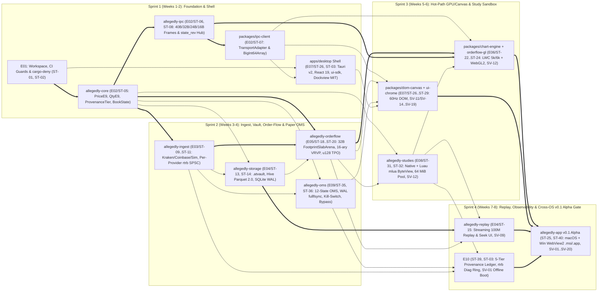

# Allegedly `v0.1` Sprint Plan (Sprints 1–4 · 8 Weeks)

> **Execution Mandate:** This plan sequences the **4 two-week Sprints (8 weeks total)** that take **Allegedly** (*"Allegedly a trading terminal."*) from Phase 3 architecture lock to an **unsigned/ad-hoc cross-platform `v0.1.0` Alpha release** (`SHA256SUMS.txt` + `THIRD_PARTY_NOTICES.md`, `updates.checkOnStartup = false`) on **macOS (Apple Silicon + Intel) and Windows 10/11** (`Apache-2.0`, `$0` core, zero paid accounts or live broker credentials). Developer ID / SignPath / Minisign signing (`ST-41`) ships in **`v0.2`**; CycloneDX/SPDX SBOMs, Cosign OIDC, reproducible builds, and `RK-04` formal trademark clearance (`ST-42`) ship in **`v1.0`**; and **Linux (`X11`/`Wayland`, `RK-01`, `ST-04`) is explicitly deferred to `Post-v1.0`** while keeping all Rust crates, WebGL2 shaders, and `TransportAdapter` portable (`[[0001-license-brand-and-platform-scope|ADR-0001]]`, `[[Assumptions]]` `A01`).
>
> **Canonical Artifacts & Cross-Links:** [[Milestones]] · [[Epics-and-Stories]] · [[v0.1-Definition-of-Done]] · [[Unverified-Claims]] · [[C4-Architecture]] · [[Data-Model]] · [[IPC-Contract]] · [[Plugin-ABI]] · [[Error-Observability]] · [[Testing-Strategy]]

---

## 1. Execution Invariants & Engineering Guardrails

Every Sprint and Kickoff Task (`T01`–`T10a`/`T10b`) enforces these non-negotiable rules from [[Constraints]], [[Principles]], [[Glossary]], and `AGENTS.md`:

1. **Canonical Naming & Zero Legacy Residue (`ADR-0001` §3.2):**
   - **9 Production Workspace Crates:** `allegedly-core`, `allegedly-ingest`, `allegedly-storage`, `allegedly-orderflow`, `allegedly-studies`, `allegedly-replay`, `allegedly-oms`, `allegedly-ipc`, `allegedly-app` (+ dev-only `allegedly-docgen`, excluded from packaged releases).
   - **Canonical Local Formats:** `.atvault` (live Zstd-3 + CRC32 tick capture), `.atdepth` (24h liquidity heatmap chunks, full UI/soak staged to `v0.5`), `.atworkspace.toml` (portable Workspace), `.atanalysis.toml` (Analysis Layer), `keymap.toml`, `theme.toml`, `template.toml`, and Hive Parquet 2.0 + SQLite WAL (`catalog.sqlite`, `paper_journal.sqlite`, `live_journal.sqlite`).
   - **Canonical Vocabulary:** Always use **`Study`** (never the retired charting synonym), **`Bar`**, **`Footprint Bar`**, **`Volume Profile`**, **`TPO Profile`**, **`DOM Ladder`**, **`Instrument`**, **`Venue`**, **`Provider`**, **`Broker`**, **`Provenance`**, **`Bracket Order`**.
   - **CI Legacy-Prefix Guard:** Merge-blocking script rejects any retired legacy crate prefix or file extension across `Cargo.toml`, `crates/**`, `apps/**`, `packages/**`, and `schemas/**`.
2. **Rust Build Cache Isolation (`AGENTS.md`, `RK-10`):**
   - Every local `cargo` command MUST set `export CARGO_TARGET_DIR=/Users/abelmora/.cache/allegedly-target` so zero `target/` artifacts ever enter `/Users/abelmora/Documents/Obsidian/Allegedly`.
   - Multi-hundred-MB test vaults/replays run strictly under `/tmp/allegedly-*-test/` with runtime path guards (`!path.contains("/Documents/Obsidian/")`) and automatic cleanup.
3. **Zero-Float Financial Core (`Constraints` #7, `SV-08`):**
   - `PriceE9(i64)`, `QtyE9(i64)`, `PriceTicks(i64)`, `LotQty(i64)`, `MoneyMicros(i128)`, `TimestampNs(i64)`, and `i128` accumulators everywhere in `allegedly-core`, `allegedly-ingest`, `allegedly-storage`, `allegedly-orderflow`, `allegedly-oms`, `allegedly-replay`, and binary IPC wire frames.
   - Only GPU/viewport projection, isolated legacy wire ingress (e.g., `v0.2` Dukascopy `.bi5`), and sandboxed `Study` DSP kernels (`allegedly-studies`) may touch IEEE-754 floats under deterministic quantization rules (`[[Plugin-ABI]]` §5).
4. **Hot-Path UI & `ui-sdk` Governance (`AGENTS.md`, `S01`, `S04`):**
   - `@ui-sdk/react` and `@ui-sdk/core` (`Apache-2.0`) are **exact-pinned to `"0.1.0-beta.17"`** (no `^` or `~`).
   - **Mandatory `pnpm` Release-Age Policy Rule (`AGENTS.md`):** Install `@ui-sdk/react` and `@ui-sdk/core` via `pnpm` **without bypassing, disabling, or weakening the release-age policy**. If a release-age policy blocks the install, **stop and ask Abel** before proceeding. Read `node_modules/@ui-sdk/react/docs/llms.txt` before use, and read `core.md` + `rendering.md` before building new components.
   - Zero React reconciliation in `60 fps` chart ticks or `30+ Hz` `DOM Ladder` / Time & Sales paths; MIT `dockview` `8.9.1` only (`dockview-enterprise` hard-blocked in CI).
5. **Execution Safety & Zero Paid Dependencies (`Constraints` #1–#3, `S06`):**
   - `live_armed = false` on boot; `allow-live-trading` Cargo feature off by default; `LocalPaperAdapter` default; `FORBIDDEN_DO_NOT_BUILD_ADAPTERS` (`9/9`) rejected at compile/load time; zero secrets cross IPC; Risk-Reduction Bypass Rule unconditionally enforced.
6. **Canonical `v0.1` vs. Staged Milestone Boundaries (`RT4-01` / `RT4-02` Lock):**
   - **Deferred to `v0.2` (explicitly out of `v0.1` Sprints 1–4):** Native pop-out `WebviewWindow` detach (`ST-30`), Databento `.dbn.zst` & Dukascopy `.bi5` offline importers (`ST-12`), Wasmtime Tier-2 WASM sandbox (`ST-33`), opt-in paper broker adapters (`ST-37`), DuckDB sidecar / `10M`-row L2 MBP Parquet (`ST-16`), and Developer ID / SignPath / Minisign signing + `tauri-plugin-updater` (`ST-41`).
   - **Canonical `SV-11`, `SV-13`, `SV-17` Staging:**
     - **`SV-11`:** `v0.1` ships honest `L2` non-MBO labeling + `[Est / Max]` DOM PIQ badge (`ST-11`, `ST-27`, `ST-39`, Sprints 2–4); **`v0.5`** adds L2 Iceberg/Pull spoofing heuristic detectors + `dwell_ms`/`conflation_guard_ms` (`ST-21`).
     - **`SV-13`:** `v0.1` Tier A verifies `FootprintSlabArena < 60 MiB` (`ST-18`, `UV-04`) + `<= 64 MiB` global `Study` pool (`ST-32`); `v0.1` Tier B verifies full OS process-tree `< 300 MB` idle RAM (`ST-40`, `UV-05`); **24h `.atdepth` heatmap (`< 64 MB` RAM / `< 30 MB` disk)** (`ST-20`, `UV-07`) is deferred to **`v0.5`** and re-certified at **`v1.0` GA**.
     - **`SV-17`:** `v0.1` ships `Volume Profile` POC/VAH/VAL + single-session `u128` `TPO Profile` magnet snap (`ST-19`, `ST-23`, `ST-24`, Sprint 3); **`v0.5`** extends to multi-day `CompositeTpoRow` (`ST-20`).

---

## 2. Crate Dependency Graph & Critical Path

The diagram below maps the build-order DAG across the **9 production Rust crates** (`allegedly-*`), the **5 TypeScript packages** (`packages/*`), and the **4 Sprints**. **Bold solid paths (`==>`)** denote the **`v0.1` Critical Path** governing minimum end-to-end delivery latency.

### Critical Path Analysis

- **Primary Critical Path (`8 weeks`, zero slack):** `E01` Workspace & CI Hygiene (`ST-01`, `ST-02`) → `allegedly-core` (`E02`/`ST-05`) → `allegedly-ingest` (`E03`/`ST-09`–`ST-10`, per-provider `rtrb` SPSC + Dispatcher) → `allegedly-orderflow` (`E05`/`ST-18`–`ST-19`, `32 B` `FootprintSlabArena` + 16-ary Dyadic VRVP) → `chart-engine` + `orderflow-gl` (`E06`/`ST-22`–`ST-23`, LWC `5,000`/`6,000` hysteresis + WebGL2 sync, fed by `STUDIES --> CHART` full-history warmup and `IPCCLI --> CHART`) → `allegedly-app` Cross-Platform `v0.1.0` Alpha Qualification (`ST-25`, `ST-40`, `macOS WKWebView` + `Windows WebView2` `.msi`/`.app`, `SV-01`–`SV-20`).
- **Mid-Flight `KC-07` Scope-Cut Checkpoint (End of Sprint 2 / Week 4):** Verify `allegedly-core`, `allegedly-ipc`, `allegedly-ingest`, `allegedly-storage`, `allegedly-orderflow`, and `allegedly-oms` are all green before entering Sprint 3; if any non-critical polish slips, cut breadth rather than compromising the 8-week vertical-slice ceiling (`[[Kill-Criteria]]` `KC-07`).
- **Early Windows `WebView2` De-Risking (Sprint 3 Week 5):** Run the initial headless Windows `WebView2` WebGL2 + IPC smoke (`UV-03` early gate, `ST-25`) on `windows-latest` in **Sprint 3 Week 5** so any `KC-01`/`KC-02` regression leaves **3 full weeks** of remediation runway before Sprint 4 tag freeze.
- **Secondary Near-Critical Path (`1 week` float):** `E01` → `apps/desktop` (`ST-26`, `ui-sdk` `"0.1.0-beta.17"` clean `pnpm` install gate) → `dom-canvas` + `ui-chrome` (`E07`/`ST-27`–`ST-29`, Canvas2D `DOM Ladder` + `SV-11`/`SV-14`–`SV-19`) → `allegedly-app` E2E & `< 300 MB` full process-tree RSS gate (`ST-40`).

---

## 3. Epic-to-Sprint Allocation Matrix (`E01`–`E10`)

| Epic ID | Epic Scope | `v0.1` Stories (`ST-*`) | Staged Stories (`v0.2`+) | Sprint 1 (W1–W2) | Sprint 2 (W3–W4) | Sprint 3 (W5–W6) | Sprint 4 (W7–W8) | Primary Crates / Packages |
|---|---|---|---|---|---|---|---|---|
| **`E01`** | Workspace, Apache-2.0 Licensing, CI Guards & Offline Boot | `ST-01`, `ST-02`, `ST-03` | `ST-04` (`Post-v1.0`) | **Primary** (`ST-01`, `ST-02`, `ST-03` init) | Maintain | Maintain | **Primary** (`ST-03` `SV-01` gate) | Root `Cargo.toml`, `deny.toml`, `package.json`, `.github/workflows/*`, `allegedly-docgen` |
| **`E02`** | Fixed-Point Domain Core & Binary IPC `v1` | `ST-05`, `ST-06`, `ST-07`, `ST-08` (core hub) | `ST-08` pop-out fanout (`v0.2`) | **Primary** (`ST-05`–`ST-08`) | Wire live streams | Wire study plots | Contract freeze | `allegedly-core`, `allegedly-ipc`, `packages/ipc-client`, `schemas/ipc-v1/` |
| **`E03`** | `$0` Live Market-Data Ingest & `BookState` FSM | `ST-09`, `ST-10`, `ST-11` | `ST-12` (`v0.2` `.dbn.zst`/`.bi5`) | Stub traits | **Primary** (`ST-09`–`ST-11`) | Diagnostics feed | **Primary** (`ST-11` 30-min soak) | `allegedly-ingest` |
| **`E04`** | `.atvault`, Hive Parquet 2.0 & Streaming Replay | `ST-13`, `ST-14`, `ST-15` | `ST-16` (`v0.2`), `ST-17` (`v0.5`) | Schema lock | **Primary** (`ST-13`, `ST-14` Vault) | History hydration | **Primary** (`ST-15` Replay UI) | `allegedly-storage`, `allegedly-replay` |
| **`E05`** | Order-Flow Engine (`FootprintSlabArena`, VP, `u128` TPO) | `ST-18`, `ST-19`, `ST-20` (`u128` `TpoRow`) | `ST-20` (`v0.5` Composite/24h `.atdepth`), `ST-21` (`v0.2`/`v0.5`) | Struct layouts | **Primary** (`ST-18`–`ST-20`) | 10-chart slab profile | 10-chart RSS proof (`ST-18`) | `allegedly-orderflow` |
| **`E06`** | LWC `v5.3` Windowed Chart, WebGL2 Order-Flow & Drawings | `ST-22`, `ST-23`, `ST-24`, `ST-25` | `ST-25` GA sign-off (`v1.0`) | Spike port prep | Canvas contracts | **Primary** (`ST-22`–`ST-24`, early W5 `ST-25`) | **Primary** (`ST-25` Win `WebView2`) | `packages/chart-engine`, `packages/orderflow-gl` |
| **`E07`** | Tauri v2 Shell, `ui-sdk`, Dockview MIT & Canvas2D DOM | `ST-26`, `ST-27`, `ST-28`, `ST-29` | `ST-30` (`v0.2` pop-out `WebviewWindow`) | **Primary** (`ST-26` Shell) | **Primary** (`ST-28` TOML) | **Primary** (`ST-26`–`ST-29` DOM/UX) | E2E `SV-02`–`SV-19` | `apps/desktop`, `packages/dom-canvas`, `packages/ui-chrome`, `allegedly-app` |
| **`E08`** | Native & Sandboxed Luau `Study` Runtime (`<= 64 MiB` Pool) | `ST-31`, `ST-32` | `ST-33` (`v0.2` Wasmtime), `ST-34` (`v0.5` DSL) | Trait & ABI lock | Full-history hooks | **Primary** (`ST-31`, `ST-32`, `SV-12`) | Cross-OS `SV-09` parity | `allegedly-studies`, `plugins/examples/` |
| **`E09`** | Fixed-Point Paper OMS, WAL & Kill-Switch | `ST-35`, `ST-36` | `ST-37` (`v0.2`), `ST-38` (`v0.5`/`v1.0`) | Type lock | **Primary** (`ST-35`, `ST-36`) | DOM ticket wiring | Reconcile E2E | `allegedly-oms` |
| **`E10`** | 5-Tier Provenance Ledger, Diagnostics & Alpha Packaging | `ST-39`, `ST-40` | `ST-41` (`v0.2` signing), `ST-42` (`v1.0` SBOM/TM) | Log ring trait | Ingest/OMS spans | Perf sparklines | **Primary** (`ST-39`, `ST-40`) | `allegedly-core`, `allegedly-app`, `packages/ui-chrome` |

---

## 4. Sprint 1–4 Detailed Execution Plan

### Sprint 1 (Weeks 1–2): Workspace Foundation, Domain/IPC Contracts & Shell Skeleton

- **Goal:** Establish a green, license-audited macOS + Windows monorepo with locked zero-float domain types, aligned `v1` binary IPC codecs, and a booting single-window Tauri v2 + React 19 + `ui-sdk` + MIT Dockview desktop skeleton.
- **Entry Criteria:** Phase 3 Architecture & Red-Team Gate `PASS` (`2026-11-25`); `04-Architecture/*`, `AGENTS.md`, and `08-Dashboards/Unverified-Claims.md` frozen as baseline.
- **Exit Criteria:**
  1. `ci-pr-fast.yml` (`ST-01`, `ST-02`) passes green on both `macos-14` and `windows-latest` (`cargo fmt`, `cargo clippy -D warnings`, `cargo deny check`, zero-float lint `SV-08`, legacy-prefix guard, npm SPDX + exact `@ui-sdk` `"0.1.0-beta.17"` pin check, `dockview-enterprise` ban).
  2. `allegedly-core` (`ST-05`) & `allegedly-ipc` (`ST-06`, `ST-08`) pass compile-time alignment assertions for all `v1` binary frames (`40 B` `LIVE_TRADE_BATCH`, `32 B` `FootprintCell` / `LIVE_FOOTPRINT_DELTA`, `24 B` header / `LIVE_L2_BOOK_BATCH` level / `VOLUME_PROFILE_SOA` bin / `u128` `TPO_PROFILE_BITMASK` row, `16 B` `STREAM_STATUS_FRAME` & book/index headers, `72 B` `LIVE_BAR_UPDATE_BATCH`) and round-trip zero-copy `BigInt64Array` decoding in `packages/ipc-client` (`ST-07`).
  3. `apps/desktop` (`ST-26`, `ST-03` async init skeleton) installs `@ui-sdk/react` and `@ui-sdk/core` (`"0.1.0-beta.17"`) via clean `pnpm install` respecting release-age policy (no bypass), boots on macOS `WKWebView` & Windows `WebView2`, renders a single-window 3-panel MIT `dockview` `8.9.1` layout, and passes `vitest` + `axe-core` baseline smoke.

| Epic ID | Stories (`ST-*`) | Deliverable & Story Sequence | Crates / Files | Parallel Track | Verification Gate |
|---|---|---|---|---|---|
| **`E01`** | `ST-01` | Initialize 9-crate Rust workspace (`allegedly-*`) + dev-only `allegedly-docgen`, `Apache-2.0` `LICENSE`, `NOTICE`, `THIRD_PARTY_NOTICES.md`, `deny.toml` (`cargo-deny v0.22.1`), `CARGO_TARGET_DIR` wrapper/env check | `Cargo.toml`, `deny.toml`, `crates/*`, `scripts/ci/` | **Rust Core** + **QA/CI** | `cargo deny check licenses advisories bans sources` |
| **`E01`** | `ST-02` | Implement merge-blocking `check-no-floats.sh` (`SV-08`), `check-no-legacy-prefix.sh` (`ADR-0001` §3.2), `check-npm-policy.mjs` (SPDX + exact `@ui-sdk` pin + `dockview-enterprise` ban), and GitHub Actions `ci-pr-fast.yml` (`macos-14`, `windows-latest`) | `scripts/ci/check-no-floats.sh`, `scripts/ci/check-no-legacy-prefix.sh`, `scripts/ci/check-npm-policy.mjs`, `.github/workflows/ci-pr-fast.yml` | **QA/CI** | Intentional negative test triggers fail-closed CI error |
| **`E02`** | `ST-05` | Implement `PriceE9(i64)`, `QtyE9(i64)`, `PriceTicks(i64)`, `LotQty(i64)`, `MoneyMicros(i128)`, `TimestampNs(i64)`, `Instrument`, `Venue`, `Session`, canonical 5-tier `ProvenanceTier` + orthogonal modifiers, canonical 5-state `BookState`, and 5-level TOML cascade structs | `crates/allegedly-core/src/{fixed.rs,domain.rs,provenance.rs,config.rs}` | **Rust Core** | Property tests (`proptest`) on exact decimal parse/overflow/rounding; `0` float tokens (`SV-08`) |
| **`E02`** | `ST-06`, `ST-07`, `ST-08` | Implement `v1` `24 B` `ALG2` header + aligned binary frame codecs (`40 B`, `32 B`, `24 B`, `16 B`, `72 B`), `16 ms` coalescing frame batcher, authoritative Rust `state_rev: u64` Workspace State Hub (`ST-08` core; multi-window pop-out fanout deferred to `v0.2`/`ST-30`), and TypeScript `TransportAdapter` (`TauriTransportAdapter` + `LoopbackWsTransportAdapter`) | `crates/allegedly-ipc/src/{framing.rs,batcher.rs,hub.rs}`, `packages/ipc-client/src/`, `schemas/ipc-v1/` | **Rust Core** + **Desktop UI** | `size_of` & offset alignment unit tests + Rust↔TS binary round-trip (`0.00 ms` JS decode, `p95 <= 16.0 ms` bulk) |
| **`E07`** | `ST-26`, `ST-03` | Scaffold single-window `apps/desktop` (Tauri v2 + Vite + React `19.3.1` + Tailwind `4.3.5` + exact-pinned `@ui-sdk/react` & `@ui-sdk/core` `"0.1.0-beta.17"` + MIT `dockview` `8.9.1`), read `node_modules/@ui-sdk/react/docs/llms.txt`, wire `WorkspaceHost` adapter + async-init `main()` skeleton (`updates.checkOnStartup = false`, `SV-01`, `SV-20`) | `apps/desktop/src-tauri/`, `apps/desktop/src/`, `packages/ui-chrome/`, `pnpm-workspace.yaml` | **Desktop UI** | Clean `pnpm install` (no release-age bypass; escalate if blocked), `tsc --noEmit`, `axe-core` smoke |

**Sprint 1 Parallel Track Split:**
- **Rust Core Track:** `E01` (`ST-01`) Cargo workspace → `E02` (`ST-05`) `allegedly-core` types → `E02` (`ST-06`, `ST-08`) `allegedly-ipc` binary framing + `state_rev` hub.
- **Desktop UI Track:** `pnpm` workspace + `ui-sdk` `"0.1.0-beta.17"` install gate (`ST-26`) → `packages/ipc-client` `TransportAdapter` (`ST-07`) → `apps/desktop` Tauri v2 + single-window MIT Dockview shell (`ST-26`, `ST-03`).
- **QA/CI Track:** `deny.toml` (`ST-01`), `check-no-floats.sh`, `check-no-legacy-prefix.sh`, `check-npm-policy.mjs`, `ci-pr-fast.yml` on `macos-14` + `windows-latest` (`ST-02`).

---

### Sprint 2 (Weeks 3–4): Live Ingest, `.atvault` Storage, Order-Flow Core & Paper OMS (`KC-07` Checkpoint)

- **Goal:** Deliver the complete `$0` real-time data pipeline (`allegedly-ingest` → single-threaded Dispatcher → `allegedly-orderflow` + `allegedly-storage`) and the crash-safe, fixed-point Paper OMS (`allegedly-oms`) with fail-closed `BookState::Stale` and Risk-Reduction Bypass enforcement. *(Note: Databento `.dbn.zst` and Dukascopy `.bi5` offline importers (`ST-12`) are deferred to `v0.2`.)*
- **Entry Criteria:** Sprint 1 exit gates green; `allegedly-core` (`ST-05`) & `allegedly-ipc` (`ST-06`–`ST-08`) `v1` binary codecs frozen.
- **Exit Criteria:**
  1. `allegedly-ingest` (`ST-09`, `ST-10`, `ST-11`) runs Kraken WS v2 (CRC32 verified), Coinbase Advanced Trade WS (monotonic `sequence_num` + mandatory maker→taker side inversion), and deterministic Synthetic Sim over strictly isolated **per-provider `rtrb` SPSC rings (`cap = 16,384`)** drained by a single-threaded Core Event Dispatcher into a dedicated `StorageRing`, passing all loopback fault-injection tests (`7.41 ms`-class gap resync, TCP drop backoff, backpressure drop → immediate `BookState::Stale`) and honest L2 non-MBO capability tagging (`SV-10`, `SV-11`).
  2. `allegedly-storage` (`ST-13`, `ST-14`) records crash-safe `.atvault` (`ALGDTV01`/`TVEND001`, Zstd-3 + `CRC32`, `72 B` `NormalizedTick`), compacts atomically to Hive Parquet 2.0 (`DELTA_BINARY_PACKED` + Zstd-3, `catalog.sqlite` WAL), and passes 2-stage row-group pruning (`<= 100 ms` cold seek).
  3. `allegedly-orderflow` (`ST-18`, `ST-19`, `ST-20`) computes flat contiguous `32 B` `FootprintCell` `FootprintSlabArena`, `16`-ary Dyadic Segment Tree VRVP (`100%` brute-force integer parity, `p99 < 250 µs`, `SV-12`, exact `i64` POC/VAH/VAL `SV-17`), and single-session `u128` `TpoRow` (`96`-bracket 15m 24h coverage; multi-day `CompositeTpoRow` & 24h `.atdepth` heatmap soak deferred to `v0.5`).
  4. `allegedly-oms` (`ST-35`, `ST-36`) passes canonical 12-state `OrderState` invariants, UUIDv7 idempotency, `Bracket Order` OCO partial fills, `500`-order WAL crash recovery (`0` duplicates across `54` wire-mock faults), `FORBIDDEN_DO_NOT_BUILD_ADAPTERS` (`9/9`), Risk-Reduction Bypass Rule, `keyring-rs v4.2.0 (keyring-core)` zero-leak tests, and the dedicated **macOS APFS `PRAGMA fullfsync = ON` batched 50-order Kill-Switch benchmark** (`<= 15 ms` target, `<= 25 ms` CI ceiling, `UV-02`).
  5. **`KC-07` End-of-Sprint-2 (Week 4) Checkpoint:** All core Rust vertical-slice crates build and pass CI on macOS and Windows MSVC (`UV-03` early compile gate); any lagging non-critical breadth is cut before Sprint 3 starts.

| Epic ID | Stories (`ST-*`) | Deliverable & Story Sequence | Crates / Files | Parallel Track | Verification Gate |
|---|---|---|---|---|---|
| **`E03`** | `ST-09`, `ST-11` | Implement `DataProvider` trait, Kraken WS v2 adapter (CRC32 top-10 + direct taker side), Coinbase AdvTrade WS adapter (monotonic `sequence_num` + mandatory maker→taker inversion stamped `ExchangeReportedInverted`), Synthetic Sim generator, Lee-Ready / Tick-Rule fallback classifier (`SV-10`), and honest L2 non-MBO capability flags (`SV-11`) | `crates/allegedly-ingest/src/{provider.rs,kraken.rs,coinbase.rs,sim.rs,classifier.rs}` | **Rust Core** | Unit + loopback WS fault-injection harness (`0` silent corruptions, `< 2 s` resync) |
| **`E03`** | `ST-10` | Implement strict per-provider `rtrb` SPSC rings (`cap = 16,384`) → single-threaded Core Event Dispatcher → inline order-flow update + dedicated `StorageRing`, emitting immediate `16 B` `0x0201` `STREAM_STATUS_FRAME` on `BookState::Stale` | `crates/allegedly-ingest/src/{dispatcher.rs,orderbook.rs,resilience.rs}` | **Rust Core** | `>= 250k ticks/s` synthetic SPSC bench (`p99 <= 500 µs`); saturation test forces `BookState::Stale` (`KC-05`) |
| **`E04`** | `ST-13`, `ST-14` | Implement `.atvault` Zstd-3 + `CRC32` segment recorder (`1M` ticks / `15 MiB` / `1h` rotation), atomic Hive Parquet 2.0 compactor (`200k` row groups, `DELTA_BINARY_PACKED` + Zstd-3), SQLite WAL `catalog.sqlite`, and 2-stage row-group pruning reader *(note: `.dbn.zst` / `.bi5` importers `ST-12` deferred to `v0.2`)* | `crates/allegedly-storage/src/{atvault.rs,parquet_vault.rs,catalog.rs}` | **Rust Core** | `.atvault` → Parquet round-trip `0` lost ticks (`<= 5 B/tick`); cold seek `p99 <= 100 ms`; `/tmp/` vault path guard |
| **`E05`** | `ST-18`, `ST-19`, `ST-20` | Implement flat contiguous `FootprintSlabArena` (`#[repr(C)]` `32 B` `FootprintCell`, `64 B` `FootprintBarHeader`), `i128` diagonal imbalances & `70%` Steidlmayer Volume Profile, `16`-ary Dyadic Segment Tree VRVP (`SV-12`, `SV-17`), and single-session `u128` `TpoRow` *(multi-day `CompositeTpoRow` & 24h `.atdepth` heatmap soak deferred to `v0.5`)* | `crates/allegedly-orderflow/src/{footprint.rs,slab.rs,vrvp.rs,tpo.rs}` | **Rust Core** | `10,000` random VRVP ranges `100%` exact parity (`p99 < 250 µs`, `SV-12`); `size_of::<FootprintCell>() == 32`; `u128` `TpoRow` `96`-bracket 15m 24h test |
| **`E09`** | `ST-35`, `ST-36` | Implement canonical 12-state `OrderState` machine, SQLite WAL `paper_journal.sqlite` / `live_journal.sqlite` (mandatory macOS `PRAGMA fullfsync = ON` for `BrokerLive` with batched Kill-Switch commits), `LocalPaperAdapter`, `Bracket Order` OCO, Risk-Reduction Bypass Rule, `keyring-rs v4.2.0 (keyring-core)` + `zeroize` secret redaction, and `FORBIDDEN_DO_NOT_BUILD_ADAPTERS` (`9/9`) | `crates/allegedly-oms/src/{state.rs,journal.rs,risk.rs,kill_switch.rs,paper.rs,credentials.rs}` | **Rust Core** + **QA/CI** | `54`-fault `axum` wire-mock (`0` dupes), `500`-order WAL crash recovery, `S06-T6` canary secret leak check, **macOS APFS `fullfsync` 50-order Kill-Switch bench (`UV-02`)** |
| **`E07`** | `ST-28` | Wire `.atworkspace.toml` / `.atanalysis.toml` / `template.toml` sorted-key `BTreeMap` serializers (`SV-06`), 5-level cascade override resolver (`SV-07`), and `TransportAdapter` live stream subscriptions in `apps/desktop` | `packages/ipc-client/`, `packages/ui-chrome/src/settings/` | **Desktop UI** | Deterministic `SHA-256` TOML round-trip + `<= 3`-line single-param diff (`SV-06`, `SV-07`) |

**Sprint 2 Parallel Track Split:**
- **Rust Core Track:** Stream A (`E03` `ST-09`–`ST-11` ingest + Dispatcher + `E05` `ST-18`–`ST-20` order-flow); Stream B (`E04` `ST-13`–`ST-14` `.atvault`/Parquet + `E09` `ST-35`–`ST-36` Paper OMS & WAL).
- **Desktop UI Track:** Settings-as-Code TOML serializers (`ST-28`, `SV-06`, `SV-07`), 5-level cascade UI state store, binary frame consumer mocks for Sprint 3 chart/DOM integration.
- **QA/CI Track:** Loopback WS fault harness, `axum` broker wire-mock, macOS APFS `PRAGMA fullfsync = ON` Kill-Switch benchmark (`UV-02`), `ci-bundle-mac-win.yml` early Windows MSVC compile check.

---

### Sprint 3 (Weeks 5–6): Hot-Path Rendering, Sandboxed Luau Study Runtime & Early Windows Smoke

- **Goal:** Connect the Rust core to `60 fps` hot-path visualization (LWC `v5.3` + `5,000`/`6,000`-bar hysteresis + WebGL2 Order-Flow + Canvas2D `DOM Ladder` & Time & Sales), deliver the sandboxed `Study` runtime (`allegedly-studies`) with cross-OS IEEE-754/`libm` determinism and `<= 64 MiB` global memory pooling (`SV-12`), and execute the **early Windows `WebView2` headless WebGL2/IPC smoke in Week 5** (`UV-03`) to preserve 3 weeks of `KC-01`/`KC-02` remediation runway. *(Note: Native pop-out `WebviewWindow` detach `ST-30` is deferred to `v0.2`.)*
- **Entry Criteria:** Sprint 2 exit gates & `KC-07` Week 4 checkpoint green; live synthetic + Kraken/Coinbase streams emitting binary `v1` frames; `FootprintSlabArena`, Dyadic VRVP, and Paper OMS verified.
- **Exit Criteria:**
  1. LWC `v5.3.0` (`ST-22`) renders `5,000`-bar active window (`6,000`-bar idle-trim hysteresis) fed by full-history Rust `Study` warmup (`STUDIES --> CHART`), synchronized via `ISeriesPrimitive` (`useBitmapCoordinateSpace`) with raw WebGL2 instanced Footprint / Volume Profile / single-session `u128` TPO (`ST-23`, `<= 0.5 CSS px` drift, `>= 55 fps` CI / `60 fps` `P99 <= 16.6 ms` target `SV-12`, `0` stalls `> 33 ms`, `webglcontextlost` Canvas2D fallback verified).
  2. Canvas2D `DOM Ladder` & Time & Sales (`ST-27`) sustain `60 Hz` (`0.00 ms` Layout/RecalcStyle, `0` React commits `SV-14`, honest L2 non-MBO + `[Est / Max]` PIQ badge `SV-11`, ARIA summary region); `1,000` unmodified price-axis drag gestures emit `0` OMS orders (`ST-29`, `SV-15`); `Cmd/Ctrl+Z` isolates Drawings/Studies from working Orders (`ST-29`, `SV-16`); and Volume Profile + single-session `u128` `TPO Profile` magnet snaps to exact `i64` tick (`ST-24`, `SV-17`). Single-window MIT `dockview` `8.9.1` chrome (`ST-26`, `ST-28`) passes `SV-02`–`SV-05`, `SV-18`, `SV-19` and 20-cycle leak audit.
  3. `allegedly-studies` (`ST-31`, `ST-32`) executes Tier-1 Native `O(1)` built-ins (`EMA`, `SMA`, `RSI`, `ATR`, `MACD`, `Bollinger`, `Session VWAP`, `CVD`) + sandboxed Luau (`mlua v0.12.3` + `luau0-src`) over flat SoA `ByteView` buffers under the `<= 64 MiB` global terminal-wide `Study` memory pool (with background-tab LRU eviction, `SV-13`), passes `12/12` hostile trap vectors (`0` escapes, `SV-12`, `KC-06`), compiles cleanly on Windows MSVC (`luau0-src` C++17), and matches cross-OS IEEE-754/`libm` determinism (`0.000e0` diff) + `TA-Lib v0.8.3` dev-only CI oracle (`<= 1e-9`).
  4. **Week 5 Early Windows `WebView2` Smoke (`UV-03`, `ST-25`):** `ci-nightly.yml` executes headless `WebView2` WebGL2 + IPC smoke on `windows-latest` in **Sprint 3 Week 5** (`>= 55 fps`, `<= 0.5 CSS px` drift, `p95 <= 16.0 ms` bulk IPC), leaving 3 weeks before Sprint 4 tag freeze for any `KC-01`/`KC-02` mitigation.

| Epic ID | Stories (`ST-*`) | Deliverable & Story Sequence | Crates / Files | Parallel Track | Verification Gate |
|---|---|---|---|---|---|
| **`E06`** | `ST-22` | Build `ChartViewportController` (`5,000`-bar sliding window, `6,000`-bar idle-trim hysteresis, prefetch) over `Lightweight Charts v5.3.0`, coupled via `packages/ipc-client` (`IPCCLI --> CHART`) and full-history Rust `Study` warmup (`STUDIES --> CHART`) before window slicing (`SV-12`) | `packages/chart-engine/src/{viewport.ts,lwc-host.ts}`, `crates/allegedly-ipc/src/viewport.rs` | **Desktop UI** + **Rust Core** | `60.0 fps` (`P99 <= 16.6 ms`, `SV-12`) @ `60 Hz` tick burst (`0` stalls `> 33 ms`, `0` React commits) |
| **`E06`** | `ST-23`, `ST-24` | Build `ISeriesPrimitive` sync hook (`useBitmapCoordinateSpace`) + raw WebGL2 instanced renderer for Footprint cells, Volume Profile histograms, and single-session `u128` TPO brackets + DPR bitmap glyph atlas + `webglcontextlost` Canvas2D fallback; build 6 clean-room `Drawing` tools + `SV-17` exact `i64` Volume Profile & single-session `u128` `TPO Profile` POC/VAH/VAL magnet snap | `packages/orderflow-gl/src/{primitive.ts,gl-renderer.ts,glyph-atlas.ts,fallback-2d.ts}`, `packages/chart-engine/src/{drawings/,magnet.ts}` | **Desktop UI** | `<= 0.5 CSS px` drift (`0.000 px` target), draw `p95 <= 4.0 ms` (`SV-12`); `0` sub-tick float error (`SV-17`) |
| **`E07`** | `ST-27`, `ST-29` | Build dedicated Canvas2D `DOM Ladder` (21 columns, click-to-trade arming, honest L2 non-MBO + `[Est / Max]` PIQ badge `SV-11`, ARIA summary region, fed via `IPCCLI --> DOMUI`) & Time & Sales at `60 Hz` (`SV-14`), plus `SV-15` unmodified price-axis zoom guard and `SV-16` split Undo/Redo stacks | `packages/dom-canvas/src/{dom-ladder.ts,tape.ts,aria-bridge.ts}`, `packages/chart-engine/src/axis-guard.ts` | **Desktop UI** | `0.00 ms` Layout/Style, `0` React commits (`SV-14`); `SV-11` PIQ badge; `1,000` drag `0` orders (`SV-15`); `SV-16` E2E |
| **`E07`** | `ST-26`, `ST-28` | Build `ui-sdk` non-hot-path chrome (`Cmd/Ctrl+K` Command Palette `SV-02`, non-blocking `320 px` 4-tab Right Inspector `SV-03`, Tier-1 micro-toolbar `<= 5` controls / `<= 36 px` `SV-04`, `>= 90%` canvas ratio `SV-05`, `keymap.toml` `SV-18`, WCAG AA / `Okabe-Ito` `SV-19`) over single-window MIT `dockview` `8.9.1` *(native pop-out `WebviewWindow` `ST-30` deferred to `v0.2`)* | `packages/ui-chrome/src/{palette/,inspector/,toolbar/,keymap/}` | **Desktop UI** | `axe-core` + `vitest` (`SV-02`–`SV-05`, `SV-18`, `SV-19`); `20`-cycle Dockview leak `< +2 MB`, `0` DOM leaks |
| **`E08`** | `ST-31`, `ST-32` | Implement `allegedly-studies`: Tier-1 Native `O(1)` built-ins, flat SoA `ByteView` ABI, sandboxed Luau (`mlua v0.12.3` + `luau0-src`, `sandbox(true)`, `10k`-op interrupt, `16–32 MiB` per-instance cap), global `<= 64 MiB` terminal-wide `Study` memory pool + background-tab LRU eviction (`SV-13`), pure-software `libm`, `round_ties_even()` quantization, and MTF non-repainting (`commit_snapshot`/`rollback`) | `crates/allegedly-studies/src/{abi.rs,native/,luau.rs,pool.rs,mtf.rs,determinism.rs}` | **Rust Core** | **`SV-12`** & `KC-06`: `12/12` hostile sandbox traps (`0` escapes); `10`-study tick `p99 <= 1,000 µs`; cross-OS IEEE-754/`libm` `0` mismatches; `TA-Lib v0.8.3` dev-only oracle `<= 1e-9`; `luau0-src` MSVC build green |
| **`E06`** | `ST-25` *(Early W5)* | Pull initial **Windows `WebView2` headless WebGL2/IPC smoke (`UV-03` early gate)** into **Sprint 3 Week 5** (`ci-nightly.yml` on `windows-latest`) + initial 10-chart `FootprintSlabArena` RSS profile (`UV-04`) | `.github/workflows/ci-nightly.yml`, `crates/allegedly-orderflow/tests/slab_arena_10chart_rss.rs` | **QA/CI** | Week 5 `windows-latest` WebGL2 `>= 55 fps` & IPC `p95 <= 16.0 ms`; `FootprintSlabArena < 60 MiB` (`SV-13` Tier A) |

**Sprint 3 Parallel Track Split:**
- **Rust Core Track:** `E08` (`ST-31`, `ST-32`) `allegedly-studies` (Native + Luau `ByteView` + `<= 64 MiB` pool + `libm` determinism + MTF) + `allegedly-ipc` `5,000`-bar viewport controller (`ST-22`).
- **Desktop UI Track:** Stream A (`E06` `ST-22`–`ST-24` LWC + WebGL2 instanced renderer + Drawings/magnet snap); Stream B (`E07` `ST-26`–`ST-29` Canvas2D `DOM Ladder` + `ui-sdk` Inspector/Cmd+K/single-window Dockview).
- **QA/CI Track:** **Sprint 3 Week 5 early `windows-latest` `WebView2` WebGL2/IPC smoke (`UV-03`, `ST-25`)**, headless sync-drift & `0`-React-commit harness, `SV-02`–`SV-19` Playwright/`axe-core` suite, `TA-Lib v0.8.3` dev-only CI parity job, initial 10-chart `FootprintSlabArena` RSS profile (`UV-04`).

---

### Sprint 4 (Weeks 7–8): Streaming Replay, Observability, `SV-01`–`SV-20` Hardening & Cross-Platform `v0.1.0` Alpha Qualification

- **Goal:** Complete deterministic `100M`-tick streaming replay (`E04`/`ST-15`), Active 5-Tier Provenance Ledger & zero-telemetry diagnostics (`E10`/`ST-39`), resolve every `v0.1`-gated `UNVERIFIED` item on both **macOS (`WKWebView`)** and **Windows 10/11 (`WebView2`)**, and cut the **unsigned/ad-hoc cross-platform `v0.1.0` Alpha candidate** (`SHA256SUMS.txt` + `THIRD_PARTY_NOTICES.md`, `updates.checkOnStartup = false`). *(Developer ID / SignPath / Minisign signing `ST-41` ships in `v0.2`; SBOMs / Cosign OIDC / reproducible builds / `RK-04` trademark clearance `ST-42` ship in `v1.0`.)*
- **Entry Criteria:** Sprint 3 exit gates & Week 5 early Windows `WebView2` smoke green; hot-path chart, WebGL2, Canvas2D DOM, Paper OMS, and Luau `Study` runtime integrated end-to-end.
- **Exit Criteria:**
  1. `allegedly-replay` (`ST-15`) streams `100M`-tick Hive Parquet partitions (`1×`, `50×`, max-CPU batch) with `<= 100 ms` cold seek, conservative L2 queue-position fills, and bit-identical cross-OS `SHA-256` digests on `macos-14` (`arm64`), Intel macOS, and `windows-latest` (`SV-09`).
  2. `E10` (`ST-39`) Active 5-Tier Provenance Ledger, non-dismissible badges (`SV-10`, honest `L2` non-MBO + `[Est / Max]` PIQ `SV-11`; spoofing/iceberg detectors staged to `v0.5`/`ST-21`), `rtrb` (`8,192`-entry) diagnostics ring, `<= 50 MiB` rotating JSONL logs, 3-layer secret redaction, and one-click Redacted Diagnostic `.zip` export pass all assertions; isolated-namespace offline boot emits **`0` outbound packets** (`updates.checkOnStartup = false`, `ST-03`, `SV-01`).
  3. Packaged unsigned/ad-hoc macOS `.app`/`.dmg` and Windows `.msi` (`WebView2` `embedBootstrapper`, `ST-40`) pass **`< 40 MB` installer size** (`SV-20`), **`< 2.0 s` packaged/ad-hoc cold start** with async hydration (`SV-01`, `SV-20`, `UV-05`), **`< 300 MB` full OS process-tree idle RAM** (`SV-13` Tier B, `UV-05`), **10-chart `FootprintSlabArena < 60 MiB` RSS proof** (`SV-13` Tier A, `UV-04`), **`SV-12`** cross-OS WebGL2/VRVP/Study bounds (`ST-25`), and **30-minute unattended peak-volatility live soak** (`ST-11`, `UV-06`: `>= 1,000` trades/venue, `0` CRC32/seq/drop faults, RSS `< 60 MB`). *(Note: 24h `.atdepth` heatmap `< 64 MB` RAM / `< 30 MB` disk is deferred to `v0.5` and re-certified at `v1.0` GA.)*
  4. All 20 Sovereignty Checklist gates (`SV-01`–`SV-20`, respecting canonical `v0.1` vs `v0.5`/`v1.0` staging for `SV-11`, `SV-13`, `SV-17`) and Kill Criteria (`KC-01`–`KC-07`) pass per [[v0.1-Definition-of-Done]].

| Epic ID | Stories (`ST-*`) | Deliverable & Story Sequence | Crates / Files | Parallel Track | Verification Gate |
|---|---|---|---|---|---|
| **`E04`** | `ST-15` | Implement `allegedly-replay` deterministic streaming controller (`1×`/`50×`/batch), `ReplayRunManifest` SHA-256 hash pinning, conservative L2 queue-position fill engine, and seek/transport bar UI (`<= 100 ms` cold seek) | `crates/allegedly-replay/src/{engine.rs,queue_fill.rs,manifest.rs}`, `packages/ui-chrome/src/replay/` | **Rust Core** + **Desktop UI** | Cross-OS `5M`-tick `SHA-256` bit-identity (`SV-09`); `100M`-tick streaming `<= 200 MB` RSS & cold seek `p99 <= 100 ms` |
| **`E10`** | `ST-39` | Implement Active 5-Tier Provenance Ledger (`EXACT: L3-MBO`..`SYNTHETIC: 1m-INTRABAR` + `PartialVenue`/`OtcIndicative`/`Delayed` + honest `L2` non-MBO & `[Est / Max]` PIQ disclosures; `v0.5` `ST-21` adds Iceberg/Pull detectors), non-dismissible badges (`SV-10`, `SV-11`), lock-free `rtrb` (`8,192`) diagnostics ring, `<= 50 MiB` rotating JSONL sink, 3-layer `RedactingLayer`, and one-click Redacted Diagnostic `.zip` exporter | `crates/allegedly-core/src/diagnostics.rs`, `apps/desktop/src-tauri/src/{diagnostics.rs,export_zip.rs}`, `packages/ui-chrome/src/diagnostics/` | **Rust Core** + **Desktop UI** | Canary secret leak test (`0` hits in logs/WAL/`.zip`/IPC); `SV-10`/`SV-11` E2E; `4 Hz` diagnostics poll with `0` chart frame regression |
| **`E01` / `E10`** | `ST-03`, `ST-40` | Implement OS-specific full process-tree RSS attribution (`proc_pidinfo` + WebKit XPC grouping on macOS; Job Object / parent-PID aggregation on Windows), enforce `updates.checkOnStartup = false` (`SV-01`), complete async lazy vault hydration off `main()` (`SV-20`), and attach `SHA256SUMS.txt` + `THIRD_PARTY_NOTICES.md` for unsigned/ad-hoc `v0.1.0` Alpha | `apps/desktop/src-tauri/src/{main.rs,mem_tree.rs,updater.rs}` | **Rust Core** | `SV-01` zero-network offline boot (`0` packets, `< 2.0 s`); full OS process-tree idle RAM `< 300 MB` (`SV-13` Tier B) |
| **`E03` / `E05` / `E06` / `E10`** | `ST-11`, `ST-18`, `ST-25`, `ST-40` | Execute full `v0.1.0` Alpha Cross-Platform Qualification Suite: `ci-bundle-mac-win.yml` (unsigned/ad-hoc `.app`/`.dmg` + `.msi` `< 40 MB`), `ci-nightly.yml` (`macos-14` + `windows-latest` `WebView2` E2E `SV-12` + 10-chart `FootprintSlabArena < 60 MiB` RSS `SV-13` Tier A), and `ci-pre-release-soak.yml` (30-min peak-volatility Kraken + Coinbase live soak `ST-11`) | `.github/workflows/{ci-bundle-mac-win.yml,ci-nightly.yml,ci-pre-release-soak.yml}` | **QA/CI** | **All 20 `SV-01`–`SV-20` gates green** (per canonical `v0.1` staging) on macOS & Windows; installer `< 40 MB` (`SV-20`); 30-min soak `PASS` (`UV-06`) |

**Sprint 4 Parallel Track Split:**
- **Rust Core Track:** `E04` (`ST-15`) `allegedly-replay` streaming engine + `E10`/`E01` (`ST-39`, `ST-03`, `ST-40`) `rtrb` diagnostics ring, `RedactingLayer`, OS process-tree RSS attribution, async cold-start optimization.
- **Desktop UI Track:** Replay transport & seek bar (`ST-15`), Active 5-Tier Provenance Ledger & Live Operational Diagnostics panel (`ST-39`, `4 Hz`), `SV-01`–`SV-20` UX polish.
- **QA/CI Track:** `ci-bundle-mac-win.yml`, `ci-nightly.yml`, `ci-pre-release-soak.yml`, Windows `WebView2` packaged `.msi` verification (`ST-25`, `ST-40`), 10-chart `FootprintSlabArena` profiler (`ST-18`), 30-min peak-volatility live soak (`ST-11`).

---

## 5. Dedicated `UNVERIFIED` Validation Schedule

Every item from [[Unverified-Claims]] (all 10 post-Phase-3 entries) plus the supplementary targets from [[Testing-Strategy]] §5 is mapped below to its exact sprint/milestone, verification harness, pass threshold, and concrete fallback plan.

| ID | `UNVERIFIED` Item (Source) | Target Sprint / Milestone | Exact Test Command / Verification Harness | Pass Threshold | Fallback / Mitigation Plan |
|---|---|---|---|---|---|
| **`UV-01`** | **`@ui-sdk/react` & `@ui-sdk/core` (`0.1.0-beta.17`)** React 19 compile stability, WAI-ARIA keyboard/focus compliance & `pnpm` release-age policy install check (`[[0010-ui-kit-docking-and-settings-as-code|ADR-0010]]`, `[[License-Registry]]`, `AGENTS.md`, `ST-26`) | **Sprint 1** (Task `T04`) | Clean `pnpm install` (**without bypassing or disabling `pnpm` release-age policy**); read `node_modules/@ui-sdk/react/docs/llms.txt`; `pnpm --filter @allegedly/desktop typecheck && pnpm test:a11y` (`vitest` + Testing Library + `axe-core`) | `0` install policy violations; `0` TS/React 19 errors; `0` critical/serious `axe-core` violations; exact pin `"0.1.0-beta.17"` verified | **Per `AGENTS.md`: if `pnpm` release-age policy blocks install, STOP immediately and ask Abel rather than changing the policy.** If React 19 / a11y blocker emerges in `beta.17`, isolate behind `packages/ui-chrome/primitives/` adapter seam (`shadcn/ui + Radix` fallback) |
| **`UV-02`** | **macOS APFS `PRAGMA fullfsync = ON` batched 50-order Kill-Switch WAL latency** (`[[Data-Model]]`, `[[0009-oms-broker-and-prop-firm-strategy|ADR-0009]]`, `[[Testing-Strategy]]`, `ST-36`) | **Sprint 2** (Task `T10b`) | `CARGO_TARGET_DIR=/Users/abelmora/.cache/allegedly-target cargo test --release -p allegedly-oms --test apfs_fullfsync_kill_switch_bench -- --nocapture` (single-transaction batched WAL commit for 50-order cancel wave under `PRAGMA fullfsync = ON`) | **`<= 15 ms` p50 target** (`<= 25 ms` hard CI ceiling on Apple APFS); `0` stray working orders; `100%` crash recovery | Keep single-transaction batching (1 `F_FULLFSYNC` per cancel wave instead of 50); if APFS hardware variance exceeds `15 ms`, pre-warm WAL file preallocation (`SQLITE_FCNTL_CHUNK_SIZE`) and decouple non-critical audit telemetry from the synchronous kill-switch transaction |
| **`UV-03`** | **Windows 10/11 (`WebView2` + `x86_64-pc-windows-msvc`)** live WebGL2 frame times, binary IPC throughput, `luau0-src` C++17 MSVC build & packaged `.msi` `< 40 MB` *(note: multi-window pop-out RTT `ST-30` deferred to `v0.2`)* (`[[S01-Chart-WebGL-Sync]]`–`[[S04-CSS-Layout-Perf]]`, `[[0002-desktop-shell-and-binary-ipc|ADR-0002]]`, `ST-25`, `ST-32`, `ST-40`) | **Sprint 2** (MSVC build) · **Sprint 3 Week 5** (early headless `WebView2` WebGL2/IPC smoke + `luau0-src`) · **Sprint 4** (packaged `.msi` gate) | GitHub Actions `windows-latest` running `ci-pr-fast.yml`, `ci-bundle-mac-win.yml`, and `ci-nightly.yml` (`tauri-driver` + `WebView2` `S01`/`S02`/`S04` harnesses + `.msi` size check) | WebGL2 `>= 55 fps` (`0` stalls `> 33 ms`, `<= 0.5 CSS px` drift, `SV-12`); IPC `100k` load `p95 <= 16.0 ms` & stream `>= 20k msgs/s`; `luau0-src` MSVC clean build; `.msi < 40 MB` (incl. `embedBootstrapper`, `SV-20`) | Early Week 5 gate preserves **3 weeks of remediation runway**: if `WebView2` ANGLE D3D11 shows WebGL2 sync jitter, enable `LoopbackWsTransportAdapter` diagnostic toggle and fall back to decimated Canvas2D Footprint overlay; if `luau0-src` MSVC flags fail, pin explicit C++17 `/std:c++17` in `build.rs` or stage Luau behind feature flag while keeping Native Studies live |
| **`UV-04`** | **`FootprintSlabArena` live RSS footprint across 10 concurrent multi-timeframe charts** within `< 300 MB` idle budget (`[[Data-Model]]`, `[[0004-orderflow-gpu-and-hotpath-renderer|ADR-0004]]`, `ST-18`, `SV-13` Tier A) | **Sprint 3** (initial profile) · **Sprint 4** (final 10-chart soak) | `CARGO_TARGET_DIR=/Users/abelmora/.cache/allegedly-target cargo test --release -p allegedly-orderflow --test slab_arena_10chart_rss -- --nocapture` + packaged Tauri 10-chart soak RSS profiler (`SV-13`) | `FootprintSlabArena` **`< 60 MiB`** for `100k` bars (vs `260.77 MiB` `S08` per-bar `Vec` baseline); 10-chart terminal RSS within `< 300 MB` budget | Evict off-viewport historical Footprint slabs to cold `.atvault`/Parquet with on-demand `5,000`-bar window hydration (`5.22 ms` cold seek proven in `S08`) and compact inactive tabs |
| **`UV-05`** | **Full OS process-tree idle RAM `< 300 MB`** (`SV-13` Tier B: macOS `launchd`-parented `WKWebView` XPC helpers + Windows `msedgewebview2.exe` child processes) & **packaged/ad-hoc lazy-init cold start `< 2.0 s`** (`SV-01`, `SV-20`; signed Developer ID/SignPath re-verified in `v0.2` `ST-41`) (`[[0002-desktop-shell-and-binary-ipc|ADR-0002]]`, `[[C4-Architecture]]`, `ST-03`, `ST-40`) | **Sprint 3** (async init) · **Sprint 4** (packaged `.app` / `.msi` gate) | Packaged `.app` (macOS `proc_pidinfo` + WebKit XPC tree script) and `.msi` (Windows Job Object tree script) in `ci-nightly.yml` + `SV-01` offline-boot cold-start harness (`10` cold runs) | Full process-tree idle RAM (1 Chart + 1 DOM) **`< 300 MB`** (`SV-13` Tier B); cold start to interactive first frame **`p95 < 2.0 s`** (`0` outbound packets, `SV-01`/`SV-20`) | Move all non-essential catalog scans, study compilation, and secondary panel hydration onto post-first-paint background tasks; cap WebGL2 context count via pane pooling and trim `5,000`-bar initial window to `1,000` bars on boot with progressive backfill |
| **`UV-06`** | **30-minute unattended peak-volatility live dual-venue soak** (`SOL/USD`, `BTC/USD`, `ETH/USD`, `depth=100`, `>= 1,000` trades/venue, `ST-11`) + **real user-downloaded Databento `.dbn.zst` CME sample** (`ST-12`, deferred to `v0.2`) (`[[S05-Live-Ingest-TickVault]]`, `[[Testing-Strategy]]`) | **Sprint 4** (30-min soak `v0.1` release gate) · **`v0.2` Human Opt-In (`ST-12`)** for `.dbn.zst` | `ci-pre-release-soak.yml` during US session (`13:30–16:00 UTC`): `cargo run --release -p allegedly-ingest --bin live_soak -- --duration-secs 1800 --depth 100 --pairs BTC/USD,ETH/USD,SOL/USD`; `v0.2` human CLI check `allegedly-storage verify-dbn <user-file.dbn.zst>` | `>= 1,000` live trades/venue; `0` Kraken CRC32 mismatches; `0` unrecovered Coinbase `sequence_num` gaps; `0` parse errors; `0` channel drops; RSS `< 60 MB` flat slope | Tune per-provider `rtrb` ring capacity (`16,384` → `32,768`) and coalesced L2 flush batching; if exchange maintenance interrupts a scheduled soak, verify fail-closed `BookState::Stale` → `< 2 s` clean resync and re-run soak window |
| **`UV-07`** | **`TA-Lib v0.8.3` (`BSD-3-Clause`) dev-only C oracle parity** (`ST-31`, Sprint 3) + **`10M`-row L2 MBP delta Parquet archive** (`ST-16`, `v0.2`) & **24h `.atdepth` heatmap bound** (`< 64 MB` RAM / `< 30 MB` disk, `ST-20`, deferred to `v0.5` & re-certified at `v1.0` GA) (`[[S07-Scripting-Sandbox]]`, `[[S08-Storage-100M-Replay]]`, `[[Testing-Strategy]]`) | **Sprint 3** (`TA-Lib`) · **`v0.2`** (`10M` L2 MBP) · **`v0.5` / `v1.0` GA** (24h `.atdepth` heatmap `SV-13`) | Dev-only CI job `cargo test --release -p allegedly-studies --features dev-talib-oracle` (excluded from release); `v0.2`: `cargo test --release -p allegedly-storage --test l2_mbp_10m_bench`; `v0.5`: `cargo test --release -p allegedly-orderflow --test heatmap_24h_bound` | `TA-Lib` diff `<= 1e-9` across `EMA`/`SMA`/`RSI`/`ATR`/`MACD`/`BB`; `v0.2` L2 seek `<= 100 ms`; `v0.5`/`v1.0` 24h heatmap (`864k` slices) `< 64 MB` RAM & `< 30 MB` `.atdepth` disk | If `TA-Lib` C build flakes on Windows MSVC, run oracle parity on `macos-14` against checked-in golden CSV/Parquet fixtures generated from `TA-Lib v0.8.3`; if `v0.5` 24h heatmap RAM nears `64 MB`, tighten delta-compression quantization or reduce default retained depth levels (`200` → `100`) |
| **`UV-08`** | **Optional `wasmtime::component` (WIT) binary size delta & batch call overhead** + **Wasmtime `.cwasm` warm disk-cache deserialize (`< 1 ms`)** (`[[Plugin-ABI]]`, `[[0005-study-runtime-and-scripting-language|ADR-0005]]`, `[[Testing-Strategy]]`, `ST-33`) | **`v0.2`** (Explicitly deferred out of `v0.1` critical path) | Benchmark `wasmtime::component` vs `S07`'s flat linear-memory `ByteView` (`+3.32%` vs Native, `+1.74 MiB` gzip-9) and `Module::deserialize_file` cold/warm latency | WIT gzip delta `<= +1.0 MiB` & 100k-bar overhead `< 10%`; `.cwasm` warm load `< 1 ms` | **Already mitigated for `v0.1`:** Lock flat SoA `ByteView` as primary ABI and ship Native + Luau in `v0.1` (without Wasmtime's `+1.74 MiB` binary cost); only adopt WIT for low-frequency metadata/lifecycle in `v0.2` if benchmark passes |
| **`UV-09`** | **Live-network smoke against `paper-api.alpaca.markets/v2` & tastytrade Certification Sandbox** (`[[S06-OMS-Paper-Execution]]`, `ST-37`) | **`v0.2` (Opt-In Manual Workflow)** | Manual `workflow_dispatch` with user-supplied paper/cert sandbox secrets only (never on PRs, zero live accounts, zero secrets in repo/vault) | `0` duplicate orders across idempotency retry; clean WS disconnect → `< 3 s` REST reconcile; `Bracket Order` OCO verified | Keep `LocalPaperAdapter` + local `axum` wire-mock (`54` faults verified) as the `100%` deterministic `$0` CI gate for `v0.1` |
| **`UV-10`** | **Formal trademark counsel clearance for "Allegedly"** (`allegedly.market` / `allegedlyapp.com`), Pine clean-room spec, `nautilus_trader` LGPL sidecar boundary, CFTC Rule 4.41 disclaimers (`[[R08-Prior-Art]]`, `[[R09-Legal-Licensing]]`, `[[Compliance-Notes]]`, `ST-17`, `ST-38`, `ST-42`) | **`v1.0` GA / Pre-Public Release** (Human / Legal Gate; non-blocking for internal unsigned `v0.1.0` Alpha) | Human engagement with qualified IP & securities/commodities counsel reviewing brand marks (`RK-04`), clean-room documentation, LGPL process boundary, and CFTC Rule 4.41 UI notices | Written legal clearance before public GA marketing, hosted signed downloads, or `nautilus_trader` official sidecar promotion | Zero code dependency on brand string (centralized display-name constant); `nautilus_trader` remains strictly external opt-in docs until cleared; CFTC Rule 4.41 disclaimer ships in paper/backtest banners by default |

---

## 6. First Executable Tasks (`T01`–`T10a`/`T10b`) for Immediate Stage D Kickoff

These 11 atomic, single-crate/single-surface tasks are ordered for immediate autonomous execution upon Stage D (Implementation Kickoff), with explicit story traceability (`ST-*`), working-directory hygiene (`CARGO_TARGET_DIR=/Users/abelmora/.cache/allegedly-target`), and measurable exit checks.

| Task ID | Sprint / Epic | Stories (`ST-*`) | Concrete Deliverable | Target Paths | Verification Command / Pass Criterion |
|---|---|---|---|---|---|
| **`T01`** | S1 / `E01` | `ST-01` | Initialize Cargo workspace root (`allegedly-*` 9 production crates + dev-only `allegedly-docgen`), `Apache-2.0` `LICENSE`, `NOTICE`, `THIRD_PARTY_NOTICES.md`, and `deny.toml` (`cargo-deny v0.22.1`) | `Cargo.toml`, `deny.toml`, `LICENSE`, `NOTICE`, `THIRD_PARTY_NOTICES.md`, `crates/*/Cargo.toml` | `CARGO_TARGET_DIR=/Users/abelmora/.cache/allegedly-target cargo check --workspace && cargo deny check licenses bans sources` exits `0`; zero `target/` inside vault |
| **`T02`** | S1 / `E01` | `ST-02` | Author merge-blocking CI guard scripts: zero-float financial crate AST/grep lint (`SV-08`), zero retired legacy-prefix/extension lint (`ADR-0001` §3.2), and npm SPDX + exact `@ui-sdk` pin + `dockview-enterprise` ban | `scripts/ci/check-no-floats.sh`, `scripts/ci/check-no-legacy-prefix.sh`, `scripts/ci/check-npm-policy.mjs` | Both positive (clean repo exits `0`) and negative (temp fixture triggers non-zero exit) self-tests pass |
| **`T03`** | S1 / `E01` | `ST-02` | Create `.github/workflows/ci-pr-fast.yml` targeting `macos-14` (`aarch64-apple-darwin`) and `windows-latest` (`x86_64-pc-windows-msvc`) running `fmt`, `clippy -D warnings`, `cargo-deny`, static guards, and unit tests | `.github/workflows/ci-pr-fast.yml` | Valid YAML + local dry check; executes green on first PR across both OS targets |
| **`T04`** | S1 / `E07` | `ST-26` | Initialize `pnpm` workspace (`apps/desktop` Tauri v2 + Vite + React `19.3.1` + Tailwind `4.3.5` + exact-pinned `@ui-sdk/react` & `@ui-sdk/core` `"0.1.0-beta.17"` + MIT `dockview` `8.9.1`). **Enforce `AGENTS.md`: never bypass `pnpm` release-age policy; stop and ask Abel if blocked.** Read `node_modules/@ui-sdk/react/docs/llms.txt` before component wiring | `package.json`, `pnpm-workspace.yaml`, `apps/desktop/package.json`, `apps/desktop/src-tauri/` | Clean `pnpm install` exits `0` (or escalates to Abel if release-age blocked); `scripts/ci/check-npm-policy.mjs` exits `0`; `pnpm --filter @allegedly/desktop typecheck` exits `0` |
| **`T05`** | S1 / `E02` | `ST-05` | Implement `allegedly-core` fixed-point numeric primitives (`PriceE9`, `QtyE9`, `PriceTicks`, `LotQty`, `MoneyMicros`, `TimestampNs`), `Instrument`, `Venue`, `Session`, canonical 5-tier `ProvenanceTier` + orthogonal modifier flags, and canonical 5-state `BookState` | `crates/allegedly-core/src/{lib.rs,fixed.rs,domain.rs,provenance.rs}` | `CARGO_TARGET_DIR=/Users/abelmora/.cache/allegedly-target cargo test --release -p allegedly-core` passes `proptest` exact decimal & overflow suite; `check-no-floats.sh` exits `0` (`SV-08`) |
| **`T06`** | S1 / `E02` | `ST-06`, `ST-08` | Implement `allegedly-ipc` `24 B` `ALG2` `v1` frame header, aligned binary encoders/decoders (`40 B` `LIVE_TRADE_BATCH`, `32 B` `FootprintCell` / `LIVE_FOOTPRINT_DELTA`, `24 B` `LIVE_L2_BOOK_BATCH` / `VOLUME_PROFILE_SOA` / `u128` `TPO_PROFILE_BITMASK`, `16 B` `STREAM_STATUS_FRAME`, `72 B` `LIVE_BAR_UPDATE_BATCH`), `16 ms` coalescing batcher, and authoritative `state_rev: u64` Workspace State Hub | `crates/allegedly-ipc/src/{lib.rs,framing.rs,batcher.rs,hub.rs}`, `schemas/ipc-v1/` | Compile-time `size_of` + `offset_of` assertions pass; golden binary fixture bytes match spec verbatim |
| **`T07`** | S1 / `E02` | `ST-07` | Implement TypeScript `packages/ipc-client` (`TransportAdapter` interface, `TauriTransportAdapter`, `LoopbackWsTransportAdapter`, zero-copy `BigInt64Array`/`DataView` decoders for all `v1` frames) | `packages/ipc-client/src/{transport.ts,tauri-adapter.ts,ws-adapter.ts,decoder.ts}` | `vitest` round-trip test decodes Rust-generated `v1` binary fixtures with `0` byte mismatches and `0` float money fields |
| **`T08`** | S1 / `E07` | `ST-26`, `ST-03` | Build minimal single-window `apps/desktop` shell with `WorkspaceHost` (MIT `dockview` `8.9.1` 3-panel default layout), `ui-sdk` status bar showing `PAPER / SIM` + `LIVE_ARMED = false`, async post-paint initialization (`updates.checkOnStartup = false`, `SV-01`), and `axe-core` a11y baseline | `apps/desktop/src/{App.tsx,main.tsx}`, `packages/ui-chrome/src/workspace-host.tsx`, `apps/desktop/src-tauri/src/main.rs` | `pnpm test:a11y` (`0` violations) + Tauri smoke launches cleanly on macOS & Windows with `0` outbound network requests |
| **`T09`** | S2 / `E03` | `ST-09`, `ST-10`, `ST-11` | Implement `allegedly-ingest` per-provider `rtrb` SPSC ring (`cap = 16,384`) → single-threaded Core Event Dispatcher → dedicated `StorageRing`, plus deterministic Synthetic Sim, Kraken WS v2 (CRC32 + direct taker side), Coinbase AdvTrade WS (monotonic `sequence_num` + mandatory maker→taker inversion), and Lee-Ready / Tick-Rule fallback classifier (`SV-10`, `SV-11`) | `crates/allegedly-ingest/src/{dispatcher.rs,orderbook.rs,kraken.rs,coinbase.rs,sim.rs,classifier.rs,resilience.rs}` | Loopback WS fault-injection suite passes (`0` silent corruptions, `< 2 s` resync, immediate `BookState::Stale` on gap/drop/saturation); SPSC bench `>= 250k ticks/s` (`KC-05`) |
| **`T10a`** | S2 / `E04` | `ST-13`, `ST-14` | Implement `allegedly-storage` crash-safe `.atvault` Zstd-3 + `CRC32` segment recorder, atomic Hive Parquet 2.0 compactor (`200k` row groups, `DELTA_BINARY_PACKED` + Zstd-3), SQLite WAL `catalog.sqlite`, and 2-stage row-group pruning cold-seek reader *(runs in parallel with `T10b`)* | `crates/allegedly-storage/src/{lib.rs,atvault.rs,parquet_vault.rs,catalog.rs}` | `.atvault` ↔ Parquet round-trip `0` lost ticks (`<= 5 B/tick`); cold 1-hour seek `p99 <= 100 ms`; `/tmp/` path guard enforced |
| **`T10b`** | S2 / `E09` | `ST-35`, `ST-36` | Implement `allegedly-oms` canonical 12-state `OrderState`, `LocalPaperAdapter`, `Bracket Order` OCO, SQLite WAL `paper_journal.sqlite`/`live_journal.sqlite`, `FORBIDDEN_DO_NOT_BUILD_ADAPTERS` (`9/9`), `keyring-rs v4.2.0 (keyring-core)` + `zeroize`, Risk-Reduction Bypass Rule, and macOS APFS `PRAGMA fullfsync = ON` batched 50-order Kill-Switch benchmark *(runs in parallel with `T10a`)* | `crates/allegedly-oms/src/{lib.rs,state.rs,journal.rs,risk.rs,kill_switch.rs,paper.rs,credentials.rs}` | `54`-fault `axum` wire-mock `0` duplicates; `500`-order WAL crash recovery `0` orphans; `S06-T6` canary leak `0` hits; macOS APFS `fullfsync` batched 50-order Kill-Switch bench `<= 15 ms` target (`<= 25 ms` CI ceiling, `UV-02`) |

---

## 7. Cross-References & Governance Sign-Off

- **Milestone Gates & Post-v0.1 Roadmap:** [[Milestones]]
- **Full Epic & Story Backlog (`E01`–`E10`, `ST-01`–`ST-42`):** [[Epics-and-Stories]]
- **Release Sign-Off & `SV-01`–`SV-20` Exit Criteria:** [[v0.1-Definition-of-Done]]
- **Master `UNVERIFIED` Tracker:** [[Unverified-Claims]]
- **Architecture & Verification Baselines:** [[C4-Architecture]], [[Data-Model]], [[IPC-Contract]], [[Plugin-ABI]], [[Error-Observability]], [[Testing-Strategy]], [[Release-Signing-Update]]
- **Charter Guardrails:** [[Constraints]], [[Principles]], [[Glossary]], [[Kill-Criteria]], [[Risk-Register]], [[License-Registry]]
