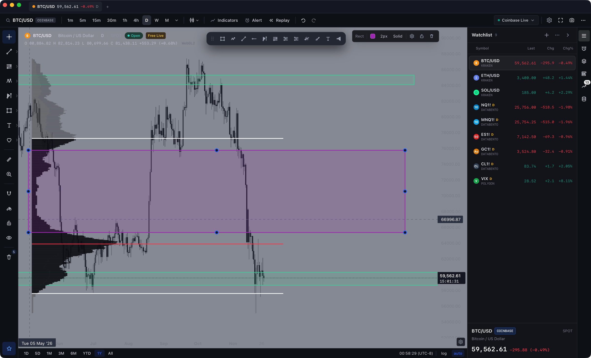
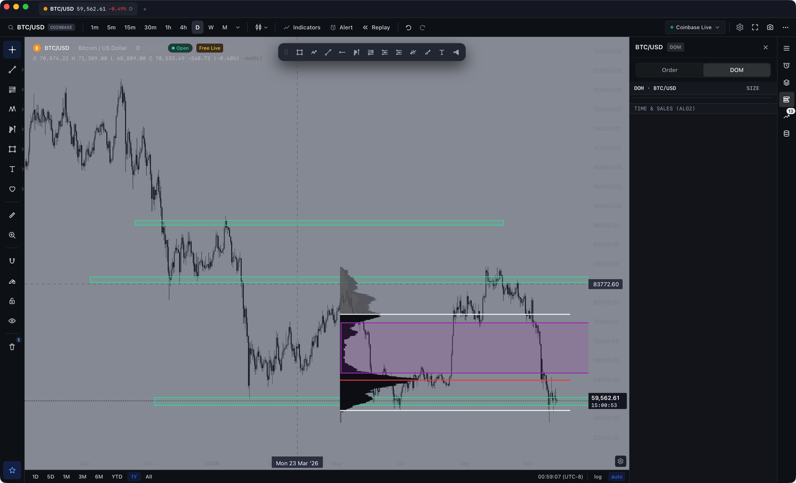
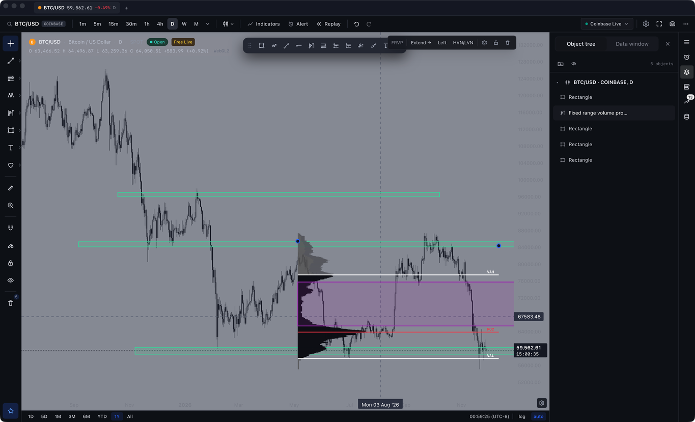

# Allegedly

"Allegedly a trading terminal."

Allegedly is a free, open-source (`Apache-2.0`), local-first desktop trading terminal for macOS (`arm64` and `x86_64`) and Windows 10/11 (`x86_64`). The roadmap defers Linux support until after `v1.0`. The terminal pairs uncluttered charting tools with fixed-point order-flow profiles, a Canvas2D DOM ladder, deterministic replay, and a sandboxed paper OMS.

## Screenshots

### Main chart terminal, drawing tools, and watchlist



### Order Book (Canvas2D DOM Ladder and Time and Sales)



### Object Tree and Data Window



## Current progress

Allegedly finished `Phases 0-5` and passed the Apple M2 Stage D `v0.1` Red-Team audit at commit `3dda8d6`. Active work on `main` extends the desktop shell, charting UI, and live public market-data adapters. The `v0.1.0` Alpha tag and Windows runtime certification remain open.

### Completed baseline (`Phases 0-5` and Stage D M2 at `3dda8d6`)

- **Phases 0-5:** Charter, 10 research tracks (`R01`-`R10`), 8 verified spikes (`S01`-`S08`), and 9 architecture specs are complete. The 10 ADRs (`0001`-`0010`), roadmap, and [`Plan-of-Record.md`](./Plan-of-Record.md) passed Red-Team review (`36/36` findings closed).
- **Rust core and storage:** Nine production crates (`core`, `ipc`, `ingest`, `storage`, `orderflow`, `replay`, `studies`, `oms`, `app`) and `docgen` form the workspace. They implement `i64`/`i128` fixed-point math, `ALG2` binary IPC, `.atvault` Zstd-3 archives, Parquet compaction, and 16-ary Dyadic VRVP. They also implement `u128` TPO, the Luau Study runtime (`<= 64 MiB` global pool), and SQLite WAL Paper OMS (`paper_oms.sqlite`).
- **Stage D Apple M2 verification (`3dda8d6`):** All `18/18` Red-Team findings closed, and CI run `45671009080` passed `6/6` jobs on `macos-latest` and `windows-latest`. Measured Apple M2 bundle metrics met `v0.1` budgets. The `.app` bundle measures `15.07 MB` (`5.26 MB` `.dmg`), UI paint-ready p95 is `969 ms`, and max idle OS RAM is `278.09 MB`. Booting offline under `sandbox-exec` opens `0` outbound sockets.

### Added on `main` after `3dda8d6`

- **Live public feeds and history backfill:** Added Kraken Spot WS v2 (`trade`, `book` with CRC32 checks, `ohlc`) and Coinbase Advanced Trade WS (`market_trades`, `heartbeats`, sequence checks, taker inversion). Added `1,500+` candle backfill with scroll-back loading. The app still boots offline in `Paper / Sim` mode with zero outbound sockets until you pick a live feed.
- **Desktop shell and boot flow:** Added the Cursor/Linear dark shell restyle ([`docs/UI-SYSTEM.md`](./docs/UI-SYSTEM.md)), `@ui-sdk/react` primitives, and persistent window geometry across restarts. Added a Flipdot boot intro without gray or chart flash, macOS traffic-light reveal after the intro, and the rounded Allegedly `A` app icon.
- **Charting, indicators, and drawings:** Added `21` chart bar types, multi-pane oscillators, VWAP Key Levels, Trading Sessions, and a centered Indicators dialog. Added custom timeframe favorites, type-to-search symbol lookup, and candle wick/body-zone magnet snapping. Added interactive drawing selection/drag with Undo/Redo, a color picker with recent colors, Object Tree, Alerts, DOM Ladder, and Paper OMS drawers.

### Remaining open items

- **Post-`3dda8d6` re-audit and bundle check:** Commits after `3dda8d6` pass local Rust, TypeScript, Vitest (`51/51`), and static policy checks. They have not re-run the full Stage D Red-Team audit or a fresh `.dmg` measurement.
- **Open `v0.1` verification gates ([`08-Dashboards/Unverified-Claims.md`](./08-Dashboards/Unverified-Claims.md)):** Windows 10/11 `WebView2` runtime frame timing and `.msi` packaging (`UV-03`) and Intel macOS `fullfsync` CI (`UV-02`) remain open. Ten-chart mounted UI RSS profiling (`UV-04`), 30-minute soak plus `.dbn.zst` fixture (`UV-06`), and `TA-Lib` parity (`UV-07`) remain open.
- **Engine gap items ([`02-Research/OpenMarket-Gap-Analysis.md`](./02-Research/OpenMarket-Gap-Analysis.md)):** Typed multi-series indicator outputs in dedicated lower panes and live tick recomputation remain open. Expanded Luau `ta.*` and `strategy.*` APIs, live trade routing into `FootprintSlabArena` and `DyadicVrvpTree`, and Rust alerts remain open.
- **Later milestones ([`05-Roadmap/Milestones.md`](./05-Roadmap/Milestones.md)):** `v0.2` adds Wasmtime Studies, native pop-out windows, `.dbn.zst`/`.bi5` importers, Alpaca/tastytrade paper adapters, and signed releases. `v0.5` adds live retail brokers, multi-day `CompositeTpoRow`, and 24h `.atdepth` heatmaps. `v1.0` completes GA and trademark clearance (`RK-04`), and Linux ships after `v1.0`.

## Quick start for local development

Set `CARGO_TARGET_DIR` outside the repository folder so Rust build files stay out of the Obsidian vault index.

```bash
export CARGO_TARGET_DIR="$HOME/.cache/allegedly-target"

# 1. Run static CI safety guards
bash scripts/ci/check-no-floats.sh
bash scripts/ci/check-no-legacy-prefix.sh
node scripts/ci/check-npm-policy.mjs

# 2. Verify Rust workspace and Tauri shell
cargo fmt --all -- --check
cargo clippy --workspace --all-targets -- -D warnings
cargo test --workspace --release
cargo clippy --manifest-path apps/desktop/src-tauri/Cargo.toml -- -D warnings

# 3. Verify frontend packages
pnpm install
pnpm typecheck
pnpm test
pnpm test:a11y
pnpm build

# 4. Build and measure macOS bundle
cargo build --release --manifest-path apps/desktop/src-tauri/Cargo.toml
node scripts/ci/measure-macos-bundle.mjs
```

Run the optional read-only public market-data soak (zero credentials, zero trading) with this command:

```bash
cargo run --release -p allegedly-ingest --bin live_soak -- --duration-secs 45
```

## Repository structure

| Path | Contents | Status |
|---|---|---|
| `crates/allegedly-*` | 9 production Rust crates and dev-only `allegedly-docgen` | Built and tested |
| `packages/ipc-client` | Aligned `ALG2` `v1` binary decoders and historical OHLC loaders | Built and tested |
| `packages/ui-chrome` | `@ui-sdk/react` primitives, MIT `dockview` shell, settings, color picker | Built and tested |
| `apps/desktop` | React 19, LWC v5.3, WebGL2 overlay, Drawing Engine, Tauri v2 desktop host | Active UI development |
| `schemas/ipc-v1/ipc-contract.json` | Generated Rust-to-TypeScript wire schema and golden fixture bytes | Verified (`0` mismatches) |
| [`Plan-of-Record.md`](./Plan-of-Record.md) | Consolidated executive Plan of Record and Stage D kickoff guide | Complete (`Phase 5`) |
| [`00-Start-Here.md`](./00-Start-Here.md) | Obsidian vault entry page and phase index | Active |
| [`docs/UI-SYSTEM.md`](./docs/UI-SYSTEM.md) | UI tokens, `@ui-sdk/react` reset rules, and visual QA checklist | Active |
| `01-Charter/` to `06-Risk/` | Charter, Research `R01`-`R10`, Spikes `S01`-`S08`, ADRs `0001`-`0010`, Roadmap | Complete (`Phases 0-5`) |
| `07-Reviews/` and `08-Dashboards/` | Red-Team audit reports and `Unverified-Claims` tracking register | Active |
| `99-Meta/` | Agent roster, handoffs, prompt log, and worklog | Active |

## Architecture summary

- **Desktop shell and UI:** Tauri v2 (`custom-protocol`), React 19, TypeScript, Tailwind CSS v4, `@ui-sdk/react` (`0.1.0-beta.17`), and MIT `dockview` (`8.9.1`).
- **Charting and order flow:** TradingView `lightweight-charts` (`v5.3.0`) with a synchronous WebGL2 `ISeriesPrimitive` overlay, clean-room Drawing Engine (`.atanalysis.toml`), and Canvas2D `60 Hz` DOM Ladder and Time and Sales.
- **Rust engine:** Zero-float fixed-point types (`PriceE9`, `QtyE9`, `MoneyMicros`, `TimestampNs`), per-provider `rtrb` SPSC queues, single-threaded Dispatcher, `FootprintSlabArena`, 16-ary Dyadic VRVP, and 5-tier `ProvenanceTier`.
- **Storage and replay:** SQLite WAL (`PRAGMA fullfsync = ON` batched commit measured at `3.961 ms` on Apple M2 APFS), `.atvault` Zstd-3 + `CRC32` archives, and Apache Parquet / Arrow compaction with cross-speed `SHA-256` replay parity.
- **Studies and execution safety:** Native Rust built-ins plus sandboxed Luau (`mlua`, `<= 64 MiB` global pool) and Paper/Sim OMS only in `v0.1` (`live_armed = false`, `updates.checkOnStartup = false`, `0` outbound sockets on boot, `9/9` forbidden prop/gateway checks enforced).

## Further reading

- Open Obsidian at [`00-Start-Here.md`](./00-Start-Here.md).
- Read [`AGENTS.md`](./AGENTS.md) for UI kit policy (`@ui-sdk/react` and `@ui-sdk/core` `"0.1.0-beta.17"`, `Apache-2.0`) and safety rails.
